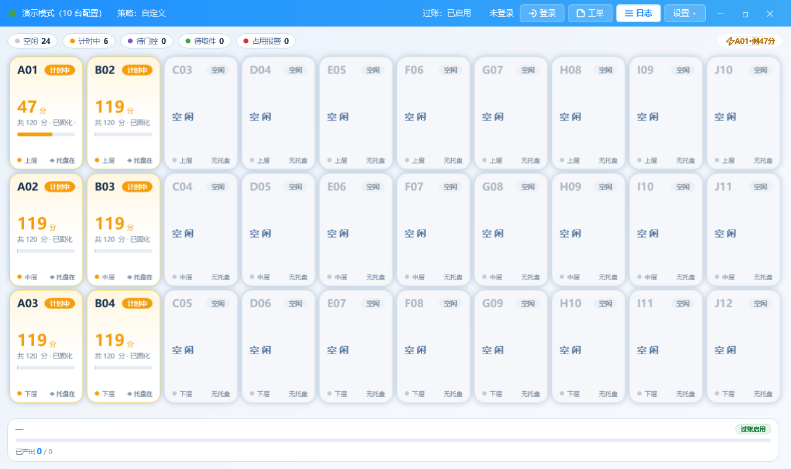
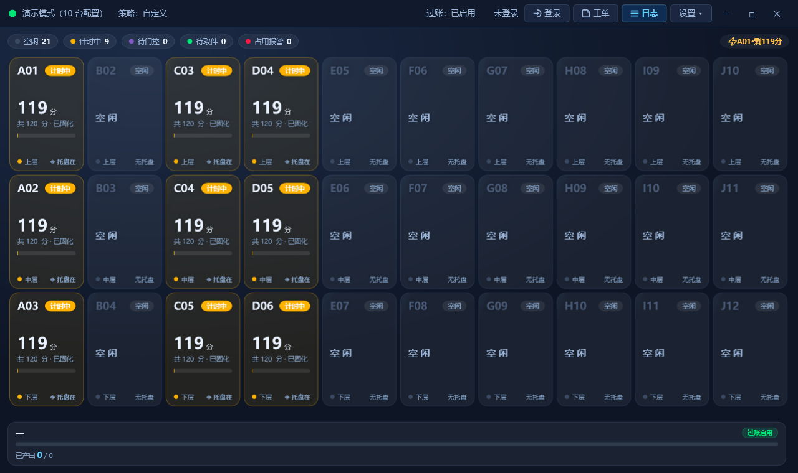
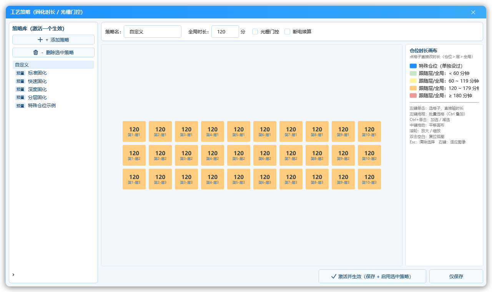
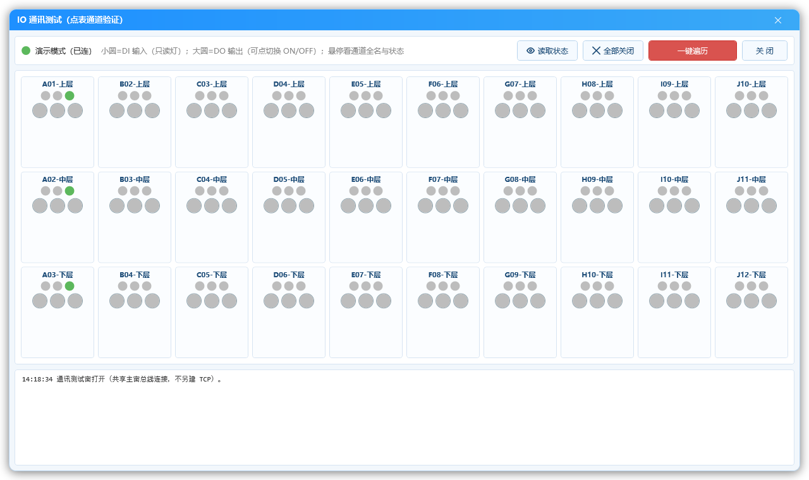
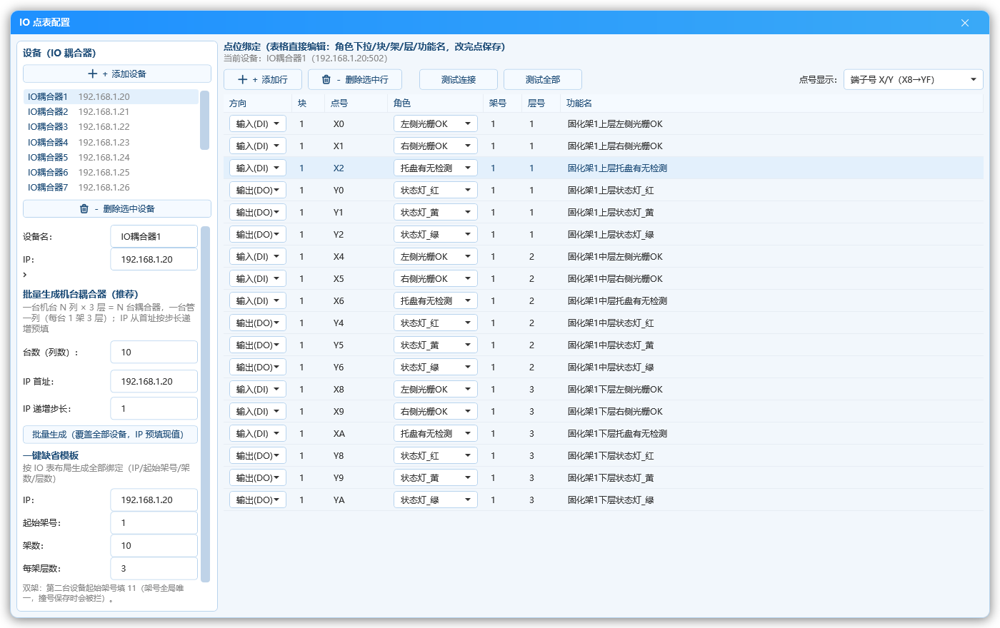
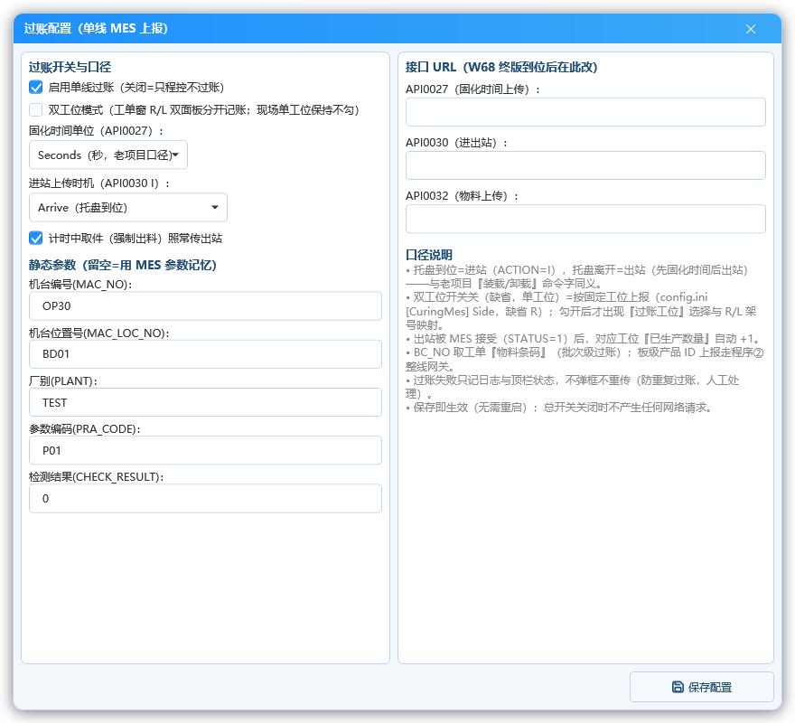
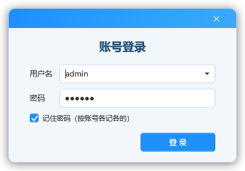
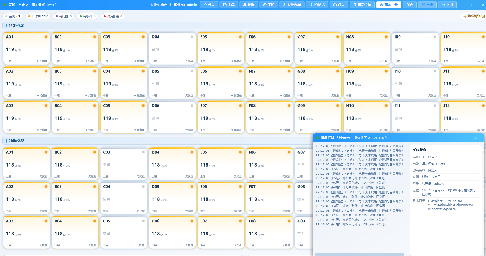
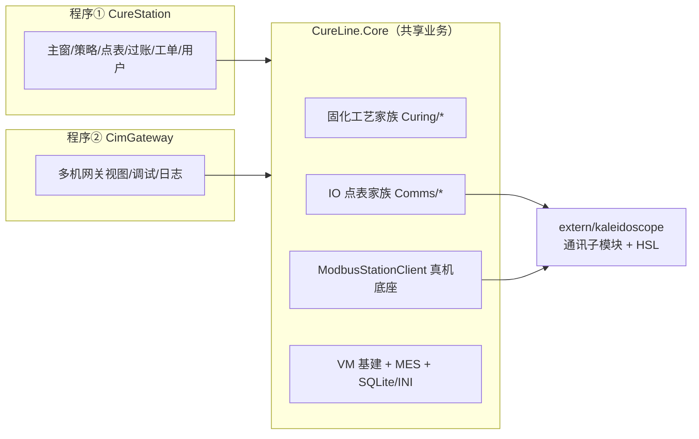

<div align="center">

# CureLine

**固化车间程控 + CIM 整线过账 · .NET 8 WPF 上位机双程序**


从 VB 老项目（`PLC_ReadData` 单机固化收料 + `PLC_ReadDataA` 八机通用网关）
融合重构的 .NET 8 解决方案，含两个可独立部署的 WPF 程序、共享一个业务内核。

</div>

---

## 界面速览

| 浅色主题（缺省） | 深色主题 |
| --- | --- |
|  |  |

| 工艺策略画布 | IO 通讯测试 |
| --- | --- |
|  |  |

| IO 点表配置 | 单线过账 |
| --- | --- |
|  |  |

| 登录（三级权限） | 日志悬浮窗 |
| --- | --- |
|  |  |

---

## 两个程序

### 程序① CureStation —— 固化程控

IO 耦合器（Modbus TCP）**30 仓位**程控（双架 60）：

- **主窗仓位网格**：一台架三排（上中下三层）× 一排 10 站，卡片主标题即客户
  库位编码（A01~J12）；状态胶囊（空闲/计时中/待门控/待取件/占用报警）+
  分钟倒计 + 进度条；默认最大化、随窗口拉伸，底部工单卡联动。
- **仓位状态机**：托盘到位 →（门控开则等光栅让空）→ 黄灯计时 → 到点绿灯
  放行 → 托盘离开灭灯回空闲；断电续算可配置，断连恢复自动对齐重计。
- **工艺策略窗**：时长三级覆盖（仓位 > 层 > 全局）+ 光栅门控 + 预置策略库；
  画布点格子直接改每仓位时长（框选批量、六态色阶、滚轮缩放）。
- **IO 点表配置窗**：现场"点点鼠标"不改代码——设备增删 / 批量生成耦合器 /
  绑定表行内直编（中文语义）/ 测试连接 / 保存前两道校验（物理点+语义查重）。
- **单线过账**：托盘到位=进站、离开=固化时间+出站（API0030 / API0027），
  出站被接受 → 已生产 +1；全参数界面可配，保存即热生效。
- **IO 通讯测试窗**：按点表铺仓位卡网格，DI 只读灯 + DO 点击切换 +
  一键遍历跑马灯，现场接线快速验证。

### 程序② CimGateway —— CIM 整线过账

MES 多机网关（八机 Modbus TCP 统一底座）：触发 → JSON → POST → 回写，
调试窗可直接预览/模拟报文，日志按机台过滤；配置窗两页（机台连接/接口
地址），保存即自动重连，全程无需重启。


---

## 快速开始

```powershell
# 1. 拉代码（含子模块）
git clone https://github.com/lq700212/CureLine.git
cd CureLine
git submodule update --init

# 2. 编译子模块（net472，需 VS MSBuild）
& "D:\Program Files\Microsoft Visual Studio\18\Enterprise\MSBuild\Current\Bin\MSBuild.exe" `
  "extern/kaleidoscope/Kaleidoscope/Kaleidoscope.csproj" `
  /p:Configuration=Debug /p:Platform=AnyCPU /t:Build /nologo /v:m

# 3. 全量构建 + 测试
dotnet build CureLine.slnx --nologo
dotnet test tests/CureLine.Tests/CureLine.Tests.csproj --nologo

# 4. 模拟联调（无真机）：把 exe 同目录 config/config.ini 里 [setting] Simulate=1
#    - CimGateway 直起即模拟 8 机台跑全流程
#    - CureStation 直起即 Mock 总线按仓位流转演示（主窗设置下拉可即时切换）
```

---

## 账号与权限（三级角色）

| 账号 | 角色 | 权限 |
| --- | --- | --- |
| `operator` | 操作员 | 工单基础字段/数量/清零、日志；**无设置入口**（整钮禁用） |
| `admin` | 管理员 | 工艺策略 / IO 测试 / 过账配置 / 用户管理 / 演示开关（**无点表项**） |
| `dev` | 开发者 | 全部功能（含点表配置）；账号**永不可删**（防锁死红线）；可重置所有人密码 |

- 预置初始密码见首次登录提示，**上线必改**；
- 操作员无改密权，改密一律由 admin/dev 在用户管理窗重置（免验原密码，≥6 位）；
- 密码存 SQLite（PBKDF2 哈希，无明文）；"记住密码"按账号各记各的（DPAPI 密文）。

---

## 架构（MVVM）



- **View**（XAML 纯绑定）← **ViewModel**（状态+命令，`ViewModelBase` 管通知与
  跨线程封送）→ **Model/Core**（业务，可测）；开窗/提示唯一出口 `IDialogService`。
- xaml.cs 只做三件事：设 DataContext、转交 PasswordBox 密码、转发关窗；
  VM 禁止碰 Window/MessageBox/Dispatcher。

---

## 目录

```text
CureLine/
├── src/
│   ├── CureLine.Core/    共享业务：IO 点表 / 固化工艺 / 过账 / 通讯底座 / VM 基建
│   ├── CureStation/      程序①固化程控（30 仓位主窗 + 6 功能窗 + 双主题）
│   └── CimGateway/       程序②CIM 整线过账（网关视图 + 配置/调试/日志窗）
├── tests/CureLine.Tests/ 395 例 xUnit（本地桩 MES / 状态机桩 / Fake 对话框）
├── extern/kaleidoscope/  通讯子模块（独立仓库；Modbus/HslCommunication）
├── docs/                 拆分设计 + 培训手册（md/pdf）+ 配图 docs/images/
├── tools/DocShot/        文档截图 harness
└── config.sample.ini     现场配置样例（含逐键注释）
```

---

## 文档导航

| 手册 | 程序① 固化程控 | 程序② 整线网关 |
| --- | --- | --- |
| 操作员 | [固化程控_操作员手册](docs/固化程控_操作员手册.md) | [整线网关_操作员手册](docs/整线网关_操作员手册.md) |
| 客户技术工艺 | [固化程控_客户技术工艺手册](docs/固化程序_客户技术工艺手册.md) | [整线网关_客户技术工艺手册](docs/整线网关_客户技术工艺手册.md) |
| 内部 | [固化程控_内部手册](docs/固化程序_内部手册.md) | [整线网关_内部手册](docs/整线网关_内部手册.md) |

- [两程序拆分设计](docs/重构设计_20261028.md) —— 架构边界与 Phase 路线
- [AGENTS.md](AGENTS.md) —— 维护规范（开工必读）｜[CHANGELOG.md](CHANGELOG.md) —— 版本日志
- PDF 版在 `docs/pdf/`

---

## 配置自愈

`config/` 目录的 JSON/INI 缺失或损坏都会自动按缺省模板重建（点表 / 工艺
策略 / 工单数据库），开箱即用；所有配置键见 [`config.sample.ini`](config.sample.ini)
逐键注释。两程序连接参数、Web 接口地址、扫描周期全部支持界面修改并
**保存即热生效**，无需重启。
