<div align="center">

# CureLine

**固化车间程控 + CIM 整线过账 · .NET 8 WPF 上位机双程序**


一套 .NET 8 解决方案：两个可独立部署的 WPF 上位机程序（固化程控 + CIM 整线过账），共享一个业务内核。

</div>

---

## 两个程序

### 程序① CureStation —— 固化程控

IO 耦合器（Modbus TCP）**30 仓位**程控（双架 60）：

| 浅色主题（缺省） | 深色主题 |
| --- | --- |
| 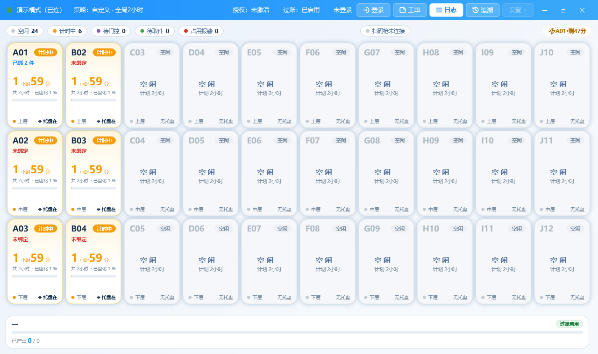 | 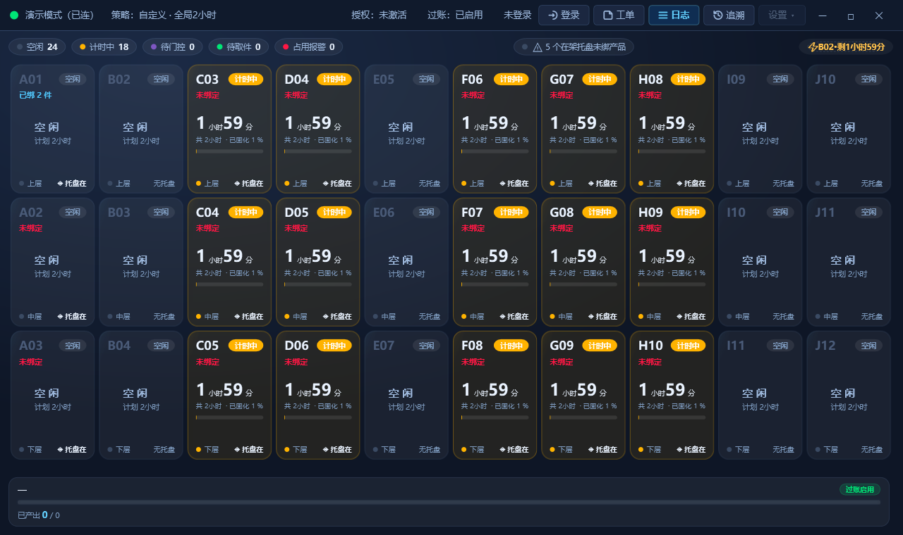 |

- **主窗仓位网格**：卡片即客户库位编码（A01~J12）+ 状态胶囊 + 倒计/进度条；
  扫码绑定显示"已绑 N 件"，未绑定红字提示（不拦截流程）。
- **仓位状态机**：托盘到位 →（光栅门控）→ 黄灯计时 → 绿灯放行 → 离架回空闲；
  断电续算可配、断连自动对齐。
- **光栅四项随策略**：门控 / 信号类型（缺省常闭）/ 报警总开关 / 报警解除
  （缺省人工复位）——计时中被挡红灯报警 + 蜂鸣，人工确认才解除；
  上料未确认期间静默不误报。
- **工艺策略窗**：时长三级覆盖（仓位 > 层 > 全局），画布点格子直接改、
  框选批量应用；时/分单位切换全界面联动。
- **机台总监塔灯**：红 = 报警（+蜂鸣长鸣）/ 绿 = 运转中 / 黄 = 待料，
  全机聚合自动写灯。

- **扫码上料三段式**：扫库位码开始 → 逐个扫产品码 → 再扫一次同库位码结束；
  一库位可放多产品，绑定落盘重启不丢。放回件三道闸防呆（禁放回原库位 /
  禁在制库位加新产品 / 禁混装），放回时弹窗问固化时长口径；扫码枪 TCP /
  串口双接入（TCP 现役），配置窗保存即热重建连接。
- **单线过账**：托盘到位 = 进站、离开 = 固化时间 + 出站，出站被接受自动
  累加"已生产"；全参数界面可配、保存即热生效。
- **IO 点表配置窗**：设备增删 / 批量生成 / 绑定表行内直编（中文语义），
  保存前物理点 + 语义双校验；IO 通讯测试窗一键遍历验接线。
- **固化追溯报表**：库位 ↔ 产品 SN 全程留痕（绑定 / 计时 / 离架 / 结束原因），
  格子面板筛库位（与主窗排布一致）+ 分页 + 导出 CSV。

| 工艺策略画布 | IO 点表配置 |
| --- | --- |
| 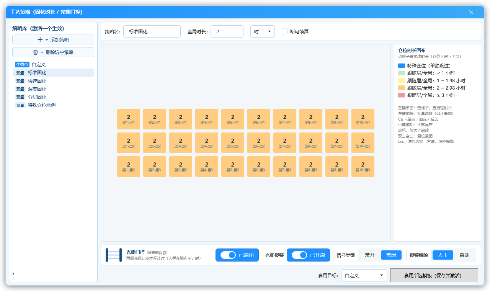 | 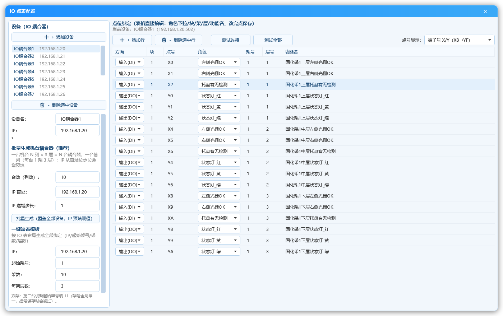 |

| IO 通讯测试 | 单线过账配置 |
| --- | --- |
| 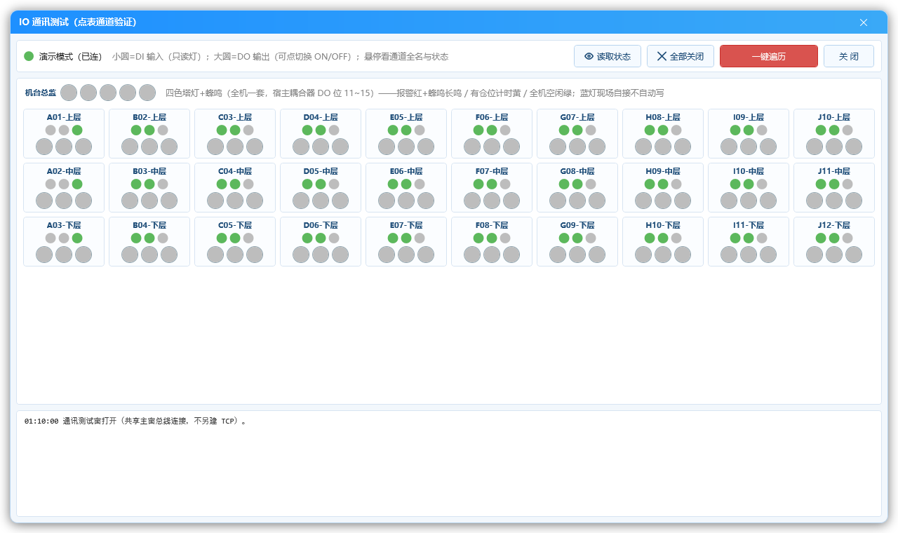 | 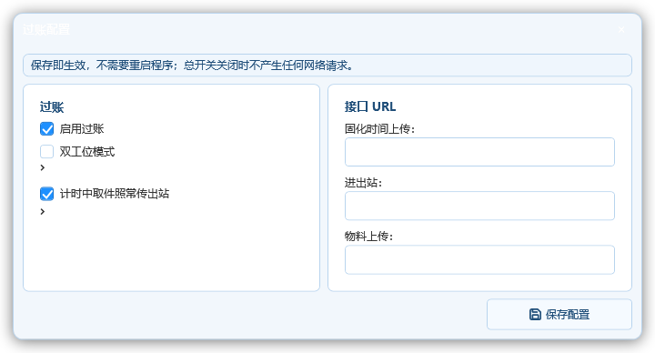 |

| 扫码枪配置 | 固化追溯报表 |
| --- | --- |
| 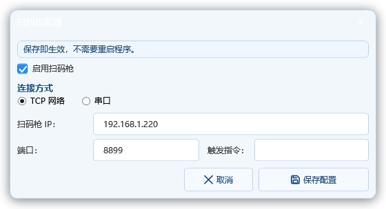 | 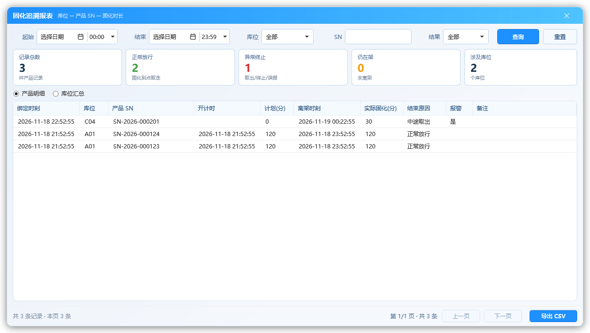 |

| 工单信息（管理员视角） | 用户管理 |
| --- | --- |
| 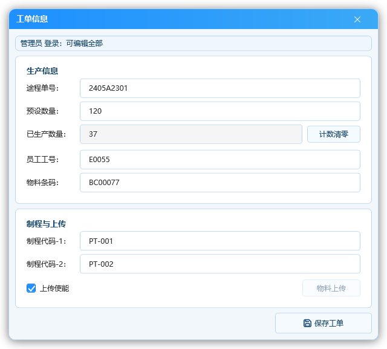 | 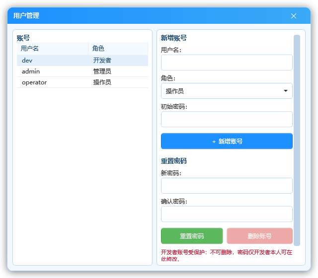 |

| 登录（三级权限） | 日志悬浮窗 |
| --- | --- |
| 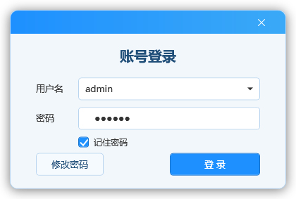 | 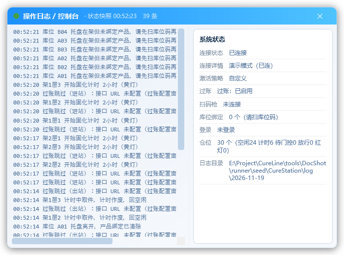 |

### 程序② CimGateway —— CIM 整线过账

MES 多机网关（8 机台 Modbus TCP 统一底座）：**触发 → JSON → POST → 回写**。

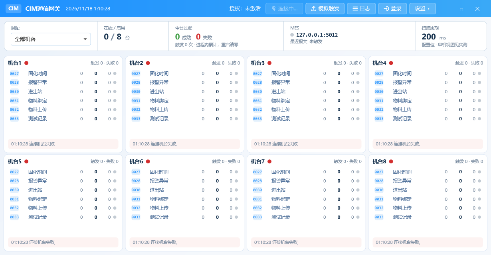

- **整线汇总条 + 8 机台过账卡片**：在线/启用、今日过账成败、MES 端点最近
  报文状态；卡片含 6 接口状态微表（触发/成功/失败/结果点），可切单台看接口明细。
- **模拟演示（`Simulate=1`）**：8 模拟机台自动连接、定时 + 手动触发，内置
  模拟 MES 桩自动应答——无任何外部依赖即可全链路演示。
- **配置 / 调试 / 日志三窗**：机台连接与接口地址两页保存即重连（无需重启）；
  5 接口表单手工调试；日志窗按机台分页。

| 网关配置 | MES 调试窗 |
| --- | --- |
| 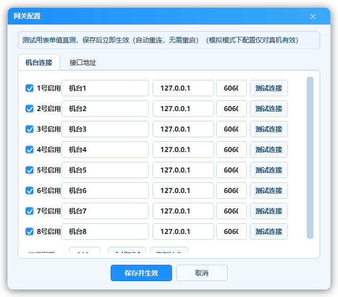 | 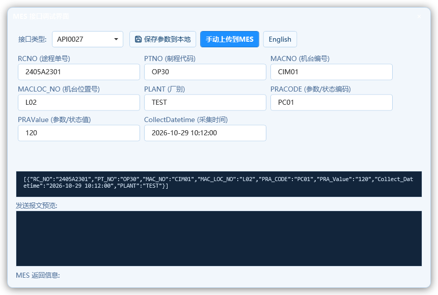 |

| 日志窗 | 登录窗 |
| --- | --- |
| 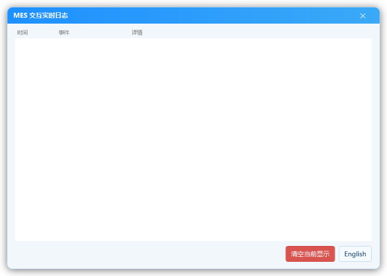 | 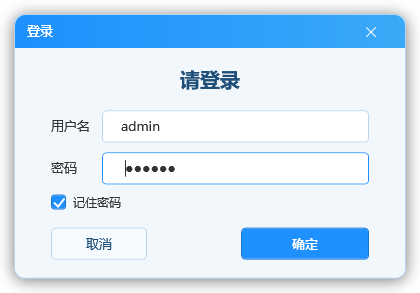 |

---

## 快速开始

```powershell
# 1. 拉代码（含子模块）
git clone https://github.com/lq700212/CureLine.git
cd CureLine
git submodule update --init

# 2. 编译子模块（net472，需 VS MSBuild）
& "D:\Program Files\Microsoft Visual Studio\18\Enterprise\MSBuild\Current\Bin\MSBuild.exe" `
  "extern/kaleidoscope/Kaleidoscope/Kaleidoscope.csproj" `
  /p:Configuration=Debug /p:Platform=AnyCPU /t:Build /nologo /v:m

# 3. 全量构建 + 测试
dotnet build CureLine.slnx --nologo
dotnet test tests/CureLine.Tests/CureLine.Tests.csproj --nologo

# 4. 模拟联调（无真机）：把 exe 同目录 config/config.ini 里 [setting] Simulate=1
#    - CimGateway 直起即模拟 8 机台自动连接，每 7s 自动触发 + 顶栏「模拟触发」
#      按钮手动注入；MES URL 未配置时内置模拟桩自动应答（全链路自洽演示）
#    - CureStation 直起即 Mock 总线按仓位流转演示（主窗设置下拉可即时切换）
```

---

## 账号与权限（三级角色）

| 账号 | 角色 | 权限 |
| --- | --- | --- |
| `operator` | 操作员 | 工单基础字段/数量/清零、日志；**无设置入口**（整钮禁用） |
| （未登录） | — | 顶栏只能登录；设置下拉同样整钮禁用，悬停提示"请先登录"（V0.0.95） |
| `admin` | 管理员 | 工艺策略 / IO 测试 / 过账配置 / 用户管理 / 演示开关（**无点表项**） |
| `dev` | 开发者 | 全部功能（含点表配置）；账号**永不可删**（防锁死红线）；可重置所有人密码 |

- 预置初始密码见首次登录提示，**上线必改**；
- 改密两通道：登录窗"修改密码"改**自己**的密码（验旧密码，≥6 位）；admin/dev
  在用户管理窗**重置他人**密码（免验原密码，立即生效）；
- 密码存 SQLite（PBKDF2 哈希，无明文）；"记住密码"按账号各记各的（DPAPI 密文）；
- **空闲自动退出**（config.ini `[setting] AutoLogoutMinutes`，缺省 15 分钟，0=不启用）：
  登录后连续无键鼠操作（弹窗内操作也算活动）达到上限自动退回未登录态——静默
  不弹框，日志一行 + 顶栏回"未登录"；改后重启生效。

---

## 软件授权（kaleidoscope Kaleidoscope.Security，ECDsa 激活码）

- **真源收口（V0.0.62）**：授权真源在 kaleidoscope 子模块 `Kaleidoscope.Security`
  （`LicenseGate` 门禁 + `LicenseCodec` 编解码 + 指纹采集），与 HJVision 用
  同一套下沉代码；宿主侧只有一层薄接线 `src/CureLine.Core/Security/
  LicenseHost.cs`——注入产品 ID/注册表根/演示桥/SQLite 水位桥四覆盖点 +
  顶栏文案 + 状态边沿事件，业务层只调 `LicenseHost`。子模块升级（修 bug/
  换指纹口径）两产品同步受益，宿主零改动或只改覆盖点。
- **方案**：ECDsa P-256 非对称签名，私钥只在厂商签发工具，程序内置公钥
  验签——反编译只能拿到公钥，无法离线伪造激活码。
- **设备码**：`CURE-<指纹8HEX>-<挑战8HEX>-<校验4HEX>`；指纹=本机四因子
  （MachineGuid + 主板/磁盘/CPU）SHA256 前 4 字节；挑战值=**era 口径**——
  按"指纹 + 30 天档号"确定性派生（SHA256 前 4 字节），**档内恒定**：
  30 天内重开激活窗/激活后换码（限期↔永久切换）免重签；跨入新档设备码
  自动刷新（旧码作废，重新抄设备码送签即可）。
- **两产品隔离**：与 HJVision 共用同一把密钥对，靠激活码 payload 产品 ID
  区分（CureLine=`0x434C` / HJVision=`0xFFFF`）——HJVision 的激活码不能
  激活 CureLine，反之亦然；设备码前缀 `CURE`（HJVision 保持历史 `HUAJI`）。
- **试用 / 永久**：厂商按设备码签发，试用 1~255 天（从签发日起算）或永久；
  授权记录存 exe 同目录 `MainSetting\LicenseState.ini`（kaleidoscope 缺省
  自管，激活窗自动维护，现场不要手工编辑），每次启动对记录原文重新验签。
- **防回拨**：时间水位三存储取最大——状态文件 `WaterMark` 键 +
  `HKCU\Software\CureLine\License`（CureLine 专属注册表根，与子模块缺省
  HuaJiVision 根共机不踩值）+ SQLite `app_meta` 键 `LicenseWaterMark`
  （宿主 `SqliteHelper` 桥回同一物理位置），并与构建日期、exe 文件时间
  取大做下限，容差 1 小时；试用机改系统时间绕不过期判定。
- **门禁**：两程序启动即校验（`App.OnStartup` 先 `LicenseHost.Setup` 再
  `Refresh`），未授权弹激活窗，关闭仍未授权则退出；运行期每小时巡检；
  主窗顶栏常显授权状态（永久/试用剩 N 天/未激活/已过期/指纹不符/演示），
  设置下拉「软件激活」可随时打开激活窗；主窗 VM 订阅 `LicenseHost.
  StateChanged` 边沿即时刷新顶栏并记一行操作日志。
- **换码切换（热更）**：已激活状态下再输一枚合法新激活码即可切换授权类型
  （限期↔永久双向）——把激活窗当前显示的设备码发厂商签新码，粘贴后落盘
  覆盖旧记录、立即生效，顶栏状态随状态变更事件即时刷新，无需重启；era
  档内免重签，跨档旧码被拦"设备码已刷新"（防重放语义，属正常防线）。
- **演示模式**：`[setting] Simulate=1` 免激活放行（宿主演示桥接
  `LicenseBridges.IsMockLicensedProvider`，配置窗热改后下一拍 Refresh 即
  生效；仅联调演示，不得用于生产）。
- **开发自动授权（仅 Debug 构建）**：Debug 编译的程序在真实状态不可用时
  自动注入 90 天内存态试用授权（不落盘、不污染水位三存储），开发机验证
  功能免输激活码；该段逻辑由 `#if DEBUG` 编译——**Release 客户版二进制里
  不存在**，发布必须 Release 编译，Debug exe 不外发。手测真实激活/换码/
  过期流程时设环境变量 `KX_DEV_LICENSE=off`（0/false 同义）关闭注入。
- **签发工具**：`tools/LicenseIssuer`（厂商内部，不随客户版分发；编解码
  同引 kaleidoscope `Kaleidoscope.dll` 真源，支持 `--generate`/`--issue
  设备码 P|T 天数` 命令行签发）。私钥 `LicenseSignKey.dat` 已加入
  `.gitignore`——丢失=已发激活码全部作废，外泄=可伪造任意激活码，禁止
  入库/外发。

---

## 架构（MVVM）

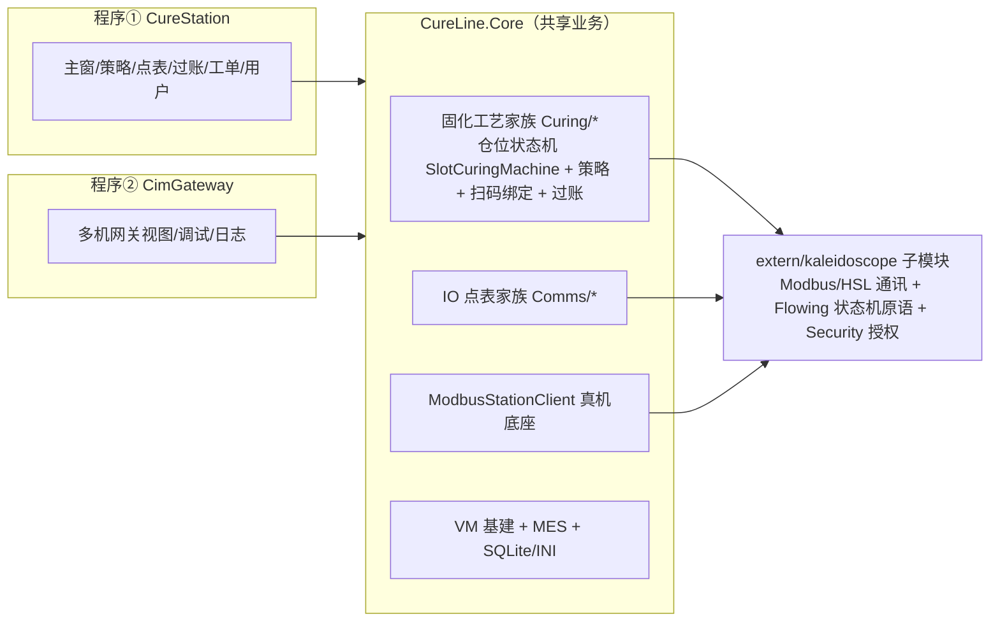

- **仓位状态机**（`Curing/SlotCuringMachine`）：托盘到位 →（光栅门控）→ 黄灯
  计时 → 绿灯放行 → 离架回空闲，含断电续算、断连对齐、光栅报警/复位；
  **政策源 / 灯写账本等供给侧原语收口 kaleidoscope 子模块
  `Kaleidoscope.Flowing`**（V0.0.106 起换库，新信号源一律继承库基类）。
- **View**（XAML 纯绑定）← **ViewModel**（状态+命令，`ViewModelBase` 管通知与
  跨线程封送）→ **Model/Core**（业务，可测）；开窗/提示唯一出口 `IDialogService`。
- xaml.cs 只做三件事：设 DataContext、转交 PasswordBox 密码、转发关窗；
  VM 禁止碰 Window/MessageBox/Dispatcher。

---

## 目录

```text
CureLine/
├── src/
│   ├── CureLine.Core/    共享业务：IO 点表 / 固化工艺 / 过账 / 通讯底座 / VM 基建
│   ├── CureStation/      程序①固化程控（30 仓位主窗 + 6 功能窗 + 双主题）
│   └── CimGateway/       程序②CIM 整线过账（网关视图 + 配置/调试/日志窗）
├── tests/CureLine.Tests/ 644 例 xUnit（本地桩 MES / 状态机桩 / Fake 对话框）
├── extern/kaleidoscope/  子模块（独立仓库）：Modbus/HSL 通讯 + Flowing 状态机原语 + Security 授权
├── docs/                 拆分设计 + 培训手册（md/pdf）+ 配图 docs/images/
├── tools/DocShot/        文档截图 harness
├── tools/LicenseIssuer/  软件授权签发工具（厂商内部，私钥不入库）
└── config.sample.ini     现场配置样例（含逐键注释）
```

---

## 文档导航

| 手册 | 程序① 固化程控 | 程序② 整线网关 |
| --- | --- | --- |
| 操作员 | [固化程控_操作员手册](docs/固化程控_操作员手册.md) | [整线网关_操作员手册](docs/整线网关_操作员手册.md) |
| 客户技术工艺 | [固化程控_客户技术工艺手册](docs/固化程控_客户技术工艺手册.md) | [整线网关_客户技术工艺手册](docs/整线网关_客户技术工艺手册.md) |
| 内部 | [固化程控_内部手册](docs/固化程控_内部手册.md) | [整线网关_内部手册](docs/整线网关_内部手册.md) |

- [两程序拆分设计](docs/重构设计_20261028.md) —— 架构边界与 Phase 路线
- [AGENTS.md](AGENTS.md) —— 维护规范（开工必读）｜[CHANGELOG.md](CHANGELOG.md) —— 版本日志
- PDF 版在 `docs/pdf/`

---

## 配置自愈

`config/` 目录的 JSON/INI 缺失或损坏都会自动按缺省模板重建（点表 / 工艺
策略 / 工单数据库），开箱即用；所有配置键见 [`config.sample.ini`](config.sample.ini)
逐键注释。两程序连接参数、Web 接口地址、扫描周期全部支持界面修改并
**保存即热生效**，无需重启。
