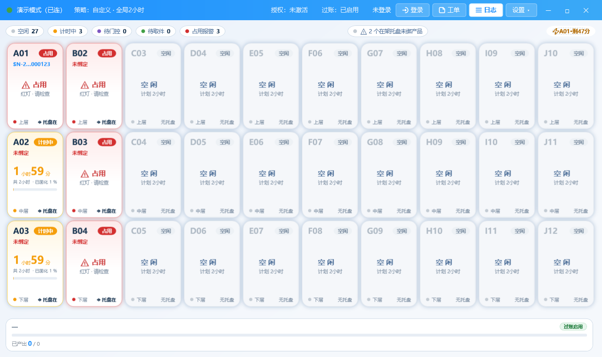
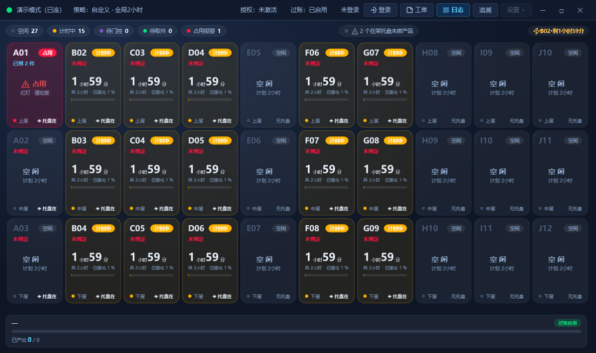
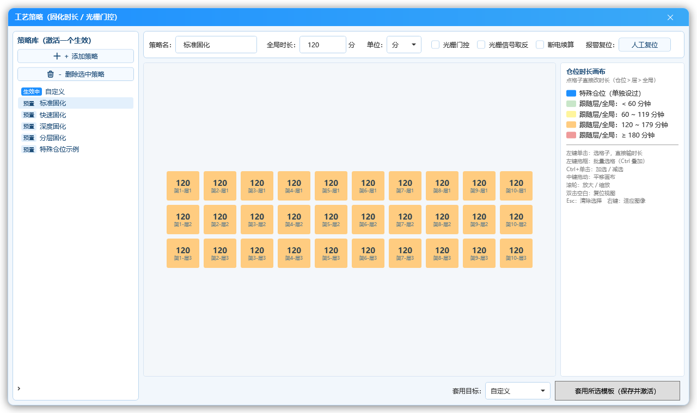
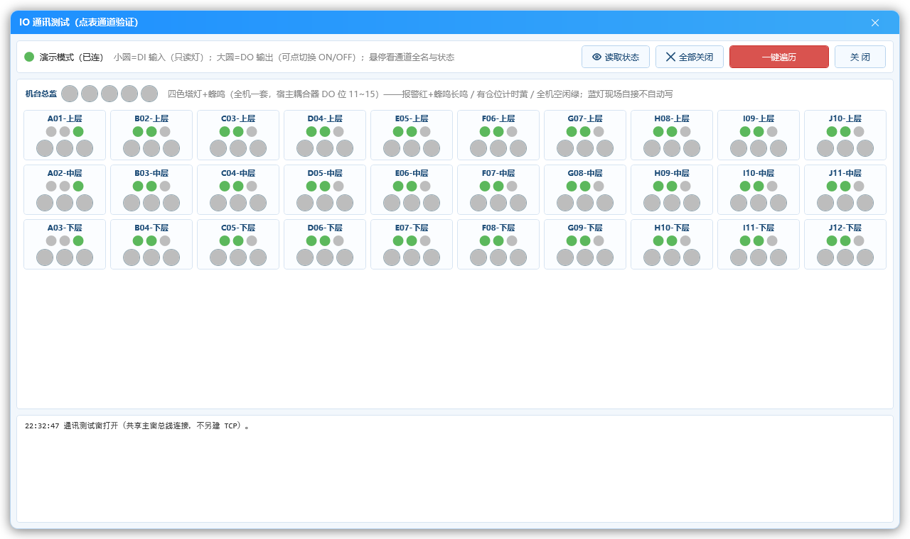
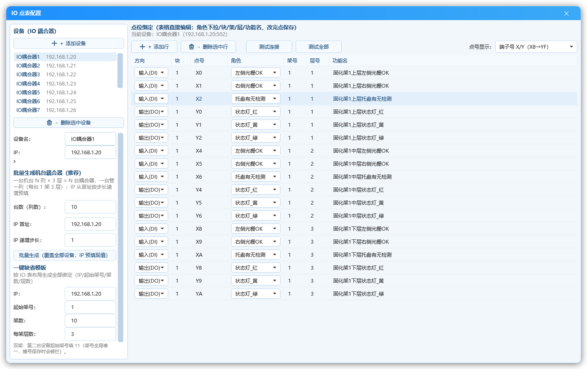
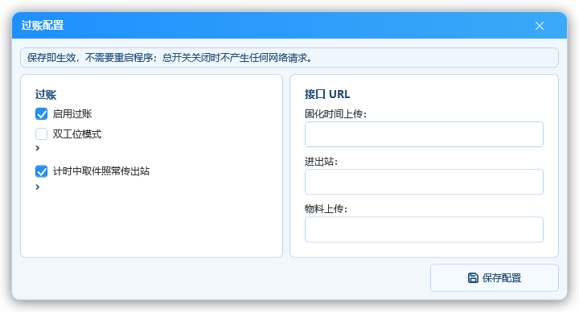
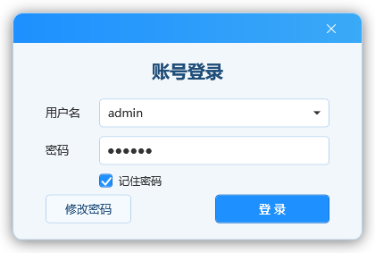
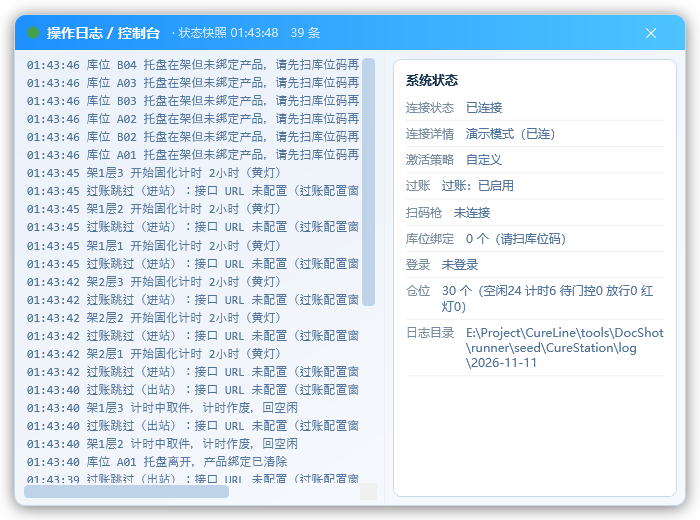
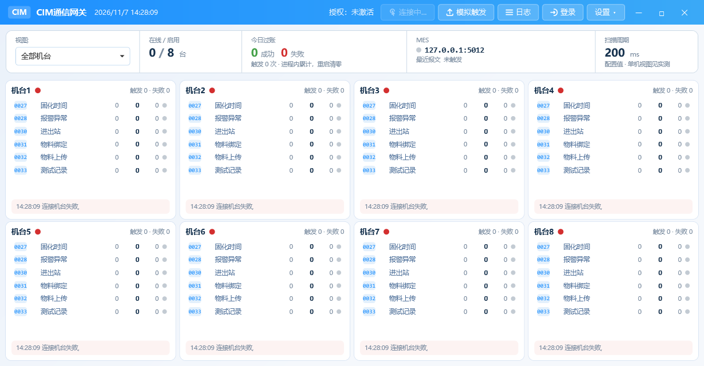
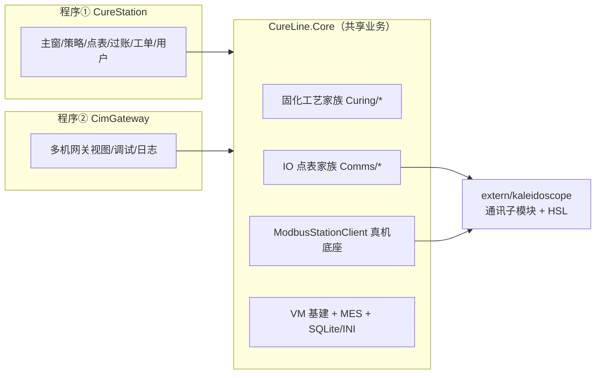

<div align="center">

# CureLine

**固化车间程控 + CIM 整线过账 · .NET 8 WPF 上位机双程序**


一套 .NET 8 解决方案：两个可独立部署的 WPF 上位机程序（固化程控 + CIM 整线过账），共享一个业务内核。

</div>

---

## 界面速览

| 浅色主题（缺省） | 深色主题 |
| --- | --- |
|  |  |

| 工艺策略画布 | IO 通讯测试 |
| --- | --- |
|  |  |

| IO 点表配置 | 单线过账 |
| --- | --- |
|  |  |

| 登录（三级权限） | 日志悬浮窗 |
| --- | --- |
|  |  |

---

## 两个程序

### 程序① CureStation —— 固化程控

IO 耦合器（Modbus TCP）**30 仓位**程控（双架 60）：

- **主窗仓位网格**：一台架三排（上中下三层）× 一排 10 站，卡片主标题即客户
  库位编码（A01~J12）；状态胶囊（空闲/计时中/待门控/待取件/占用报警）+
  分钟倒计 + 进度条；默认最大化、随窗口拉伸，底部工单卡联动。
- **工艺策略窗**：时长三级覆盖（仓位 > 层 > 全局）+ 光栅门控 + 预置策略库
  （「自定义」恒存在；预置模板可套用到自定义或用户自建策略；列表标出"生效中"）；
  画布点格子直接改每仓位时长（框选批量、六态色阶、滚轮缩放）；页面时间单位
  可切 **时 / 分**（编辑区、画布、浮层、图例全部跟换，选择记忆——
  底层计时精度仍为分钟）；单位切换即同步主窗卡片/统计条的时长字面：
  分钟口径显示"47 分"，小时口径按"多少小时多少分"显示（省零段：
  2 小时整"2小时"、不足 1 小时"47分"）；操作日志同步跟随（小时口径
  "开始固化计时 2小时"，分钟口径保持"X 分钟"老字样）。
  **画布下方光栅控制带**（V0.0.74，用户拍板从参数条下移、一处可读可改）：
  左侧光栅标志物（两立柱+光束，门控开=亮、关=暗）+ **光栅门控**开关
  （策略级，随策略保存：开=两侧光栅让空才计时，关=托盘到位即计时）+
  **信号类型**「常开｜常闭」分段按钮（V0.0.72 起为全局现场接线口径，
  `[setting] GrillSignalPolarity`：常开＝遮挡=ON 缺省；现场光栅
  "被挡=OFF、未挡=ON"（常闭安全光栅）选常闭——门控/报警/复位/日志"挡·空"
  整体反相，切换即落盘、下一拍生效）+ **报警解除**「人工｜自动」分段按钮
  （V0.0.69，全局操作规程不随单条策略保存，`[setting] GrillAlarmResetMode`；
  缺省**人工复位**——V0.0.71 用户拍板：现场必须人工确认才解除报警）。
  **保存即热更**：顶栏显示"策略：名 · 全局时长"立见
  新值；空闲卡显示"计划 X"预览（下一拍刷新）；进行中的仓位单向上调
  （只延不缩——防提前放行未固化满的货）。
- **机台总监塔灯+蜂鸣（V0.0.65 起，V0.0.66 全自动接入；V0.0.67 黄绿互换）**：
  全机一套四色塔灯（红/黄/绿/蓝；蓝留现场自接不自动写）+蜂鸣器全机聚合——
  任一仓位光栅报警 → 塔灯红+蜂鸣长鸣；有仓位计时/等门控（在固化任务中）→
  绿常亮（设备运转中）；全机空闲/放行/取完（没有来料在固化）→ 黄常亮（待料）。
  绑定随点表模板（图纸口径：第 2 台耦合器 DO 位 11~15，单台模板/批量生成
  自动带塔灯）；旧版升级点表自动补塔灯（打开程序即用，点表窗保存时落盘；
  已配过塔灯/接线位被占的表不重复补，原样保护）。
- **仓位状态机**：托盘到位 →（门控开则等光栅让空）→ 黄灯计时 → 到点绿灯
  放行 → 托盘离开灭灯回空闲；断电续算可配置，断连恢复自动对齐重计。
  **光栅信号极性可配（V0.0.72）**：缺省遮挡=ON，现场"被挡=OFF"在策略窗
  光栅条选【常闭】即整体按现场语义解释（门控/报警/复位/排障日志同源）。
  计时中光栅被挡（人手伸入）不停表不重置——红灯报警（黄绿让位），解除方式
  二选一（策略窗"报警复位"钮，V0.0.69）：**人工复位**（缺省，V0.0.71 用户
  拍板）——让空不解除（红灯与蜂鸣保持），弹出"报警复位"悬浮窗列出正在报警
  的库位（右下角非模态，清单热更：新报警自动加入、解除即移除，窗不用重开），
  操作员逐行【解除报警】或【全部解除】确认后才停蜂鸣灭红灯（复位来源记操作
  日志，自动/人工可对账）；**自动复位**——光栅两侧全让空即解除（红灯灭、
  黄灯复亮，边沿即时+心跳兜底双保险，边沿错过最迟 1 秒复位）；两档下
  卡片同步显示"⚠ 占用"报警卡（红卡+脉冲，随状态机报警标志联动；计时都
  不受影响，解除即恢复计时显示），到点放行（绿灯接替）与取件离开正常走完。
- **IO 点表配置窗**：现场"点点鼠标"不改代码——设备增删 / 批量生成耦合器 /
  绑定表行内直编（中文语义）/ 测试连接 / 保存前两道校验（物理点+语义查重）。
- **单线过账**：托盘到位=进站、离开=固化时间+出站（API0030 / API0027），
  出站被接受 → 已生产 +1；全参数界面可配，保存即热生效。
- **扫码绑定库位/产品（V0.0.76）**：托盘入库前**先扫库位码（A01~J12）再扫
  产品二维码**，绑定落盘 `config\slotbindings.json`（重启不丢，现场可追溯）；
  固化完取件（托盘离开）绑定自动作废，下次入库必须重扫。扫码枪为网口经
  USB 转接线接入的**虚拟串口**（`[Scanner]` 节，固定 COM 口或按设备名关键字
  自动找口，断线后台静默重连）；**V0.0.77 起「设置→扫码枪配置」（dev 开发者
  专属）界面化**：启用/COM 口检测/串口参数/会话超时一窗改，保存即热重启串口
  不重启程序；`config.sample.ini` 按现场预置 `Enabled=1` + `DeviceKeyword=USB`。
  统计条扫码胶囊实时提示当前阶段
  （灰=未连接 · 绿=待扫库位 · 黄=待扫产品 · 红=有在架托盘未绑定），
  扫错码 3 秒浮层提示、超时自动回"请扫库位码"；**托盘在架未绑定只红字
  报警，不拦截固化流程**（客户口径）。
- **IO 通讯测试窗**：按点表铺仓位卡网格，DI 只读灯 + DO 点击切换 +
  一键遍历跑马灯，现场接线快速验证；点表含塔灯时顶部另出"机台总监"
  专条（红/黄/绿/蓝/蜂鸣 5 路灯钮）逐路验接线。

### 程序② CimGateway —— CIM 整线过账

MES 多机网关（八机 Modbus TCP 统一底座）：触发 → JSON → POST → 回写。
**主窗业务化（V0.0.51）**：顶部整线汇总条（在线/启用 · 今日过账成败 ·
MES 端点最近报文状态 · 扫描周期）+ 8 机台过账卡片（6 接口状态微表：
触发/成功/失败/最后结果点，失败行淡红底）+ 视图切单台看接口明细大表
与最近触发流；日志窗表格化三列（时间/事件级别点/详情）；报警窗红左缘
代码块观感。**模拟演示（`Simulate=1`，真机零影响）**：开机自动连接
8 模拟机台，每 7s 自动随机触发 + 顶栏「模拟触发」按钮手动注入
（机台×接口轮转，连点 6 下覆盖 6 接口）；URL 为空/样例占位时内置模拟
MES 桩自动应答（自配 URL 透传），触发→组包→POST→回写→观测全链路
无需任何外部依赖即可演示。
配置窗两页（机台连接/接口地址）保存即自动重连，全程无需重启。



---

## 快速开始

```powershell
# 1. 拉代码（含子模块）
git clone https://github.com/lq700212/CureLine.git
cd CureLine
git submodule update --init

# 2. 编译子模块（net472，需 VS MSBuild）
& "D:\Program Files\Microsoft Visual Studio\18\Enterprise\MSBuild\Current\Bin\MSBuild.exe" `
  "extern/kaleidoscope/Kaleidoscope/Kaleidoscope.csproj" `
  /p:Configuration=Debug /p:Platform=AnyCPU /t:Build /nologo /v:m

# 3. 全量构建 + 测试
dotnet build CureLine.slnx --nologo
dotnet test tests/CureLine.Tests/CureLine.Tests.csproj --nologo

# 4. 模拟联调（无真机）：把 exe 同目录 config/config.ini 里 [setting] Simulate=1
#    - CimGateway 直起即模拟 8 机台自动连接，每 7s 自动触发 + 顶栏「模拟触发」
#      按钮手动注入；MES URL 未配置时内置模拟桩自动应答（全链路自洽演示）
#    - CureStation 直起即 Mock 总线按仓位流转演示（主窗设置下拉可即时切换）
```

---

## 账号与权限（三级角色）

| 账号 | 角色 | 权限 |
| --- | --- | --- |
| `operator` | 操作员 | 工单基础字段/数量/清零、日志；**无设置入口**（整钮禁用） |
| `admin` | 管理员 | 工艺策略 / IO 测试 / 过账配置 / 用户管理 / 演示开关（**无点表项**） |
| `dev` | 开发者 | 全部功能（含点表配置）；账号**永不可删**（防锁死红线）；可重置所有人密码 |

- 预置初始密码见首次登录提示，**上线必改**；
- 操作员无改密权，改密一律由 admin/dev 在用户管理窗重置（免验原密码，≥6 位）；
- 密码存 SQLite（PBKDF2 哈希，无明文）；"记住密码"按账号各记各的（DPAPI 密文）。

---

## 软件授权（kaleidoscope Kaleidoscope.Security，ECDsa 激活码）

- **真源收口（V0.0.62）**：授权真源在 kaleidoscope 子模块 `Kaleidoscope.Security`
  （`LicenseGate` 门禁 + `LicenseCodec` 编解码 + 指纹采集），与 HJVision 用
  同一套下沉代码；宿主侧只有一层薄接线 `src/CureLine.Core/Security/
  LicenseHost.cs`——注入产品 ID/注册表根/演示桥/SQLite 水位桥四覆盖点 +
  顶栏文案 + 状态边沿事件，业务层只调 `LicenseHost`。子模块升级（修 bug/
  换指纹口径）两产品同步受益，宿主零改动或只改覆盖点。
- **方案**：ECDsa P-256 非对称签名，私钥只在厂商签发工具，程序内置公钥
  验签——反编译只能拿到公钥，无法离线伪造激活码。
- **设备码**：`CURE-<指纹8HEX>-<挑战8HEX>-<校验4HEX>`；指纹=本机四因子
  （MachineGuid + 主板/磁盘/CPU）SHA256 前 4 字节；挑战值=**era 口径**——
  按"指纹 + 30 天档号"确定性派生（SHA256 前 4 字节），**档内恒定**：
  30 天内重开激活窗/激活后换码（限期↔永久切换）免重签；跨入新档设备码
  自动刷新（旧码作废，重新抄设备码送签即可）。
- **两产品隔离**：与 HJVision 共用同一把密钥对，靠激活码 payload 产品 ID
  区分（CureLine=`0x434C` / HJVision=`0xFFFF`）——HJVision 的激活码不能
  激活 CureLine，反之亦然；设备码前缀 `CURE`（HJVision 保持历史 `HUAJI`）。
- **试用 / 永久**：厂商按设备码签发，试用 1~255 天（从签发日起算）或永久；
  授权记录存 exe 同目录 `MainSetting\LicenseState.ini`（kaleidoscope 缺省
  自管，激活窗自动维护，现场不要手工编辑），每次启动对记录原文重新验签。
- **防回拨**：时间水位三存储取最大——状态文件 `WaterMark` 键 +
  `HKCU\Software\CureLine\License`（CureLine 专属注册表根，与子模块缺省
  HuaJiVision 根共机不踩值）+ SQLite `app_meta` 键 `LicenseWaterMark`
  （宿主 `SqliteHelper` 桥回同一物理位置），并与构建日期、exe 文件时间
  取大做下限，容差 1 小时；试用机改系统时间绕不过期判定。
- **门禁**：两程序启动即校验（`App.OnStartup` 先 `LicenseHost.Setup` 再
  `Refresh`），未授权弹激活窗，关闭仍未授权则退出；运行期每小时巡检；
  主窗顶栏常显授权状态（永久/试用剩 N 天/未激活/已过期/指纹不符/演示），
  设置下拉「软件激活」可随时打开激活窗；主窗 VM 订阅 `LicenseHost.
  StateChanged` 边沿即时刷新顶栏并记一行操作日志。
- **换码切换（热更）**：已激活状态下再输一枚合法新激活码即可切换授权类型
  （限期↔永久双向）——把激活窗当前显示的设备码发厂商签新码，粘贴后落盘
  覆盖旧记录、立即生效，顶栏状态随状态变更事件即时刷新，无需重启；era
  档内免重签，跨档旧码被拦"设备码已刷新"（防重放语义，属正常防线）。
- **演示模式**：`[setting] Simulate=1` 免激活放行（宿主演示桥接
  `LicenseBridges.IsMockLicensedProvider`，配置窗热改后下一拍 Refresh 即
  生效；仅联调演示，不得用于生产）。
- **开发自动授权（仅 Debug 构建）**：Debug 编译的程序在真实状态不可用时
  自动注入 90 天内存态试用授权（不落盘、不污染水位三存储），开发机验证
  功能免输激活码；该段逻辑由 `#if DEBUG` 编译——**Release 客户版二进制里
  不存在**，发布必须 Release 编译，Debug exe 不外发。手测真实激活/换码/
  过期流程时设环境变量 `KX_DEV_LICENSE=off`（0/false 同义）关闭注入。
- **签发工具**：`tools/LicenseIssuer`（厂商内部，不随客户版分发；编解码
  同引 kaleidoscope `Kaleidoscope.dll` 真源，支持 `--generate`/`--issue
  设备码 P|T 天数` 命令行签发）。私钥 `LicenseSignKey.dat` 已加入
  `.gitignore`——丢失=已发激活码全部作废，外泄=可伪造任意激活码，禁止
  入库/外发。

---

## 架构（MVVM）



- **View**（XAML 纯绑定）← **ViewModel**（状态+命令，`ViewModelBase` 管通知与
  跨线程封送）→ **Model/Core**（业务，可测）；开窗/提示唯一出口 `IDialogService`。
- xaml.cs 只做三件事：设 DataContext、转交 PasswordBox 密码、转发关窗；
  VM 禁止碰 Window/MessageBox/Dispatcher。

---

## 目录

```text
CureLine/
├── src/
│   ├── CureLine.Core/    共享业务：IO 点表 / 固化工艺 / 过账 / 通讯底座 / VM 基建
│   ├── CureStation/      程序①固化程控（30 仓位主窗 + 6 功能窗 + 双主题）
│   └── CimGateway/       程序②CIM 整线过账（网关视图 + 配置/调试/日志窗）
├── tests/CureLine.Tests/ 552 例 xUnit（本地桩 MES / 状态机桩 / Fake 对话框）
├── extern/kaleidoscope/  通讯子模块（独立仓库；Modbus/HslCommunication）
├── docs/                 拆分设计 + 培训手册（md/pdf）+ 配图 docs/images/
├── tools/DocShot/        文档截图 harness
├── tools/LicenseIssuer/  软件授权签发工具（厂商内部，私钥不入库）
└── config.sample.ini     现场配置样例（含逐键注释）
```

---

## 文档导航

| 手册 | 程序① 固化程控 | 程序② 整线网关 |
| --- | --- | --- |
| 操作员 | [固化程控_操作员手册](docs/固化程控_操作员手册.md) | [整线网关_操作员手册](docs/整线网关_操作员手册.md) |
| 客户技术工艺 | [固化程控_客户技术工艺手册](docs/固化程控_客户技术工艺手册.md) | [整线网关_客户技术工艺手册](docs/整线网关_客户技术工艺手册.md) |
| 内部 | [固化程控_内部手册](docs/固化程控_内部手册.md) | [整线网关_内部手册](docs/整线网关_内部手册.md) |

- [两程序拆分设计](docs/重构设计_20261028.md) —— 架构边界与 Phase 路线
- [AGENTS.md](AGENTS.md) —— 维护规范（开工必读）｜[CHANGELOG.md](CHANGELOG.md) —— 版本日志
- PDF 版在 `docs/pdf/`

---

## 配置自愈

`config/` 目录的 JSON/INI 缺失或损坏都会自动按缺省模板重建（点表 / 工艺
策略 / 工单数据库），开箱即用；所有配置键见 [`config.sample.ini`](config.sample.ini)
逐键注释。两程序连接参数、Web 接口地址、扫描周期全部支持界面修改并
**保存即热生效**，无需重启。
