# 固化程控 内部手册

> 适用版本：固化程控（CureStation）V0.0.76 及以后
> 适用对象：本公司部署与现场维护工程师（开发者 dev 账号视角全量功能）
> 截图说明：截图均为演示模式数据。**本手册为内部资料，勿外发客户。**

---

## 1. 本手册讲什么

把程序①（固化程控，CureStation.exe）的**全量功能**一册讲完：
部署、点位接线、程控语义、过账链路、账号体系、排障手段。
含开发者（dev）专属功能（点表绑定编辑、用户管理）与管理员（admin）
专属功能（工艺策略、过账参数、演示开关）。

客户侧材料分两份（操作员手册/客户技术工艺手册），不在现场重复
展开的只有两件：**账号管理**与**过账参数改动**，都按本手册口径。

## 2. 部署与目录

净机部署四件事：

1. 拷贝发布目录（`CureStation.exe` + 依赖 DLL + `config.sample.ini`）；
2. `config.sample.ini` 就地复制为 `config/config.ini` 改参数；
3. 首启自动建：`config/`（kernel32 不自建，软件兜底）、`DataBase/`
   （SQLite 表）、`Logs/`（操作日志）；
4. 桌面快捷方式可手工建；先跑一次 `Simulate=1` 演示确认视觉正常再切
   真机。

**现场配置文件一览**（均在 `config/`）：

| 文件 | 内容 | 谁写 |
| --- | --- | --- |
| config.ini | 连接参数/模拟开关/过账配置/语言 | 软件写，INI 自愈缺键 |
| pointtable.json | IO 点表（设备+绑定） | 点表窗保存 |
| curingpolicy.json | 策略库（预置+自定义+激活名） | 策略窗保存 |
| curingstate.json | 断电计时状态（可选功能，勾"断电续算"才生成） | 状态机 |
| workorder.json | 工单信息（R/L 双工位+EMP/BC/PT） | 工单窗保存 |
| operators.db3 内 | 操作员账号表（三级 operator/admin/dev） | 用户管理窗 |

> **现场密码红线**：出厂三账号 `operator/123456`、`admin/123456`、
> `dev/dev123` 一处定义（`App.OnStartup` 三参 `EnsureSeeded` 自愈播种，
> 每次启动幂等补齐、不覆盖运行期改过的密码），上线必须重置交接给
> 客户；密码存 PBKDF2 哈希，**文档不记录现场明文**。

**真机/演示切换**：主窗"设置 ▾ → 演示开关"切换（管理员门禁，
写回 `config.ini [setting] Simulate` 并经 StartBus 换总线，免重启）；
ini 只是开机初值。`Simulate=1` 走总线模拟
（30 仓位按脚本流转）；真机=0。**切机前先备份现场 ini**。

## 3. 软件架构一段话

- **主窗**：30 仓位卡，行优先（先层后架）；双架时按每 10 站分组
  各自成块（`RackGroups`），卡与平铺列表同实例；
- **IO 总线**：`ModbusPointTableBus` 按**点表**驱动——逐块 FC04 读
  DI（托盘在/光栅）、RMW 写 DO（三色灯，避免误伤同寄存器其它位），
  断线 5 秒节流重连；
- **仓位状态机**：`SlotCuringMachine` 30 实例（每仓位一个），
  1 秒心跳泵跑；
- **过账**：`CuringMesPoster` 挂状态机边沿（进站/出站/物料）；
- **账号**：三级（operator < admin < dev）+ 防锁死约束；
- **演进**：本程序（程序①）与主程序（CimGateway，程序②）可**分机
  部署**——程控与整线过两条独立线，见重构设计文档。

---

## 4. 权限模型与账号管理

三级权限 + 防锁死，一个窗口管到底（V0.0.49 重做，替代旧四级权限窗）。

顶栏"设置 ▾"点 **用户管理**（管理员 admin 及以上）：

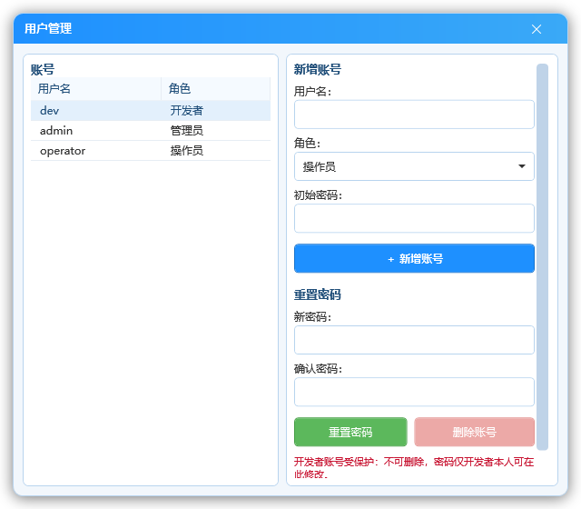

- 左表：在册账号与角色；右栏：新增/重置密码/删除（操作方法开头有
  CanXxx 兜底，程序态直调也拦）；
- **三级角色**语义与门禁：

| 角色 | 一般角色 | 主要门禁 |
| --- | --- | --- |
| Operator | 操作员 | 工单（录 EMP/BC + 数量/清零）、日志；登录后**"设置"整钮禁用** |
| Admin | 管理员 | 加：工艺策略 / IO 测试 / 过账配置 / 演示开关 / 用户管理（工单可改途程/制程/上传使能） |
| Dev | 开发者 | 加：点表配置（**admin 的"设置"下拉里直接没有此项**，不是置灰）；金账户 |

**防锁死红线（Store 层拦截，界面文案只是展示）**：

- `dev` 账号**永不可删**——谁删都拒；
- `dev` 密码**只有 dev 本人可改**（admin 改不了 dev）；
- Dev 角色**不开放创建**（预置唯一，防"造第二个金账户绕过约束"）；
- 换人物的池子永远留最高权限钥匙，不会出现"系统失管"。

**"改密面板已删，operator 无改密权"**：改密一律在用户管理窗由
admin/dev **重置**（免验原密码、立即生效、新密码 ≥6 位）；Admin 可
重置 operator+admin（含自己），Dev 可重置所有人。Store 层还有演员
（actor）兜底：调用方冒充更高角色直接打 Store 也会被拦——双层防线
有测试用例锁死。

---

## 5. 点位接线（点表）与 IO 测试

### 点表窗（dev 专属可改；两程序连接参数全支持保存即热更）

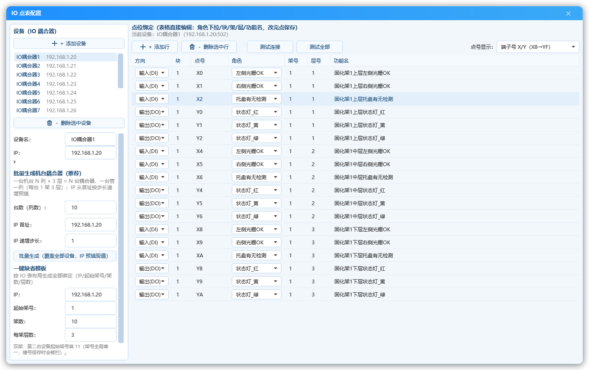

三项关键口径（改前必读）：

1. **块地址线性外推**：`DiStartAddress`(默认 0x1000) /
   `DoStartAddress`(0x1010) / `BlockStrideRegisters`(0x20)
   ——块 K 地址=起址+K×步长；现场不改这三键，点表照缺省铺；
   若要改，改后**必须重跑点表相关测试用例**（地址断言锁住口径）；
2. **DO 写入是 RMW**（读-改-写单寄存器位）：整字覆盖会**误伤**同
   寄存器其它仓位的三色灯——软件已内置，勿改链路；
3. **两道闸**：重复绑定（同点位接两处/同功能挂两路）与 IP/端口格式
   ——保存时自动校验，不合法落不了盘。

### IO 测试窗（管理员起）

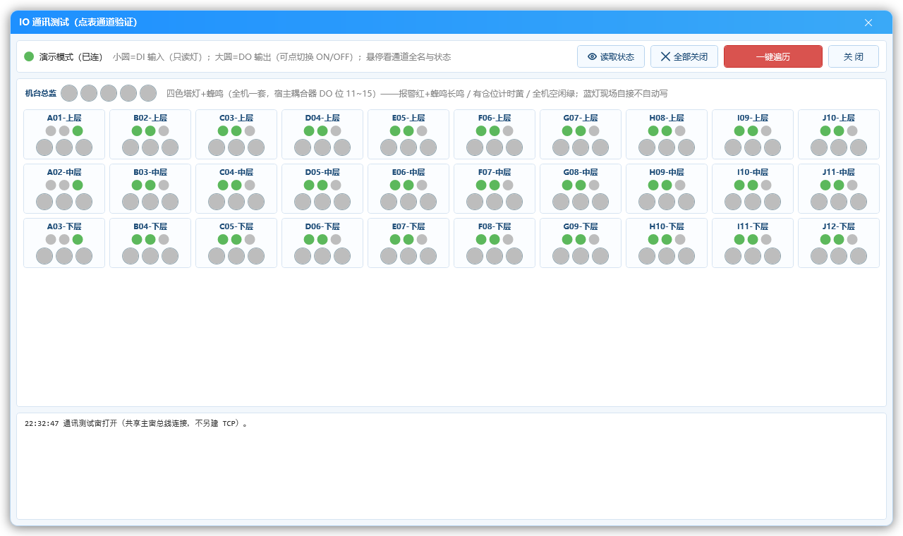

- 仓位卡内两排圆点：**小圆=DI 输入（只读状态灯，不可点）、大圆=DO 输出
  （可点击灯钮，点击切换 ON/OFF）**；顶栏有同款说明 + 悬停详解，
  每个圆点悬停自报方向（"DI 输入·角色 / DO 输出·角色"）；
- 通道清单完全来自点表（`Role != Reserved`），换项目**零代码**切换；
- 硬性窗口纪律：关窗即 `Detach()`——停计时/停遍历/退订，防悬挂
  订阅（这坑踩过）。
- 一键遍历 = 500ms 一路快跑整架，**只动本拍两路**（同寄存器其它位
  靠总线 RMW 保位），停止自动把 DO 全关。

---

## 6. 程控语义（状态机）——排障必读

以下语义一处定义（`SlotCuringMachine`），改流程先改该处与测试：

| # | 语义 | 说明 |
| --- | --- | --- |
| ① | 到位即计时 | 托盘 OFF 即回空闲灭灯；中途取件计时作废记日志（红/异常不自动写灯） |
| ② | 缺省不持久化 | 断电/重启后托盘在架的仓位**从头重计**——宁可重计也不放行；勾"断电续算"才写盘 |
| ③ | 策略热切换（只延不缩） | 新到位的仓位开计时**现取当前策略**（激活即热更）；进行中的默认按开计时那一刻锁定的时长走完（含续算恢复），策略窗保存后收口调 `ApplyPolicyHotChange` 做**单向上调热更**——新解析值比锁定值大才延长（日志"策略热更"），调小一律不动（调小立即生效=放行没固化够的货）；延长同步重写续算落盘。不动 Gate/Done/Idle |
| ④ | WaitingGate 不落盘 | 门控等待没开过计时，重启重走门控 |

## 7. 过账语义与配置（[CuringMes] 节）

以下语义一处定义（`CuringMesPoster` / `CuringMesOptions`）：

| # | 语义 | 说明 |
| --- | --- | --- |
| ① | 触发映射=老项目命令字 | 到位=进站 API0030 I；离开=固化时间 API0027+出站 API0030 O；出站 STATUS=1→已生产+1 |
| ② | 只发真实边沿 | 重启对齐（AlignFromSnapshot）不发事件——防 MES 重复过账 |
| ③ | 失败不弹窗不重传 | 只记日志+顶栏状态（老项目是写机台报警位+弹窗，差异已登记） |
| ④ | 双保险门槛 | 开关开 + URL 非空，缺一不发任何请求 |
| ⑤ | 物料上传 API0032 按**按钮工位** | 自动过账才用全局配置 Side |
| ⑥ | WaitingGate 补口径 | 在 Arrive 口径下补出站（固化 0 秒，有进必有出）；Start 口径没发进站则不出 |
| ⑦ | BC_NO=批次物料条码 | 批次级过账；板级 ID 上报走程序②——两程序分工 |
| ⑧ | 双架工位映射 | RackSides=`架号段:工位`（如 11-20:L），MAC_NO/MAC_LOC_NO 可分侧配 |
| ⑨ | 热更新 | 配置窗保存即 new 实例直赋属性生效（不缓存），**无需重启** |

配置键与样例同步检点清单（新增键必改三处）：
`config.sample.ini`、`CuringMesOptions.Load/Save`、过账配置窗控件。

## 8. 扫码绑定（[Scanner] 节）与追溯文件

### 工序链（一处定义：`SlotBindingSession` / `SlotBindingStore` /
`ScannerBarcodeService`，V0.0.76）

| # | 语义 | 说明 |
| --- | --- | --- |
| ① | 两段式会话 | 等库位码（A01~J12，`SlotLocationCode.TryDecode` 严格校验）→ 等产品码 → 绑定落盘 `config\slotbindings.json` → 回等库位码 |
| ② | 扫库位即清旧绑定 | 接受库位码先 Remove 并落盘（换产品先清旧信息）；随后超时/取消该库位保持未绑定（安全侧） |
| ③ | 换库位 / 同库位 | 等产品码阶段又扫到库位码：不同=切换待绑；相同=仅刷新超时锚点 |
| ④ | 超时 / 取消 | `SessionTimeoutSeconds`（缺省 15 秒）或【取消】→ 回"请扫库位码"；扫错码 3 秒浮层提示，不改会话阶段 |
| ⑤ | 取件作废 | 状态机 `TrayLeft` 边沿调 `Remove`；落盘/刷新必须 `UiInvoke`（状态机 `_sync` 锁内禁 IO）；`AlignFromSnapshot` 不发 `TrayLeft`→重启不清在架绑定 |
| ⑥ | 只提示不拦截 | 未绑定只在统计条胶囊 + 卡片 foot 红字 + 日志边沿；固化/过账零依赖绑定簿 |
| ⑦ | 线程 | `ScannerBarcodeService.Start/Dispose` 后台调用（子模块 Dispose 最坏等收码线程 3 秒）；扫码/连接事件在子模块后台线程触发，主窗订阅方必须封送 |
| ⑧ | 断线自愈 | 串口方式：子模块 3 秒心跳检测 + 静默重连；TCP 方式：断线 3s 节流重连 + TCP KeepAlive 兜底静默断连；宿主不改其内部逻辑 |

### 配置与实现要点

- 现场枪=SH-5000-GHD（自动连续读码）；**接入双模式（V0.0.78 起 TCP 现役）**：
  **TCP**=枪串口接 Eport E10 型 DTU（串口转以太网），DTU socket 已配
  **TCP-SERVER、本地端口 8899、Rout=uart 落 NVRAM**（改前是遗留死
  TCP-CLIENT 169.254.254.96:8888），上位机复用 kaleidoscope
  `ScannerTcpService` 作 TCP 客户端连入按行收码（实测"条码+CR"毫秒级零
  丢失）；旧 UDP 推送已弃用（断电重启不恢复、可靠性差）。**Serial（替代
  接线）**=枪经"网口转 USB 转接线"直插工控机成虚拟 COM，复用
  `ScannerService`。DTU 配置台知识：浏览器进 DTU Web 管理页（账号见站点
  交接表；按出厂初始口令启用后请现场改密），`POST /cmd` 配置 API，SET 后
  `DO_RELOAD ["SOCK"]` 生效，**必须落 NVRAM**
  才抗断电（改前双页备份 `backup_socket_page1/2.json` + `E10_backup.xml`
  在探针工程目录，可按需回滚）；
- **TCP 触发指令红线**：`ScannerBarcodeService` 必须显式取
  `ScannerOptions.NormTriggerCommand`（缺省空串=连上不发）——子模块
  `ScanConfig.TriggerCommand` 缺省 "LON" 是基恩士 SR 口径，漏覆盖会把
  LON 经 DTU 写进枪串口干扰读码（注释 + `ScannerTcpTests` 双锁）；
- **配置窗（V0.0.77 建，V0.0.78 双模式化；V0.0.79 缺省=现场预置）**：主窗
  「设置→扫码枪配置」，**仅 dev 登录后可见**（`MainViewModel.ShowScannerConfigItem
  == Dev` + 命令 `Gate(Dev)` 双保险；admin/operator/未登录设置下拉里没有此项）。
  `ScannerConfigWindow` 仿过账配置窗骨架，「连接方式」勾选框切换
  TCP/串口两参数区块互斥显隐（`ShowTcpSection`/`ShowSerialSection`；
  Visibility 缺省值写进 Style Setter 再 DataTrigger 切）。VM
  `ScannerConfigViewModel` 负责回显/**按方式分桶校验**（Tcp：IP 非空 +
  端口 1~65535 + 触发指令可空不嵌换行；Serial：原五件套，勾启用但定位
  全空当场拦下）/落盘/【检测串口】（`SerialPort.GetPortNames`，唯一口
  自动回填；仅串口方式显示）。
- **缺省值=现场预置（V0.0.79）**：`ScannerOptions` 内置缺省出厂即现场 TCP
  口径——`Mode=Tcp` + `TcpIp=FieldTcpIp（169.254.173.207，公共常量真源）` +
  `TcpPort=8899` + `TriggerCommand=`（空）；`Enabled` 代码缺省仍 0（无枪
  开发机/自动化测试零连接尝试），现场按 `config.sample.ini` 的 `Enabled=1`
  开箱即连。配置窗首次打开回显即完整现场形态，仅把【启用】勾上作建议
  （**只预填不落盘**；串口桶不再代填 USB——替代路径由现场自行填）。
  用户改过 TcpIp/定位/确认过 Enabled=0 的机器原样回显不打扰。**TcpIp 无
  "持久未配置"态**：ini 空值/缺键被读时自愈回预置（kernel32 空值=缺键），
  想不连 TCP=切 Serial 方式或关 Enabled。现场教训：曾把 DTU 死配置里指向
  旧上位机的"远端主机地址"（169.254.254.96）当枪侧 IP 填进来，连接恒超时
  ——预置值收敛进代码后这类手抄错不会再出现。
- **保存即热重建连接**：主窗 `ApplyScannerOptions()` 读盘 → 绑定簿
  `Snapshot()` 带入新 `SlotBindingSession`（在架绑定不丢；等待产品码阶段
  重置）→ UI 线程退订旧服务 → 后台 `lock(_scannerLifecycleGate)` 内
  "旧 `Dispose` → 新 `Start`"。串口独占 + 子模块 Dispose 最坏等 3 秒，
  故必须后台串行（铁律 2）；主窗退出释放同锁（`MainViewModel.Dispose`）。
- `[Scanner]` 键：`Enabled` / `Mode`（**出厂缺省 Tcp**；显式 Serial 走串口，
  其余/非法值回 Tcp）/ TCP 组 `TcpIp`（缺省=现场预置值，空值自愈回预置）/
  `TcpPort`（缺省 8899） / `TriggerCommand`（缺省空=不发）/
  串口组 `PortName` / `DeviceKeyword`（二选一，前者优先）/ `BaudRate` /
  `DataBits` / `StopBits` / `Parity` / `SessionTimeoutSeconds` / `DebugLog`
  （仅 Serial 方式生效）；`StopBits` 存 `1/15/2`（界面显示 `1/1.5/2`）。
  手工改 ini 仍需重启程序；配置窗保存不需要（与点表/策略同款热更口径）；
- 服务选型按 `NormMode`：Tcp → `ScannerTcpService`；Serial →
  `ScannerService` 且 `ScanConfig.Mode="Serial"` **必须写死**（子模块
  缺省是 Tcp）；net8 需显式引 `System.IO.Ports` 8.0.0；
- 子模块日志桥接：真实构造子模块服务时把 `LogHelper.LogAction` 改指
  `LocalLogService`，`Dispose` 恢复；测试注入假 `IScanner` 时不桥接；
- 未启用/未配当前方式目标不启动收码线程，程序其余功能零影响（启动/保存热换
  均沿记一行跳过原因日志，2026-11-07 补——此前 Enabled=0 完全静默，现场
  "胶囊=未启用 + 日志无提示"排障无头）。

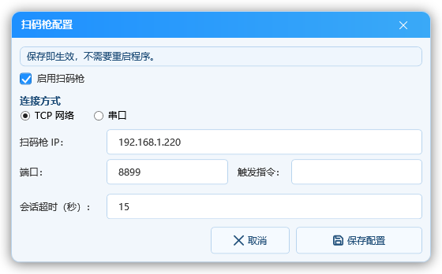

### 追溯文件 `config\slotbindings.json`

`{ "Bindings": [ { "Rack", "Level", "ProductCode", "BoundAt" } ] }`
——生产追溯数据（重启保留、现场可打开核对），不是配置；`Load` 剔除空码/
非法架层记录，`Save` 全量重写，`Reset` 删文件=回到全部未绑定。

---

## 9. 主窗与登录链（内部视角）

主窗空闲/流转两个时刻，便于给客户截图讲解：

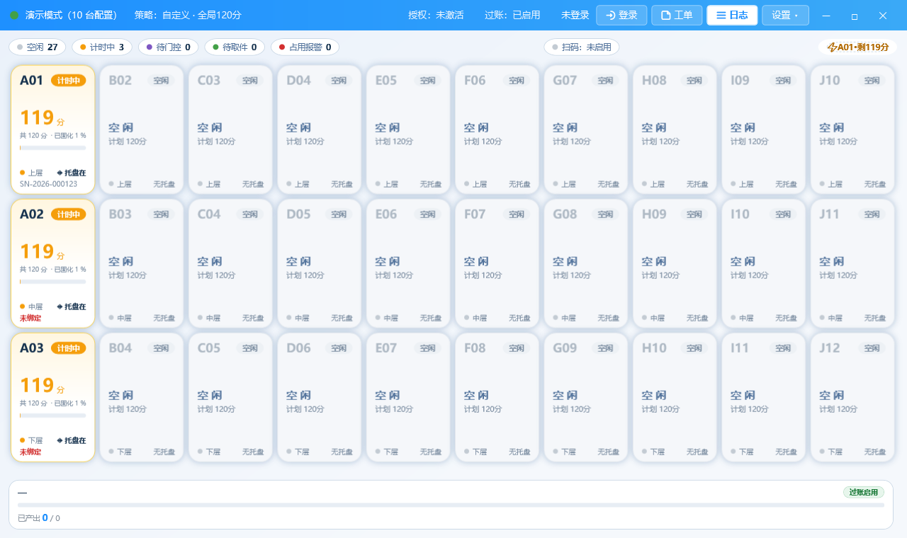

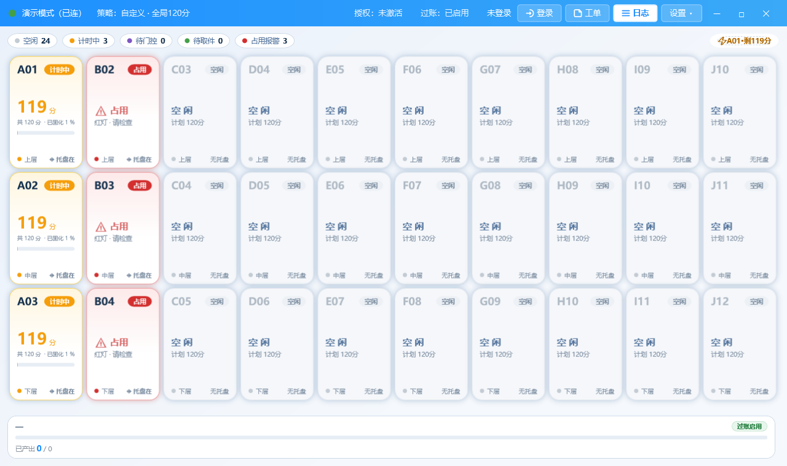

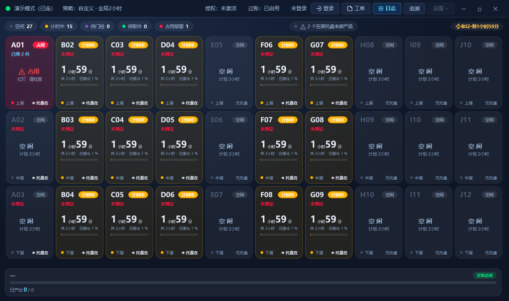

顶栏状态自解释：左 = chip + 连接灯点 + 策略激活名 + 连接短词 + 过账
状态 + 登录态；右 = 登录/工单/日志/**设置 ▾** + 系统三钮（V0.0.39
顶栏精简：策略/过账/IO测试/点表/用户管理/演示/主题全收"设置"下拉，
重新连接也在下拉里；退出钮已删，系统 ✕ 与其走同一条退出链）。
演示态靠下拉项强调色 + 连接短词"演示"字样识别。

**演示与掉线的交互坑（截图时候务必避开）**：

- Mock 总线每 **120 秒模拟一次掉线 3 秒**（复现节流重连）——
  截图与拍视频要避开 30~33 秒窗，否则会拍到"重连中"画面；
- 演示的"剩n分"是脚本起步时间，不是现场值。

**双主题（V0.0.31 起弹窗跟主题）**：Light（G2 浅色渐变浸染）/ Dark（G1 深空
玻璃舱）两套语义键字典同名异值，顶栏【深色/浅色】切换即写回
`config.ini [setting] Theme`；主窗 + 日志悬浮窗 + 全部功能弹窗一起换皮。
截图对照（同一时刻浅色 / 深色）：

### 日志悬浮窗（登录即可）

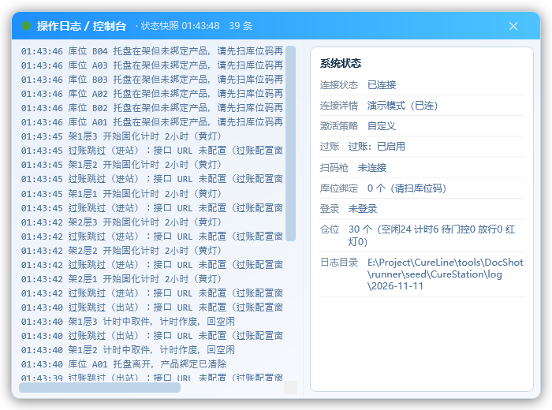

- 三路同记：内存 FIFO（200 行，界面用）/ 本地文件 `log\yyyy-MM-dd\log.txt` /
  界面实时刷新；日志只记边沿（连上/断开/触发/成功/NG），连续失败中间静默。
- 日志窗右侧系统状态卡为打开一刻的快照（连接/总线/策略/过账/登录/仓位统计
  /当日日志目录），现场排障先看这里。

### 登录与记忆（对齐 mFormLogin 语义）

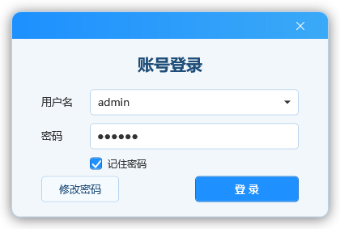

- **纯登录**（V0.0.49 起改密面板删除，登录窗只做进门验证）；
- **记住密码**复用 RunModeSettings（DPAPI 密文存 config.ini
  [setting]），**ini 永无明文**；用户名一改就跟随出该账号记忆
  （命中回填+勾选，未命中清空+取消勾）；记忆只在**登录成功时**保存；
- 密码需要变更走用户管理窗**重置**（admin/dev 操作，免验原密码、
  ≥6 位、立即生效）；操作员无自助改密入口。
- UsernameBox 下拉列在册账号（ListUsers 实时表），编辑框/下拉项/
  密码框三处文本左缘对齐是 UI 契约（对齐锚点见 AGENTS.md 登录窗语义 ⑩）。

### 工单窗（两套视角）

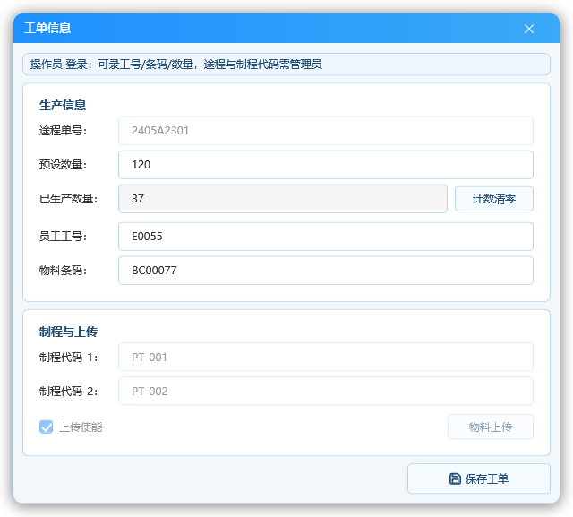

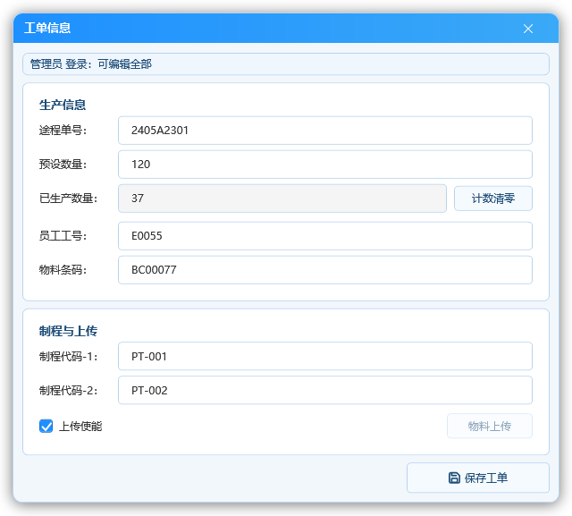

**门禁兜底红线**：级别不够的字段**保存时回读盘上原值**——防
"IsEnabled 置灰被绕过直接改 VM 属性越权落盘"。这条是测试用例锁死
的，前端禁不禁只是体验，不是防线。

---

## 10. 策略窗（内部航海图）

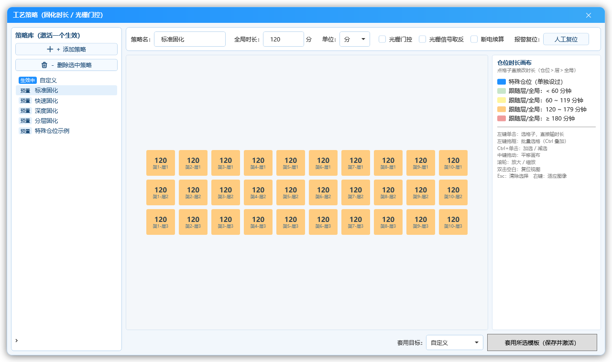

预置/套用/希望的语义要点（全部一处定义 `CuringPolicy.IsPreset` +
`CuringPolicyViewModel`；V0.0.57 用户拍板三条新口径）：

1. **「自定义」恒存在**（V0.0.57，唯一系统缺省策略）：删除一律拦 + 载入库
   缺它时自愈补回（缺省 120 分钟插队首）——预置模板有缺省落点、激活名失效
   时 `ResolveActive` 兜底回它，程控不停摆；
2. **预置**（出厂模板）可查看可编辑，但**保存/激活/删除一律拦**，唯一出口
   "套用所选模板"（**套用目标可选**：底部下拉=「自定义」+用户自建策略，缺省
   「自定义」；编辑内容**整体替换**写入目标并激活目标，不残留旧覆盖行）；
3. **开窗即显生效策略**（V0.0.57）：打开页面缺省选中当前生效策略，列表项带
   "生效中"徽标（`ActiveName` 比对）；**改名跟随**：仅保存被改名的策略恰是
   生效策略时激活名同步换新（防激活名悬挂、重启时长凭空跳回 120）；
4. **先改副本**链：草稿替换选中项进库校验→过了才 ApplyDraftToSelected
   +落盘（改名撞车**不污染**原对象）；
5. **可视化画布**：`SlotPreviewItems` = RackCount×LevelCount 格，
   与主窗网格同源（下限 10×3）；编辑任一时长 `RebuildPreview`
   实时反映；分档四色（<60 绿 / 60~119 黄 / 120~179 橙 / ≥180 红）；
6. 画布交互在 View 层（`RenderTransform`），业务零耦合：滚轮缩放（鼠标锚
   点，0.4~4.0）；**左键 / 中键（按住滚轮）拖动**平移；双击复位；右键菜单
   【适应图像】恢复开窗原始大小（V0.0.37，与复位同链 `ResetView`）。

老版本 JSON 无 IsPreset 字段反序列化 false=全按自定义，兼容零迁移。

---

## 11. 过账配置窗速查

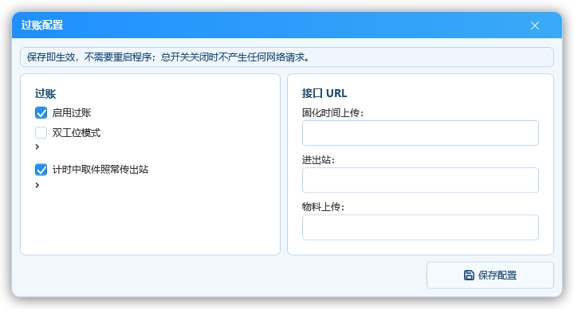

配置实施顺序（新 MES 上线）：

1. 向 MES 侧拿三接口 URL（0027/0030/0032）——与主程序[ MES ]同键；
2. 填静态参数 MacNo/MacLocNo（ 或留空走记忆文件 `mes_params.json`）；
3. 确认 TimeUnit/InAt/AbortOut 与客户口径（老客户给 Seconds/Arrive
   /照发即缺省）；
4. 开"启用单线过账"，顶栏出"过账：已启用（R 工位）"即链路；
5. **URL 校验失败保存被拦**，注意窗内每格后面的提示红字。

> **保存即热生效**——不用重启主程序；URL 校验 → 写 ini → 再
> `MesConfig` 本进程生效三步连做。

---

## 12. 排障手册（现场高频 9 问）

1. **顶栏"重连中"常驻**：设备端先看（电源/网线/IP）；软件端
   config.ini 里机台 IP 是否与点表设备 IP 一致；
2. **卡黄色不计时**：点表里该位的 DI 托盘在信号没接（跑 IO 测试窗
   逐路验证）；
3. **绿灯不亮**：确认策略激活了、时长>0；仓位覆盖行有没有把该层
   配成 0（配置窗会拦，生效后不会 0）；
4. **过账顶栏出"失败"**：过账配置窗开"启用单线过账"了吗？URL 空
   也不发；再看主程序日志窗追报文；
5. **进程启动即出"加载失败"**：database 文件被锁（现场多开第二份
   exe）——同目录只跑一份；
6. **代码 30 仓位实际只铺 30 张卡**：`BuildSlots` 有 Math.Max 垫底
   （最小 30），点表只配 1 架也会铺满 30 张属**展示口径**勿当 bug；
7. **改了点表仓位没变化**：卡片主标题走 `EncodeInRack`（按**架内
   站号**换算 A01~J12），确认改的是**架内**序号而不是全局序号；
8. **模拟与真机混乱**：模拟下卡流转是脚本（不是真实 IO），判断当前
   模式看顶栏"演示模式"字样，别对模拟数据做工艺判定。
9. **扫码枪扫不出码/一直未连接**：先看统计条胶囊，`[Scanner] Enabled=0`
   是配置问题——dev 登录「设置→扫码枪配置」勾启用保存（热生效）。
   **TCP 方式（现场现役）**：`TcpIp` 空=未配置；连不上查网线与枪侧 DTU
   （确认 DTU TCP-SERVER 8899 配置还在——UDP socket 实测断电不恢复，
   **TCP 才落了 NVRAM；DTU 断电重启后先 Web 台核对 socket**），程序后台
   3 秒节流自动重连。**Serial 方式（替代）**：`PortName`/`DeviceKeyword`
   都空=未配置，点【检测串口】选口后保存；连不上查 USB 转接线与 COM 口
   占用（子模块 3 秒心跳自动重连）。扫到产品码被拒=顺序反了（必须先扫
   库位码）；日志 grep"扫码"可看绑定/超时/未绑定边沿。

---

## 13. 与主程序（程序② CimGateway）的关系

- **程序①**只做**固化线本身**的程控与单线过账（三接口）；
- **程序②**做**整线 8 机台**的报文网关（六接口）与管理；
- 两者可分机部署，通讯配置相互独立；共用的只有 MES 地址键
  （Url_API0027/0030/0032）与密码哈希算法口径。

**各程序只有一个程序级账号库**（CureStation: operators，三级
operator/admin/dev；CimGateway: users，admin/dev）——但库互不相干
（分机部署），客户只装程序①时不存在程序②的权限。

**交付自检**：

1. `dotnet build` 0 警告 0 错误 + `dotnet test` 全绿（500+ 用例，V0.0.76 起 543）；
2. 模拟模式起 exe：卡 30 张 + 日志/协议自愈文件生成；
3. 真机切换跑一遍 IO 测试窗（30 路）；
4. 与主程序日志窗对一遍过账报文（客户 MES 对接后）。

---

> 内部资料：密码、授权号不出现在本文档；新增配置键同步
> config.sample.ini 与 README。手册版本随软件 CHANGELOG。

<!-- SECTION-BREAK -->
