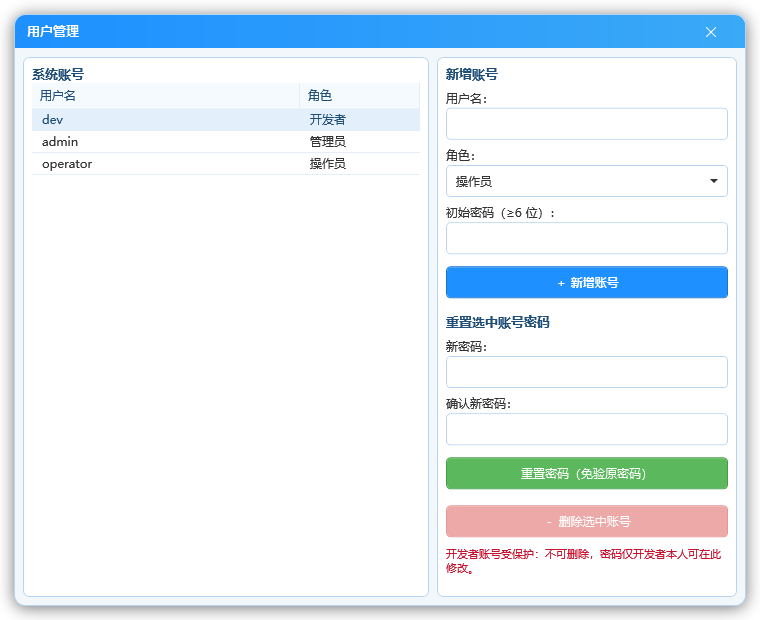
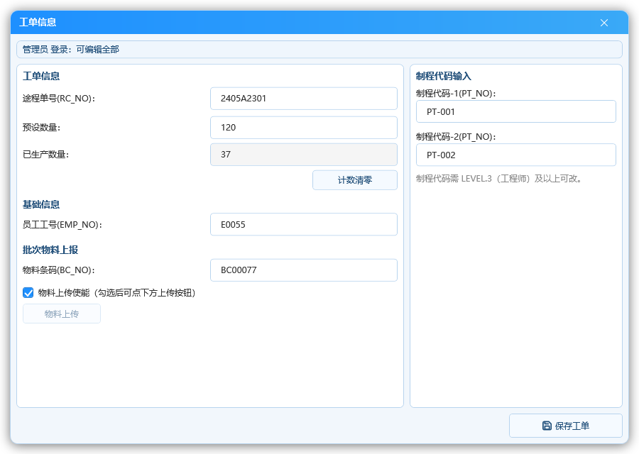

# 固化程控 内部手册

> 适用版本：固化程控（CureStation）V0.0.49 及以后
> 适用对象：本公司部署与现场维护工程师（开发者 dev 账号视角全量功能）
> 截图说明：截图均为演示模式数据。**本手册为内部资料，勿外发客户。**

---

## 1. 本手册讲什么

把程序①（固化程控，CureStation.exe）的**全量功能**一册讲完：
部署、点位接线、程控语义、过账链路、账号体系、排障手段。
含开发者（dev）专属功能（点表绑定编辑、用户管理）与管理员（admin）
专属功能（工艺策略、过账参数、演示开关）。

客户侧材料分两份（操作员手册/客户技术工艺手册），不在现场重复
展开的只有两件：**账号管理**与**过账参数改动**，都按本手册口径。

## 2. 部署与目录

净机部署四件事：

1. 拷贝发布目录（`CureStation.exe` + 依赖 DLL + `config.sample.ini`）；
2. `config.sample.ini` 就地复制为 `config/config.ini` 改参数；
3. 首启自动建：`config/`（kernel32 不自建，软件兜底）、`DataBase/`
   （SQLite 表）、`Logs/`（操作日志）；
4. 桌面快捷方式可手工建；先跑一次 `Simulate=1` 演示确认视觉正常再切
   真机。

**现场配置文件一览**（均在 `config/`）：

| 文件 | 内容 | 谁写 |
| --- | --- | --- |
| config.ini | 连接参数/模拟开关/过账配置/语言 | 软件写，INI 自愈缺键 |
| pointtable.json | IO 点表（设备+绑定） | 点表窗保存 |
| curingpolicy.json | 策略库（预置+自定义+激活名） | 策略窗保存 |
| curingstate.json | 断电计时状态（可选功能，勾"断电续算"才生成） | 状态机 |
| workorder.json | 工单信息（R/L 双工位+EMP/BC/PT） | 工单窗保存 |
| operators.db3 内 | 操作员账号表（三级 operator/admin/dev） | 用户管理窗 |

> **现场密码红线**：出厂三账号 `operator/123456`、`admin/123456`、
> `dev/dev123` 一处定义（`App.OnStartup` 三参 `EnsureSeeded` 自愈播种，
> 每次启动幂等补齐、不覆盖运行期改过的密码），上线必须重置交接给
> 客户；密码存 PBKDF2 哈希，**文档不记录现场明文**。

**真机/演示切换**：主窗"设置 ▾ → 演示开关"切换（管理员门禁，
写回 `config.ini [setting] Simulate` 并经 StartBus 换总线，免重启）；
ini 只是开机初值。`Simulate=1` 走总线模拟
（30 仓位按脚本流转）；真机=0。**切机前先备份现场 ini**。

## 3. 软件架构一段话

- **主窗**：30 仓位卡，行优先（先层后架）；双架时按每 10 站分组
  各自成块（`RackGroups`），卡与平铺列表同实例；
- **IO 总线**：`ModbusPointTableBus` 按**点表**驱动——逐块 FC04 读
  DI（托盘在/光栅）、RMW 写 DO（三色灯，避免误伤同寄存器其它位），
  断线 5 秒节流重连；
- **仓位状态机**：`SlotCuringMachine` 30 实例（每仓位一个），
  1 秒心跳泵跑；
- **过账**：`CuringMesPoster` 挂状态机边沿（进站/出站/物料）；
- **账号**：三级（operator < admin < dev）+ 防锁死约束；
- **演进**：本程序（程序①）与主程序（CimGateway，程序②）可**分机
  部署**——程控与整线过两条独立线，见重构设计文档。

---

## 4. 权限模型与账号管理

三级权限 + 防锁死，一个窗口管到底（V0.0.49 重做，替代旧四级权限窗）。

顶栏"设置 ▾"点 **用户管理**（管理员 admin 及以上）：

- 左表：在册账号与角色；右栏：新增/重置密码/删除（操作方法开头有
  CanXxx 兜底，程序态直调也拦）；
- **三级角色**语义与门禁：

| 角色 | 一般角色 | 主要门禁 |
| --- | --- | --- |
| Operator | 操作员 | 工单（录 EMP/BC + 数量/清零）、日志；登录后**"设置"整钮禁用** |
| Admin | 管理员 | 加：工艺策略 / IO 测试 / 过账配置 / 演示开关 / 用户管理（工单可改途程/制程/上传使能） |
| Dev | 开发者 | 加：点表配置（**admin 的"设置"下拉里直接没有此项**，不是置灰）；金账户 |

**防锁死红线（Store 层拦截，界面文案只是展示）**：

- `dev` 账号**永不可删**——谁删都拒；
- `dev` 密码**只有 dev 本人可改**（admin 改不了 dev）；
- Dev 角色**不开放创建**（预置唯一，防"造第二个金账户绕过约束"）；
- 换人物的池子永远留最高权限钥匙，不会出现"系统失管"。

**"改密面板已删，operator 无改密权"**：改密一律在用户管理窗由
admin/dev **重置**（免验原密码、立即生效、新密码 ≥6 位）；Admin 可
重置 operator+admin（含自己），Dev 可重置所有人。Store 层还有演员
（actor）兜底：调用方冒充更高角色直接打 Store 也会被拦——双层防线
有测试用例锁死。

---

## 5. 点位接线（点表）与 IO 测试

### 点表窗（dev 专属可改；两程序连接参数全支持保存即热更）

三项关键口径（改前必读）：

1. **块地址线性外推**：`DiStartAddress`(默认 0x1000) /
   `DoStartAddress`(0x1010) / `BlockStrideRegisters`(0x20)
   ——块 K 地址=起址+K×步长；现场不改这三键，点表照缺省铺；
   若要改，改后**必须重跑点表相关测试用例**（地址断言锁住口径）；
2. **DO 写入是 RMW**（读-改-写单寄存器位）：整字覆盖会**误伤**同
   寄存器其它仓位的三色灯——软件已内置，勿改链路；
3. **两道闸**：重复绑定（同点位接两处/同功能挂两路）与 IP/端口格式
   ——保存时自动校验，不合法落不了盘。

### IO 测试窗（管理员起）

- 仓位卡内两排圆点：**小圆=DI 输入（只读状态灯，不可点）、大圆=DO 输出
  （可点击灯钮，点击切换 ON/OFF）**；顶栏有同款说明 + 悬停详解，
  每个圆点悬停自报方向（"DI 输入·角色 / DO 输出·角色"）；
- 通道清单完全来自点表（`Role != Reserved`），换项目**零代码**切换；
- 硬性窗口纪律：关窗即 `Detach()`——停计时/停遍历/退订，防悬挂
  订阅（这坑踩过）。
- 一键遍历 = 500ms 一路快跑整架，**只动本拍两路**（同寄存器其它位
  靠总线 RMW 保位），停止自动把 DO 全关。

---

## 6. 程控语义（状态机）——排障必读

以下语义一处定义（`SlotCuringMachine`），改流程先改该处与测试：

| # | 语义 | 说明 |
| --- | --- | --- |
| ① | 到位即计时 | 托盘 OFF 即回空闲灭灯；中途取件计时作废记日志（红/异常不自动写灯） |
| ② | 缺省不持久化 | 断电/重启后托盘在架的仓位**从头重计**——宁可重计也不放行；勾"断电续算"才写盘 |
| ③ | 策略热切换只影响新仓位 | 进行中的按**开计时那一刻锁定**的时长走完（含续算恢复） |
| ④ | WaitingGate 不落盘 | 门控等待没开过计时，重启重走门控 |

## 7. 过账语义与配置（[CuringMes] 节）

以下语义一处定义（`CuringMesPoster` / `CuringMesOptions`）：

| # | 语义 | 说明 |
| --- | --- | --- |
| ① | 触发映射=老项目命令字 | 到位=进站 API0030 I；离开=固化时间 API0027+出站 API0030 O；出站 STATUS=1→已生产+1 |
| ② | 只发真实边沿 | 重启对齐（AlignFromSnapshot）不发事件——防 MES 重复过账 |
| ③ | 失败不弹窗不重传 | 只记日志+顶栏状态（老项目是写机台报警位+弹窗，差异已登记） |
| ④ | 双保险门槛 | 开关开 + URL 非空，缺一不发任何请求 |
| ⑤ | 物料上传 API0032 按**按钮工位** | 自动过账才用全局配置 Side |
| ⑥ | WaitingGate 补口径 | 在 Arrive 口径下补出站（固化 0 秒，有进必有出）；Start 口径没发进站则不出 |
| ⑦ | BC_NO=批次物料条码 | 批次级过账；板级 ID 上报走程序②——两程序分工 |
| ⑧ | 双架工位映射 | RackSides=`架号段:工位`（如 11-20:L），MAC_NO/MAC_LOC_NO 可分侧配 |
| ⑨ | 热更新 | 配置窗保存即 new 实例直赋属性生效（不缓存），**无需重启** |

配置键与样例同步检点清单（新增键必改三处）：
`config.sample.ini`、`CuringMesOptions.Load/Save`、过账配置窗控件。

## 8. 主窗与登录链（内部视角）

主窗空闲/流转两个时刻，便于给客户截图讲解：

顶栏状态自解释：左 = chip + 连接灯点 + 策略激活名 + 连接短词 + 过账
状态 + 登录态；右 = 登录/工单/日志/**设置 ▾** + 系统三钮（V0.0.39
顶栏精简：策略/过账/IO测试/点表/用户管理/演示/主题全收"设置"下拉，
重新连接也在下拉里；退出钮已删，系统 ✕ 与其走同一条退出链）。
演示态靠下拉项强调色 + 连接短词"演示"字样识别。

**演示与掉线的交互坑（截图时候务必避开）**：

- Mock 总线每 **120 秒模拟一次掉线 3 秒**（复现节流重连）——
  截图与拍视频要避开 30~33 秒窗，否则会拍到"重连中"画面；
- 演示的"剩n分"是脚本起步时间，不是现场值。

**双主题（V0.0.31 起弹窗跟主题）**：Light（G2 浅色渐变浸染）/ Dark（G1 深空
玻璃舱）两套语义键字典同名异值，顶栏【深色/浅色】切换即写回
`config.ini [setting] Theme`；主窗 + 日志悬浮窗 + 全部功能弹窗一起换皮。
截图对照（同一时刻浅色 / 深色）：

### 日志悬浮窗（登录即可）

- 三路同记：内存 FIFO（200 行，界面用）/ 本地文件 `log\yyyy-MM-dd\log.txt` /
  界面实时刷新；日志只记边沿（连上/断开/触发/成功/NG），连续失败中间静默。
- 日志窗右侧系统状态卡为打开一刻的快照（连接/总线/策略/过账/登录/仓位统计
  /当日日志目录），现场排障先看这里。

### 登录与记忆（对齐 mFormLogin 语义）

- **纯登录**（V0.0.49 起改密面板删除，登录窗只做进门验证）；
- **记住密码**复用 RunModeSettings（DPAPI 密文存 config.ini
  [setting]），**ini 永无明文**；用户名一改就跟随出该账号记忆
  （命中回填+勾选，未命中清空+取消勾）；记忆只在**登录成功时**保存；
- 密码需要变更走用户管理窗**重置**（admin/dev 操作，免验原密码、
  ≥6 位、立即生效）；操作员无自助改密入口。
- UsernameBox 下拉列在册账号（ListUsers 实时表），编辑框/下拉项/
  密码框三处文本左缘对齐是 UI 契约（对齐锚点见 AGENTS.md 登录窗语义 ⑩）。

### 工单窗（两套视角）

**门禁兜底红线**：级别不够的字段**保存时回读盘上原值**——防
"IsEnabled 置灰被绕过直接改 VM 属性越权落盘"。这条是测试用例锁死
的，前端禁不禁只是体验，不是防线。

---

## 9. 策略窗（内部航海图）

预置/套用/希望的语义要点（全部一处定义 `CuringPolicy.IsPreset` +
`CuringPolicyViewModel`）：

1. **预置**（出厂模板）可查看可编辑，但**保存/激活/删除一律拦**，
   唯一出口"套用为自定义策略"（**整体替换**写入"自定义"并激活，
   不残留旧覆盖行）；
2. **激活只认自定义**——`BuildDefaultBook` 激活名=自定义且排
   Policies[0]，ResolveActive 兜底回它，激活名失效时程控不停摆；
3. **先改副本**链：草稿替换选中项进库校验→过了才 ApplyDraftToSelected
   +落盘（改名撞车**不污染**原对象）；
4. **可视化画布**：`SlotPreviewItems` = RackCount×LevelCount 格，
   与主窗网格同源（下限 10×3）；编辑任一时长 `RebuildPreview`
   实时反映；分档四色（<60 绿 / 60~119 黄 / 120~179 橙 / ≥180 红）；
5. 画布交互在 View 层（`RenderTransform`），业务零耦合：滚轮缩放（鼠标锚
   点，0.4~4.0）；**左键 / 中键（按住滚轮）拖动**平移；双击复位；右键菜单
   【适应图像】恢复开窗原始大小（V0.0.37，与复位同链 `ResetView`）。

老版本 JSON 无 IsPreset 字段反序列化 false=全按自定义，兼容零迁移。

---

## 10. 过账配置窗速查

配置实施顺序（新 MES 上线）：

1. 向 MES 侧拿三接口 URL（0027/0030/0032）——与主程序[ MES ]同键；
2. 填静态参数 MacNo/MacLocNo（ 或留空走记忆文件 `mes_params.json`）；
3. 确认 TimeUnit/InAt/AbortOut 与客户口径（老客户给 Seconds/Arrive
   /照发即缺省）；
4. 开"启用单线过账"，顶栏出"过账：已启用（R 工位）"即链路；
5. **URL 校验失败保存被拦**，注意窗内每格后面的提示红字。

> **保存即热生效**——不用重启主程序；URL 校验 → 写 ini → 再
> `MesConfig` 本进程生效三步连做。

---

## 11. 排障手册（现场高频 8 问）

1. **顶栏"重连中"常驻**：设备端先看（电源/网线/IP）；软件端
   config.ini 里机台 IP 是否与点表设备 IP 一致；
2. **卡黄色不计时**：点表里该位的 DI 托盘在信号没接（跑 IO 测试窗
   逐路验证）；
3. **绿灯不亮**：确认策略激活了、时长>0；仓位覆盖行有没有把该层
   配成 0（配置窗会拦，生效后不会 0）；
4. **过账顶栏出"失败"**：过账配置窗开"启用单线过账"了吗？URL 空
   也不发；再看主程序日志窗追报文；
5. **进程启动即出"加载失败"**：database 文件被锁（现场多开第二份
   exe）——同目录只跑一份；
6. **代码 30 仓位实际只铺 30 张卡**：`BuildSlots` 有 Math.Max 垫底
   （最小 30），点表只配 1 架也会铺满 30 张属**展示口径**勿当 bug；
7. **改了点表仓位没变化**：卡片主标题走 `EncodeInRack`（按**架内
   站号**换算 A01~J12），确认改的是**架内**序号而不是全局序号；
8. **模拟与真机混乱**：模拟下卡流转是脚本（不是真实 IO），判断当前
   模式看顶栏"演示模式"字样，别对模拟数据做工艺判定。

---

## 12. 与主程序（程序② CimGateway）的关系

- **程序①**只做**固化线本身**的程控与单线过账（三接口）；
- **程序②**做**整线 8 机台**的报文网关（六接口）与管理；
- 两者可分机部署，通讯配置相互独立；共用的只有 MES 地址键
  （Url_API0027/0030/0032）与密码哈希算法口径。

**各程序只有一个程序级账号库**（CureStation: operators，三级
operator/admin/dev；CimGateway: users，admin/dev）——但库互不相干
（分机部署），客户只装程序①时不存在程序②的权限。

**交付自检**：

1. `dotnet build` 0 警告 0 错误 + `dotnet test` 全绿（位位≥315）；
2. 模拟模式起 exe：卡 30 张 + 日志/协议自愈文件生成；
3. 真机切换跑一遍 IO 测试窗（30 路）；
4. 与主程序日志窗对一遍过账报文（客户 MES 对接后）。

---

> 内部资料：密码、授权号不出现在本文档；新增配置键同步
> config.sample.ini 与 README。手册版本随软件 CHANGELOG。

<!-- SECTION-BREAK -->
