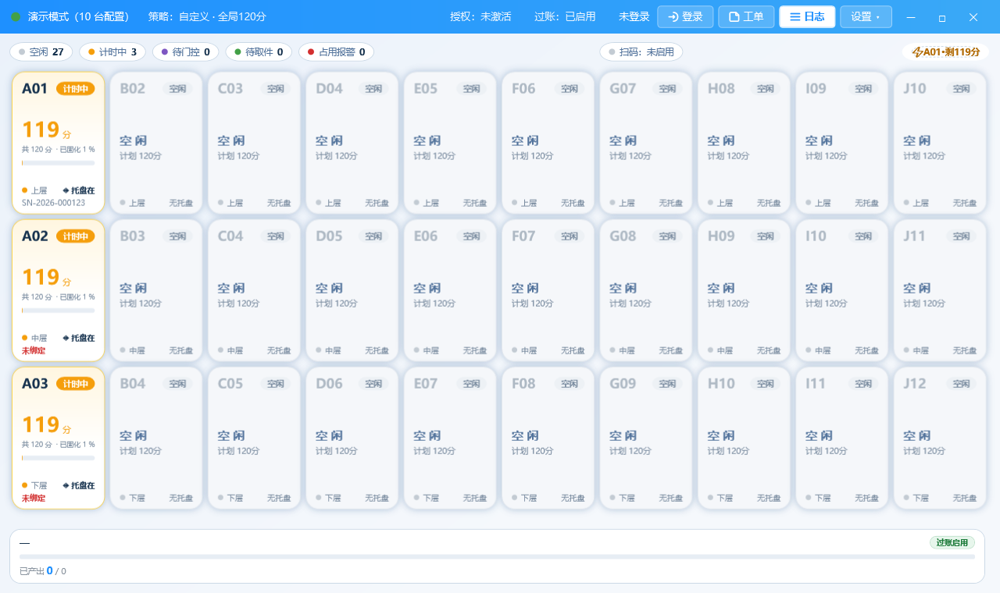
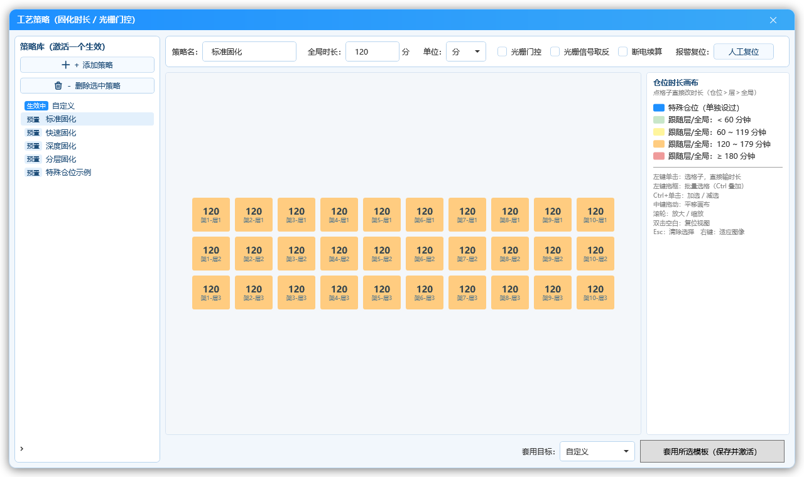
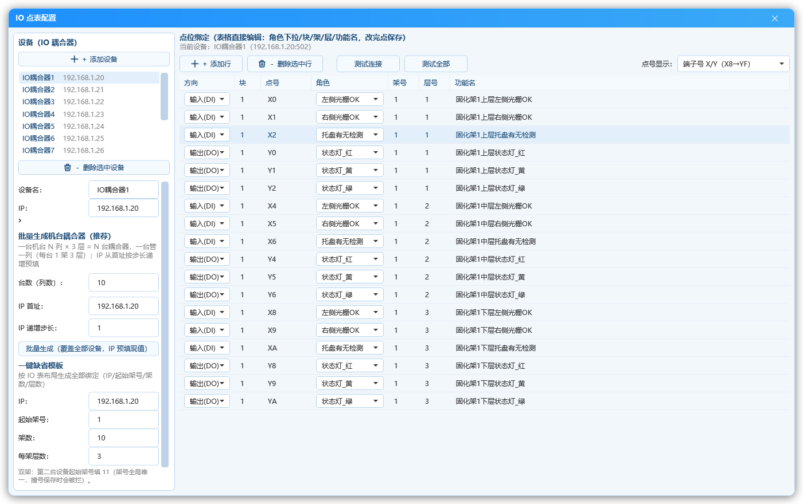
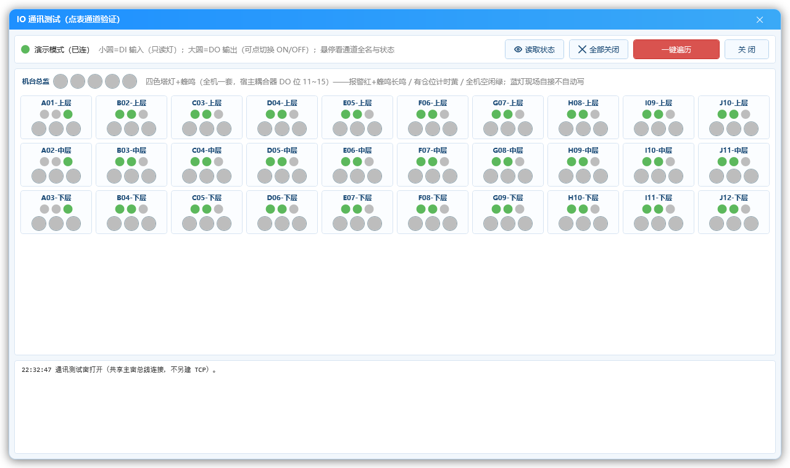
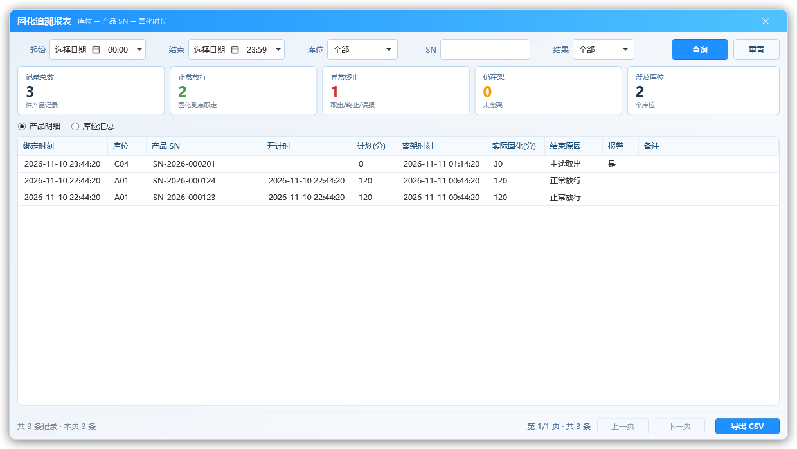
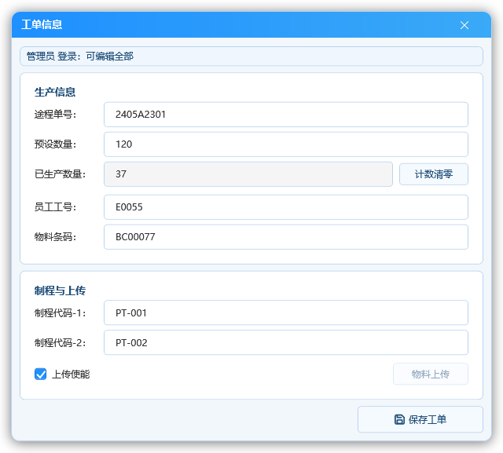
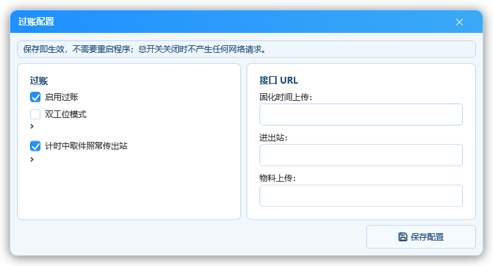

# 固化程控 客户技术工艺手册

> 适用版本：固化程控（CureStation）V0.0.76 及以后
> 适用对象：客户工艺/设备工程师（管理员 admin 账号可完成的全部操作）
> 截图说明：截图均为演示模式数据；库位编码、时长、仓位状态以现场为准。

---

## 1. 本手册讲什么

> 界面支持深色/浅色两套配色，顶栏【深色】/【浅色】按钮即时切换并记忆
> （写回 config.ini `[setting] Theme`）；两种配色功能完全一致。

出厂设置里这套软件的工艺部分已经跑通。本手册面向**会动手调工艺参数**
的工程师，把"固化程控"里工艺相关的三块讲透：

1. **工艺策略窗**：时长怎么定、光栅四项怎么用、断电要不要续算；
2. **IO 点表**：点位绑定决定哪些仓位参与程控，怎么核、怎么测；
3. **过账配置**：MES 上报口径（进站时机/时间单位/工位映射）。

开发者（dev）专属的**点表配置**、账号管理不在本手册，见文末认档表。

### 界面总览

主窗 30 张仓位卡（每架 10 位 × 3 层），顶栏是全部功能的入口：



工艺工程师日常用得最多的两个入口：**策略**（工艺参数）与
**IO测试**（点位验证）；**过账配置**在对接 MES 时用。

## 2. 工艺模型：三级时长覆盖

固化时长的取值**永远只有一条出口**，按从近到远三级找：

```
仓位覆盖（单仓位个性化，如某格 45 分）
  └─ 找不到 → 层覆盖（上层/中层/下层统一值）
       └─ 找不到 → 全局时长（一炉统一值）
```

- 三级都配了：**最准的赢**（仓位级）；
- 只有全局：全炉同一时长；
- 换策略=整体换一套时长，不用逐格清数。

**推论**：想给某格单独提速，配一条"仓位覆盖"即可，别去改全局。

## 3. 工艺策略窗

顶栏点 **策略**（管理员 admin；入口在"设置 ▾"下拉里）：



两栏布局：

| 栏 | 名字 | 干什么 |
| --- | --- | --- |
| 左 | 策略库 | 一套套工艺方案（预置+自定义），**激活一个生效** |
| 右 | 参数条 + 时长画布 | 参数条改策略名/全局时长/时间单位/断电续算；画布点格子直改单仓时长（含图例与操作说明） |

画布**下方**是**光栅控制带**（门控开关、信号类型、光栅报警、报警解除，见第 4 节）。

底部是**仓位时长预览画布**（10×3 一屏全仓位，颜色按时长分四档）：
编辑任何时长的当下即刷新，无需真假机来回跑。画布支持滚轮放大/缩小、
**左键或按住滚轮（中键）拖动**平移；双击，或右键菜单选**【适应图像】**，
即恢复窗口打开时的原始大小。

### 策略库与预置

- 库里始终有一条**「自定义」**策略（系统缺省，删不掉也丢不了——把它删掉
  软件会自动补回来），它是程控随时兜底生效的一条；
- 预置策略（标"预置"）是**出厂模板**：可查看、可编辑，但**保存/激活/
  删除一律被拦**——预置是"教材"不是"活的工作区"；
- 想用预置参数：选中预置 → 在底部**【套用目标】下拉**挑一个落点（默认
  **「自定义」**，也可以选您自己新建的策略）→ 点**【套用所选模板】**——
  整套内容复制进所选策略并**自动激活它**；
- 打开页面时**默认选中当前生效的策略**，列表里带**【生效中】**徽标的
  就是"现在跑的是哪条"。

### 编辑与保存（防误操作的草稿链）

编辑窗里的改动**先落在草稿**，点保存时才校验落盘：

1. 改时长/层覆盖 → 下方预览画布实时变色（你先看效果）；
2. 点 **仅保存**（或 **激活并生效**）→ 软件先跑校验（空值/越界层号/
   重名全部拦截）→ 通过才写进配置文件；
3. 改一半想反悔：不点保存关窗即丢，原数据毫发无损；
4. **改名撞车**：把策略改名成库里已有名字，校验拦下且**不污染**
   原来那个同名策略。

校验不通过的提示会写清楚差在哪格（如"层号超出 1~3"），照着改即可。

---

## 4. 光栅控制带

策略窗画布下方的**光栅控制带**，从左到右四件：

| 项 | 管什么 | 怎么用 |
| --- | --- | --- |
| **光栅门控**（开关） | 这条策略**用不用光栅**（随策略保存） | 开=两侧光栅都让空才开计时，防人手在架内误触发；关（缺省）=托盘到位即计时 |
| **光栅报警**（开关） | 计时中被挡**报不报警**（随策略保存，激活后生效） | 开（缺省）=红灯+蜂鸣提醒；关=整条报警链静默（门控不受影响） |
| **信号类型**（常开/常闭） | 现场光栅**接线口径**（随策略保存，激活后生效） | 常开=被挡 ON（缺省）；常闭=被挡 OFF（现场常闭安全光栅选这项） |
| **报警解除**（人工/自动） | 光栅报警**怎么解除**（随策略保存，激活后生效） | 人工（缺省）=弹窗列出报警库位逐项确认；自动=光栅双侧让空自动解除 |

- 最左侧的**光栅标志物**随门控开关点亮/压暗——不读文字也能看出光栅用没用；
- 没配光栅的仓位，门控自动放行，不卡流程；
- 以上四项全部**跟着策略走**：改完点【保存】或【激活并生效】才写入策略库，
  换策略时整组一起切换（不会出现某一项还是全局旧值）；
- 信号类型选常闭后，门控/报警/复位全部按现场语义解释，**不用改程序**；
- **上料未确认的库位不报警（V0.0.98，与上面四项无关）**：该库位已扫
  库位码但还没二次确认（货还没上完）时，光栅被挡整条报警链静默——手和
  产品挡光栅是上料正常动作，报了是误报；二次确认之后才按正常报警处理。
  这是扫码工序带来的现场事实，**不是策略项**，改策略不影响它。

> 现场线体没装光栅，或光栅常开/常闭不确定，先跑一遍第 6 节 IO 测试窗
> 确认点位，再决定怎么选。

---

## 5. 断电续算

"断电续算"复选框（默认不勾）：

- **不勾（缺省）**：断电/重启后，托盘还在架上的仓位**从头重计**
  （宁可重计也不放行没固化够的货）；
- **勾上**：途中的时间状态写盘到 `config/curingstate.json`，重启按
  状态续算，断电期间的时间计入固化时长。
  状态变化即全量重写，删掉该文件即回到"重计"行为。

选哪个看工艺诉求：**安全优先不勾，交期优先勾**。

### 层覆盖（第 4 层含义说明）

"每层覆盖"四框：上层/中层/下层 + 一格"层4（预留）"——现行点位表
只铺 3 层，层 4 是给将来加层的空位，先不用。

---

## 6. IO 点表：绑定决定哪些仓位参与

顶栏 **点表**（开发者 dev 专属；查看与测试用"设置 ▾ → IO通讯测试"，
管理员即可介入）：



三栏布局：

| 栏 | 干什么 |
| --- | --- |
| 设备列表 | 一台 IO 耦合器一条记录（名字+IP），增删改这里 |
| 点位绑定表 | 逐行:方向(DI/DO)/块/点号/角色/仓位/功能名 |
| 绑定编辑 | 改选中行:方向/块号/位号/角色/架号/层号/功能名——**表格换选中行自动回显该行**（选中谁就编辑谁）；角色下拉直接用**中文名**（与左表"角色"列同源），落盘仍存英文角色名，现场不用记英文枚举 |

对新设备，用左下角 **一键缺省模板**：输入 IP、起始架号、起始点位号、
每架点数，即可自动生成整架 30 个仓位的绑定（第二台架号接续），
不必逐格手填。

**修改后必须在线核**：两道闸由保存动作自动跑——

1. 重复绑定拦截（同点位接两处 / 同功能挂两路均报错）;
2. IP/端口格式校验。

点 **保存（校验后写配置文件）**，不合法直接拦在本窗。

### IO 通讯测试窗

顶栏 **IO测试**：



- 仓位卡内两排圆点：**小圆=DI 输入（只读状态灯）、大圆=DO 输出（可点击
  灯钮）**，顶栏有同款说明，悬停圆点自报方向；
- 30 张仓位卡按**点表**生成（没绑通道的格占灰不发不收）；
- **DI（状态灯）**只读照真——灰底色块亮绿表示输入点已接通；
- **DO（三色灯钮）**可点击——快速验证每个输出点都能点亮；
- **一键遍历**：500ms 一路快跑整架（自动全关），责任到路；
- 底部有逐条日志（通道全名/状态/结果）。

> 测试窗与主看板共用总线连接，不额外建第二条链路；测试完**关窗即
> 自动还原**（停止遍历并把 DO 全关）。

---

## 7. 扫码上料（库位 ↔ 产品绑定）

### 工序与时序

一个库位可以放**多个**产品，所以登记是"扫库位 → 扫若干产品 → 再扫一次
库位码"，顺序不能反：

```
① 扫库位码（A01~J12）= 该库位开始上料
   → ② 扫产品二维码 × N（一个一个扫，扫一件登记一件）
   → ③ 再扫一次同一个库位码 = 上料结束（落盘、卡片显示"已绑 N 件"）
```

| 动作 | 软件行为 |
| --- | --- |
| 扫库位码 | 清除该库位上一轮绑定（换产品先清旧信息）→ 进入"待扫产品码"，该库位标记**上料中** |
| 扫产品码 | **追加**进该库位产品清单并立即落盘（一库位可多件）→ 仍停在"待扫产品码"（可继续扫下一个） |
| 再次扫同一库位码 | **上料结束**：该库位标记"上料已确认"→ 回到"请扫库位码" |
| 等产品码时扫另一个库位码 | 自动切换待绑库位（扫错自救）；旧库位的"上料未确认"状态保持不变 |
| 15 秒没扫码 / 点【取消】 | 回到"请扫库位码"（**已登记的产品不丢**；该库位仍算"上料未确认"） |
| 托盘离开（取件） | 该库位绑定自动作废，下次入库必须重扫 |
| 托盘在架但无绑定 | 统计条红字 + 卡片库位码正下方红字"未绑定"；**只提示，不拦截固化流程** |

- **上料未确认期间该库位不报光栅报警**（手和产品挡光栅是上料正常动作，
  报了是误报）；**上料确认后**光栅被挡才按正常报警处理——这是 V0.0.98
  新增口径，状态机经 `loadPendingProvider` 每拍现取会话的确认状态；
- 统计条中间的**扫码胶囊**四态：灰=扫码枪未启用/未连接 · 绿=已连接待扫
  库位 · 黄=已扫库位待产品码（右侧出【取消】）· 红=有在架托盘未绑定；
- 扫错的字符串给 3 秒浮层提示（不改变当前阶段）；**卡片库位编号正下方
  显示"已绑 N 件"**（不再显示单个产品码——一库位十几件显示不下），
  完整产品码与固化时长在顶栏【追溯】报表里查（见本节末「追溯报表」）。

### 追溯报表：查产品固化了多久（V0.0.98 新增）

客户要求"记录能追溯"——软件把每个产品从入库到离架的完整过程落进本地
SQLite 库（`DataBase\CureLine.db3`），顶栏【追溯】按钮打开报表窗
（**登录即可见**，操作员/质检都能查）：



- **筛选行**：起始/结束时间（按绑定时刻）、库位码（A01~J12，支持前缀）、
  产品 SN（包含匹配）、结束原因；【查询】刷新、【重置】清空条件；
- **统计卡**（与表格同一次查询口径）：记录总数 / 正常放行 / 异常终止 /
  仍在架 / 涉及库位——一眼看有没有异常件；
- **两个页签**：【产品明细】一件产品一行（绑定时刻/库位/产品SN/开计时/
  计划时长/离架时刻/实际固化分钟/结束原因/报警标志/备注）；
  【库位汇总】一个库位一行（累计件数/正常/异常/在架/累计固化时长）；
- **导出 CSV**：当前筛选条件下的**全部**记录（不分页），UTF-8 带 BOM，
  Excel 直接打开中文不乱码——交付质量部/客户都用它。

**结束原因口径**（质量追溯最关心的字段）：

| 结束原因 | 含义 | 处置建议 |
| --- | --- | --- |
| 正常放行 | 固化到点后取走 | 正常件 |
| 中途取出 | 没到点就被拿出（报警确认时补扫的 SN） | **固化不足，重点复盘** |
| 报警终止 | 报警确认后整库位停表 | 按返工处理 |
| 误报解除 | 光栅误触，无人取件 | 不影响产品 |
| 人工终止 | 其他人工干预结束 | 查日志 |

> 写入点（宿主全部放后台线程，UI 线程不碰 DB）：扫码绑定/上料确认/开计时/
> 离架/报警产生/中途取出/报警终止——写入失败只记日志，不影响程控与过账。

### 扫码枪接入与配置

现场扫码枪为 SH-5000-GHD（自动连续读码），**两种接入方式（2026-11 起以
TCP 为现役）**：
**TCP（现役）**——枪的串口线上接一台 **Eport E10 型 DTU**（串口转以太网），
DTU 已在 Web 配置台配成 **TCP-SERVER、本地端口 8899** 并落 NVRAM，上位机
作 TCP 客户端连入收码，断线自动重连（TCP KeepAlive 兜底拔网线/断电）；
**串口（替代接线）**——枪经"网口转 USB 转接线"直插工控机，系统里表现为
**虚拟串口**（设备管理器"端口(COM 和 LPT)"下多出的 COM 号），按串口读码。

**首选界面配置（V0.0.77 建，V0.0.78 双模式，V0.0.79 缺省=现场预置，开发者
dev 账号专属）**：主窗「设置 ▾」→「扫码枪配置」——连接方式**出厂缺省已勾
「以太网 TCP」，IP/端口/触发指令已按现场预填好**（触发指令保持留空——这台
枪自动连续读码，连上发任何指令都会被 DTU 当成串口数据写进枪），只需勾启用
并保存即可接通；换接入方式/换 DTU 时才需要改——串口方式点【检测串口】选
COM 号（或填设备名关键字让程序自动找口）、按枪的手册核对串口参数；
**保存即热重建连接，不重启程序**。admin/operator/未登录的"设置"
里没有这一项（设备接入参数与点表同级，归开发者管）；现场需要改扫码枪
参数时找 dev 工程师。

程序内置缺省与样例同值（2026-11 起，配置窗开箱回显即这一套现场 TCP）：
`Enabled`（样例 1，代码缺省 0=无枪不自启）+ `Mode=Tcp` +
`TcpIp=192.168.1.220` + `TcpPort=8899`（串口组键留作替代路径）。若现场是
手工维护 `config\config.ini`，`[Scanner]` 键含义如下（ini 方式改完需重启
程序；界面保存不需要）：

| 键 | 说明 |
| --- | --- |
| `Enabled` | 1=按所选连接方式启动收码；0=不启动（现场样例预置 1；配置窗对从未配过的机器会预填启用建议） |
| `Mode` | 连接方式：`Tcp`=以太网 TCP（出厂缺省、现役）；`Serial`=串口（替代）；非法值回 Tcp |
| `TcpIp` / `TcpPort` | 【TCP 方式】枪侧 DTU 地址与 TCP-SERVER 端口（缺省已预置现场值 192.168.1.220 / 8899）；**手工清空 TcpIp 不持久**（ini 读时自愈回预置）——想不连 TCP=把 `Mode` 改 `Serial` 或把 `Enabled` 置 0 |
| `TriggerCommand` | 【TCP 方式】连上后发的触发指令（尾自动补回车换行）；**现场必须留空**（自动连续读码枪），只有接"连上要发 LON"的枪才填 |
| `PortName` | 【串口方式】固定 COM 口（如 `COM3`）——最直接，换 USB 口要改 |
| `DeviceKeyword` | 【串口方式】设备名关键字（如 `USB`/`CH340`）——PortName 留空时自动找口 |
| `BaudRate` / `DataBits` / `StopBits` / `Parity` | 【串口方式】串口参数，按扫码枪手册核对（常见 9600 / 8 / 1 / None） |
| `SessionTimeoutSeconds` | 扫库位后等产品码的超时秒数（5~600，缺省 15；两方式共用） |
| `DebugLog` | 【串口方式】1=每个心跳周期把 WMI 找口过程写进操作日志（排障用，正常保持 0） |

当前方式的定位（TCP 方式 `TcpIp` 非空 / 串口方式 `PortName`、`DeviceKeyword`
至少一个非空）为空=未配置扫码枪，程序其余功能零影响。断线后软件自动重连
（串口 3 秒心跳 / TCP 3 秒节流重连）。

在架绑定记录存 `config\slotbindings.json`（生产追溯数据，重启保留；现场可直接
打开核对）。删掉该文件只回到"全部未绑定"，不影响程控与过账。

**历史追溯另存 SQLite**（V0.0.98 新增，库文件 `DataBase\CureLine.db3`）：
表 `slot_product_trace` 一件产品一行（绑定/上料确认/开计时/计划时长/离架/
**实际固化分钟**/结束原因/报警标志/备注），视图 `slot_trace_summary` 一个
库位一行汇总。顶栏【追溯】报表窗读这两张件（登录即可见，可导出 CSV）。

### 排障对照

| 现象 | 原因/处理 |
| --- | --- |
| 胶囊"扫码：未启用" | `[Scanner] Enabled=0`：dev 登录「设置→扫码枪配置」勾启用保存（或 ini 改 1 后重启）；此时日志窗有"扫码枪：未启用……跳过启动"一行可与连接类问题区分 |
| 胶囊"扫码：未配置串口" | 串口方式 `PortName` 与 `DeviceKeyword` 都为空：配置窗点【检测串口】选口或填关键字后保存 |
| 胶囊"扫码枪未连接"（TCP） | 查网线与枪侧 DTU（确认 DTU 已通电、TCP-SERVER 8899 配置还在——DTU 断电重启后先到 Web 配置台核对 socket）；另核配置里目标 IP 是否为 DTU **本机** IP（勿把 DTU 死配置里指向旧上位机的"远端主机"地址当枪侧 IP 填，填错连接恒超时；程序缺省已预置现场值）；恢复后自动重连 |
| 胶囊"扫码枪未连接"（串口） | 查 USB 转接线/扫码枪电源/COM 号是否被占用；配置窗【检测串口】核对 COM 号，插回后自动重连 |
| 扫库位码提示"不是库位码" | 库位标签应为字母+两位数字（A01~J12）；枪输出若带前后缀需改枪的格式设置 |
| 托盘在架红字"未绑定" | 漏扫码，补扫库位码+产品码即可 |
| 扫了产品码仍提示"请扫库位码" | 顺序反了：必须先扫库位码、再扫产品码 |
| 上料完不做二次确认 | 库位一直算"上料未确认"→ 光栅被挡不报警；且追溯里没有"上料确认时刻"。**扫完所有产品码后再扫一次同一个库位码** |
| 卡片不显示产品码 | V0.0.98 起卡片只显示"已绑 N 件"（一库位多件显示不下）；完整产品码/固化时长看顶栏【追溯】报表 |

---

## 8. 工单窗与计数

管理员（admin）登录后，工单窗比操作员多出的编辑权如下（途程/制程/
上传使能三块，数量与清零操作员也能动）：



| 字段/动作 | operator 操作员 | admin 管理员 |
| --- | --- | --- |
| 员工工号 / 物料条码 | 可编辑 | 可编辑 |
| 预设数量 / 已生产数量 | 可编辑 | 可编辑 |
| R/L 计数清零 | 可用 | 可用 |
| 途程单号（RC_NO）/ 制程代码（PT_NO×2）/ 物料上传使能 | 只读（灰） | **可编辑** |
| 保存工单 | 可用 | 可用 |

**计数语义**：

- 预设数量：工单下达数（R/L 工位各一套）；
- 已生产数量：出站被 MES 接受（STATUS=1）时自动 +1，不是本地累加
  ——以 MES 回写为准，避免断电丢数；
- 计数清零：换批次/清账时用，相当于把"已生产"重新从 0 起算（也通知
  MES 侧归档该批次），注意变更会**记录在主程序日志窗**里。

> 界面上"制程代码需管理员（admin）及以上可改"的说明与软件行为一致：
> 操作员即使把字段置灰绕过，保存时也会被门禁锚回原值（防越权落盘）。

## 9. 过账：上线 MES 的口径配置

过账的作用：托盘进出固化架时，软件**自动**向 MES 报工头/报出站，
人不用手工抄单。

顶栏 **过账配置**（配置进一步改最下 URL 段，管理员权限）：



### 收发货方式（进站/出站）

- **启用单线过账**（主开关）：关掉只程控不过账（调试期常用）；
- **过账工位**：R/L——一台架上只有一侧报工时选默认；
  **双架工位映射**：两台架报同一 MES 的**不同工位**时，填
  `架号段:工位`（如 `11-20:L`），第二台架自动切 L 侧；
  相应机台号/位置号也可给 L 侧配专用值（不填回落主值）；
- **固化时间单位**：秒（老项目口径）或分钟——报给 MES 的
  PRA_Value 单位，跟客户 MES 对齐后别再改；
- **进站上传时机**：
  - **Arrive（托盘到位）**：托盘放进去就报进站（默认，行话"装载"）；
  - **Start（开计时）**：光栅通过/计时开动才算进站；
  两者的差别在"门控关着放进去但没开计时的那几秒算不算工时"，
  按客户 MES 对账口径选；
- **计时中取件**：中途拿件是否照常补出站（勾=照常，老项目口径）。

### 静态参数与 URL

- **机台编号（MAC_NO）**、**机台位置号（MAC_LOC_NO）**：写现场的
  设备编号，空着则用主程序调试窗维护的记忆值；
- 三条 **接口 URL**：进站/出站/物料上传的 MES 地址——供应商给终版
  后在此填入，**保存即生效，无需重启软件**。

### 口径说明（窗口右栏原文）

- 托盘到位=进站（ACTION=I），托盘离开=出站（先报固化时间再出站）
 ——与老项目"**装载/卸载**"命令字同义；
- 出站被 MES 接受（STATUS=1）后，对应工位"**已生产数**"自动 +1；
- BC_NO 取工单"物料条码"（批次级过账），板级产品 ID 上报走**主程序
 （整线网关）**路径；
- 过账失败只记日志与顶栏状态，**不弹窗不重传**（防重复过账、人工处理）；
- **保存即生效**（无需重启）；总开关关闭时不产生任何网络请求。

> 过账失败不丢数据：MES 侧会记状态与原因，全套在**主程序日志窗**
> 可追溯（见"整线网关 手册"），本程序不重复报。

---

## 10. 日常工艺调整 SOP（照单子走）

1. 走一个新工艺：策略窗 → 套用预置为自定义 → 改全局时长/层覆盖 →
   仓位覆盖逐格特殊值 → 预览画布核对 → **激活并生效**；
2. 只动某几格：策略窗 → 选中当前激活策略 → 在"每仓位覆盖"添行 →
   保存；
3. 接新设备先跑通：点表窗 → 一键缺省模板 → 保存 → IO 测试窗逐路
   验证 → 主窗叫清零再看卡状态；
4. MES 上新 URL：过账配置窗改 URL → 保存 → 顶栏绿色"过账：已启用"
   确认恢复。

---

## 11. 一句认档：管理员与开发者专属

| 功能 | 需要权限 | 去处 |
| --- | --- | --- |
| 账号增删 / 重置密码（≥6 位，当场生效） | 管理员 admin | 内部手册 |
| IO 点位接线修改（点表配置） | 开发者 dev 专属 | 内部手册 |
| 过账 URL/静态参数改动 | 管理员 admin | 内部手册 |
| 扫码枪接入配置与排障（「设置→扫码枪配置」/ `[Scanner]`） | 开发者 dev 专属 | 内部手册 |

---

## 12. FAQ

**Q1：改了策略但某格还在按旧时长走？**
分两种情况：**新进架**的仓位一定按当前策略走（保存即生效）；**已在计时
中**的仓位按开计时那一刻锁定的时长走完，只有当新时长**比它长**时才会
自动延长（保存后立刻生效，日志记"策略热更"）——把时长改**短**不会让
正在固化的格子提前放行（防放走没固化够的产品）。要立刻刷新得清仓位重来。
另外顶栏"策略：名 · 全局时长"与空闲卡的"计划 X"会立即显示新值，可用于
确认保存已生效。

**Q2：仓位卡一直"空闲"不动？**
先看托盘到底有没有进（主窗底部有托盘在/无），再看点位有没有绑
——跑一遍 IO 测试窗即可定位是接线、点表还是软件配置问题。

**Q3：启用过账后 MES 一直不回应？**
先在本程序过账配置窗核对 URL；再去**主程序**的 MES 日志窗看请求/
返回报文（报文逐条有记录），定位是网络、URL 还是 MES 侧拒单。

**Q4：扫码枪扫了没反应/一直提示"请扫库位码"？**
先看统计条扫码胶囊：灰=枪没连上（查枪电源与连接；TCP 方式查网线与枪侧
DTU，串口方式查 USB 转接线/COM 口），黄=在等产品码
（补扫产品即可），红=有在架托盘漏扫。若提示"不是库位码"，确认扫的是
格子旁的库位标签（A01~J12）且枪没有额外前后缀；扫产品码前必须先扫
库位码（顺序反了会被当成库位码拒收）。

**Q5：上料扫完了还要再扫一次库位码，为什么？**
一个库位可能放多个产品，软件不知道你扫完没有。**第二次扫同一个库位码
= "这个库位上完了"**——软件据此把该库位标记为"上料已确认"（光栅被挡开始
正常报警），并在追溯库盖上"上料确认时刻"。不二次确认的后果：该库位一直
按"上料中"处理，光栅被挡不报警。

**Q6：光栅报警了怎么确认？**
右下角报警窗三步：① 每行二选一【误报·解除】（没人取产品，纯误触，计时
继续）或【有产品取出】；② 补扫被取出的产品码（追溯留证：这些产品固化
不足）；③ 选【继续计时】（没取出的产品继续固化）或【终止计时】（整库位
产品停表，当前固化时长入库）。上料期间手挡光栅**不报警**，报的都是上料
确认之后的真报警。

---

> 手册版本：随软件版本同步更新（见 CHANGELOG）。

<!-- SECTION-BREAK -->
