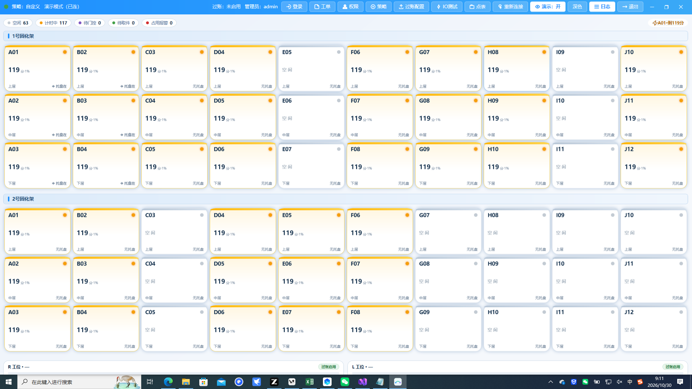
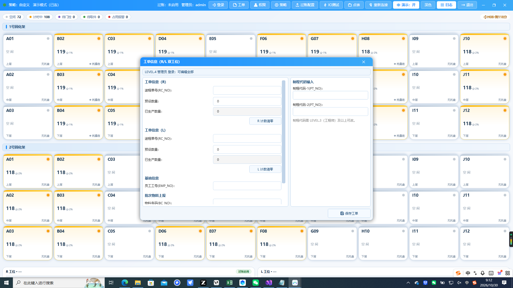

# 固化程控 客户技术工艺手册

> 适用版本：固化程控（CureStation）V0.0.20 及以后
> 适用对象：客户工艺/设备工程师（LEVEL.3 账号可完成的全部操作）
> 截图说明：截图均为演示模式数据；库位编码、时长、仓位状态以现场为准。

---

## 1. 本手册讲什么

> 界面支持深色/浅色两套配色，顶栏【深色】/【浅色】按钮即时切换并记忆
> （写回 config.ini `[setting] Theme`）；两种配色功能完全一致。

出厂设置里这套软件的工艺部分已经跑通。本手册面向**会动手调工艺参数**
的工程师，把"固化程控"里工艺相关的三块讲透：

1. **工艺策略窗**：时长怎么定、光栅门控怎么用、断电要不要续算；
2. **IO 点表**：点位绑定决定哪些仓位参与程控，怎么核、怎么测；
3. **过账配置**：MES 上报口径（进站时机/时间单位/工位映射）。

管理员专属（LEVEL.4）的权限管理、点位接线修改不在本手册，见文末
认档表。

### 界面总览

主窗 30 张仓位卡（每架 10 位 × 3 层），顶栏是全部功能的入口：



工艺工程师日常用得最多的两个入口：**策略**（工艺参数）与
**IO测试**（点位验证）；**过账配置**在对接 MES 时用。

## 2. 工艺模型：三级时长覆盖

固化时长的取值**永远只有一条出口**，按从近到远三级找：

```
仓位覆盖（单仓位个性化，如某格 45 分）
  └─ 找不到 → 层覆盖（上层/中层/下层统一值）
       └─ 找不到 → 全局时长（一炉统一值）
```

- 三级都配了：**最准的赢**（仓位级）；
- 只有全局：全炉同一时长；
- 换策略=整体换一套时长，不用逐格清数。

**推论**：想给某格单独提速，配一条"仓位覆盖"即可，别去改全局。

## 3. 工艺策略窗

顶栏点 **策略**（LEVEL.3 及以上）：


三栏布局：

| 栏 | 名字 | 干什么 |
| --- | --- | --- |
| 左 | 策略库 | 一套套工艺方案（预置+自定义），**激活一个生效** |
| 中 | 策略编辑 | 编辑选中的那套（全局时长/光栅门控/断电续算/层覆盖） |
| 右 | 每仓位覆盖 | 单格个性化时长（架号+层号+分钟，可空） |

底部是**仓位时长预览画布**（10×3 一屏全仓位，颜色按时长分四档）：
编辑任何时长的当下即刷新，无需真假机来回跑。

### 策略库与预置

- 预置策略（标"预置"）是**出厂模板**：可查看、可编辑，但**保存/激活/
  删除一律被拦**——预置是"教材"不是"活的工作区"；
- 想用预置参数：选中预置 → 点 **套用为自定义策略** → 整套内容复制进
  "自定义"并自动激活，之后在"自定义"上改。
- **激活只认自定义**：预置永远只是模板，防止误操作激活一条没确认过
  的参数。

### 编辑与保存（防误操作的草稿链）

编辑窗里的改动**先落在草稿**，点保存时才校验落盘：

1. 改时长/层覆盖 → 下方预览画布实时变色（你先看效果）；
2. 点 **仅保存**（或 **激活并生效**）→ 软件先跑校验（空值/越界层号/
   重名全部拦截）→ 通过才写进配置文件；
3. 改一半想反悔：不点保存关窗即丢，原数据毫发无损；
4. **改名撞车**：把策略改名成库里已有名字，校验拦下且**不污染**
   原来那个同名策略。

校验不通过的提示会写清楚差在哪格（如"层号超出 1~3"），照着改即可。

---

## 4. 光栅门控

"光栅门控"复选框（默认勾）：

- **勾上**：左+右两只光栅都打开（清空态）才开计时——防人手在架内
  误触发计时；
- **不勾**：托盘到位即计时（跳过门控）；
- 没配光栅的仓位，门控自动放行，不卡流程。

> 现场线体没装光栅或光栅常闭常开变过，先跑一遍第 6 节 IO 测试窗确认
> 点位，再决定勾不勾这一项。

---

## 5. 断电续算

"断电续算"复选框（默认不勾）：

- **不勾（缺省）**：断电/重启后，托盘还在架上的仓位**从头重计**
  （宁可重计也不放行没固化够的货）；
- **勾上**：途中的时间状态写盘到 `config/curingstate.json`，重启按
  状态续算，断电期间的时间计入固化时长。
  状态变化即全量重写，删掉该文件即回到"重计"行为。

选哪个看工艺诉求：**安全优先不勾，交期优先勾**。

### 层覆盖（第 4 层含义说明）

"每层覆盖"四框：上层/中层/下层 + 一格"层4（预留）"——现行点位表
只铺 3 层，层 4 是给将来加层的空位，先不用。

---

## 6. IO 点表：绑定决定哪些仓位参与

顶栏 **点表**（LEVEL.4；查看与测试 LEVEL.3 即可介入）：


三栏布局：

| 栏 | 干什么 |
| --- | --- |
| 设备列表 | 一台 IO 耦合器一条记录（名字+IP），增删改这里 |
| 点位绑定表 | 逐行:方向(DI/DO)/块/点号/角色/仓位/功能名 |
| 绑定编辑 | 改选中行:块号/位号/架号/层号/功能名——**表格换选中行自动回显该行**（选中谁就编辑谁） |

对新设备，用左下角 **一键缺省模板**：输入 IP、起始架号、起始点位号、
每架点数，即可自动生成整架 30 个仓位的绑定（第二台架号接续），
不必逐格手填。

**修改后必须在线核**：两道闸由保存动作自动跑——

1. 重复绑定拦截（同点位接两处 / 同功能挂两路均报错）;
2. IP/端口格式校验。

点 **保存（校验后写配置文件）**，不合法直接拦在本窗。

### IO 通讯测试窗

顶栏 **IO测试**：


- 仓位卡内两排圆点：**小圆=DI 输入（只读状态灯）、大圆=DO 输出（可点击
  灯钮）**，顶栏有同款说明，悬停圆点自报方向；
- 30 张仓位卡按**点表**生成（没绑通道的格占灰不发不收）；
- **DI（状态灯）**只读照真——灰底色块亮绿表示输入点已接通；
- **DO（三色灯钮）**可点击——快速验证每个输出点都能点亮；
- **一键遍历**：500ms 一路快跑整架（自动全关），责任到路；
- 底部有逐条日志（通道全名/状态/结果）。

> 测试窗与主看板共用总线连接，不额外建第二条链路；测试完**关窗即
> 自动还原**（停止遍历并把 DO 全关）。

---

## 7. 工单窗与计数

工程师（LEVEL.3）登录后，工单窗**全部字段可编辑**——程度对比如下
（与操作员视角对比）：



| 字段/动作 | L1 操作员 | L3 工程师 |
| --- | --- | --- |
| 员工工号 / 物料条码 | 可编辑 | 可编辑 |
| 途程单号 / 预设数量 / 制程代码 | 只读（灰） | **可编辑** |
| R/L 计数清零 | 灰色禁用 | **可用** |
| 保存工单 | 可用 | 可用 |

**计数语义**：

- 预设数量：工单下达数（R/L 工位各一套）；
- 已生产数量：出站被 MES 接受（STATUS=1）时自动 +1，不是本地累加
  ——以 MES 回写为准，避免断电丢数；
- 计数清零：换批次/清账时用，相当于把"已生产"重新从 0 起算（也通知
  MES 侧归档该批次），注意变更会**记录在主程序日志窗**里。

> 界面上"制程代码需 LEVEL.3（工程师）及以上可改"的说明与软件行为
> 一致：L2 及以下即使把字段置灰绕过，保存时也会被校验栏挡回去。

## 8. 过账：上线 MES 的口径配置

过账的作用：托盘进出固化架时，软件**自动**向 MES 报工头/报出站，
人不用手工抄单。

顶栏 **过账配置**（配置进一步改最下 URL 段，管理员权限）：


### 收发货方式（进站/出站）

- **启用单线过账**（主开关）：关掉只程控不过账（调试期常用）；
- **过账工位**：R/L——一台架上只有一侧报工时选默认；
  **双架工位映射**：两台架报同一 MES 的**不同工位**时，填
  `架号段:工位`（如 `11-20:L`），第二台架自动切 L 侧；
  相应机台号/位置号也可给 L 侧配专用值（不填回落主值）；
- **固化时间单位**：秒（老项目口径）或分钟——报给 MES 的
  PRA_Value 单位，跟客户 MES 对齐后别再改；
- **进站上传时机**：
  - **Arrive（托盘到位）**：托盘放进去就报进站（默认，行话"装载"）；
  - **Start（开计时）**：光栅通过/计时开动才算进站；
  两者的差别在"门控关着放进去但没开计时的那几秒算不算工时"，
  按客户 MES 对账口径选；
- **计时中取件**：中途拿件是否照常补出站（勾=照常，老项目口径）。

### 静态参数与 URL

- **机台编号（MAC_NO）**、**机台位置号（MAC_LOC_NO）**：写现场的
  设备编号，空着则用主程序调试窗维护的记忆值；
- 三条 **接口 URL**：进站/出站/物料上传的 MES 地址——供应商给终版
  后在此填入，**保存即生效，无需重启软件**。

### 口径说明（窗口右栏原文）

- 托盘到位=进站（ACTION=I），托盘离开=出站（先报固化时间再出站）
 ——与老项目"**装载/卸载**"命令字同义；
- 出站被 MES 接受（STATUS=1）后，对应工位"**已生产数**"自动 +1；
- BC_NO 取工单"物料条码"（批次级过账），板级产品 ID 上报走**主程序
 （整线网关）**路径；
- 过账失败只记日志与顶栏状态，**不弹窗不重传**（防重复过账、人工处理）；
- **保存即生效**（无需重启）；总开关关闭时不产生任何网络请求。

> 过账失败不丢数据：MES 侧会记状态与原因，全套在**主程序日志窗**
> 可追溯（见"整线网关 手册"），本程序不重复报。

---

## 8. 日常工艺调整 SOP（照单子走）

1. 走一个新工艺：策略窗 → 套用预置为自定义 → 改全局时长/层覆盖 →
   仓位覆盖逐格特殊值 → 预览画布核对 → **激活并生效**；
2. 只动某几格：策略窗 → 选中当前激活策略 → 在"每仓位覆盖"添行 →
   保存；
3. 接新设备先跑通：点表窗 → 一键缺省模板 → 保存 → IO 测试窗逐路
   验证 → 主窗叫清零再看卡状态；
4. MES 上新 URL：过账配置窗改 URL → 保存 → 顶栏绿色"过账：已启用"
   确认恢复。

---

## 9. 一句认档：管理员专属

| 功能 | 需要权限 | 去处 |
| --- | --- | --- |
| 账号增删/重置密码/改级别 | LEVEL.4 | 内部手册 |
| IO 点位接线修改（绑定编辑区） | LEVEL.4 | 内部手册 |
| 过账 URL/静态参数改动 | LEVEL.4 | 内部手册 |

---

## 10. FAQ

**Q1：改了策略但某格还在按旧时长走？**
策略热切换只影响**新进架**的仓位；已开计时的仓位按**开计时那一刻
锁定的时长**走完（包括断电续算恢复的）。要立刻刷新得清仓位重来。

**Q2：仓位卡一直"空闲"不动？**
先看托盘到底有没有进（主窗底部有托盘在/无），再看点位有没有绑
——跑一遍 IO 测试窗即可定位是接线、点表还是软件配置问题。

**Q3：启用过账后 MES 一直不回应？**
先在本程序过账配置窗核对 URL；再去**主程序**的 MES 日志窗看请求/
返回报文（报文逐条有记录），定位是网络、URL 还是 MES 侧拒单。

---

> 手册版本：随软件版本同步更新（见 CHANGELOG）。

<!-- SECTION-BREAK -->
