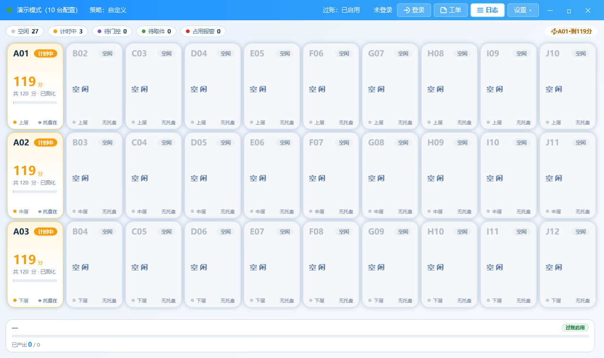
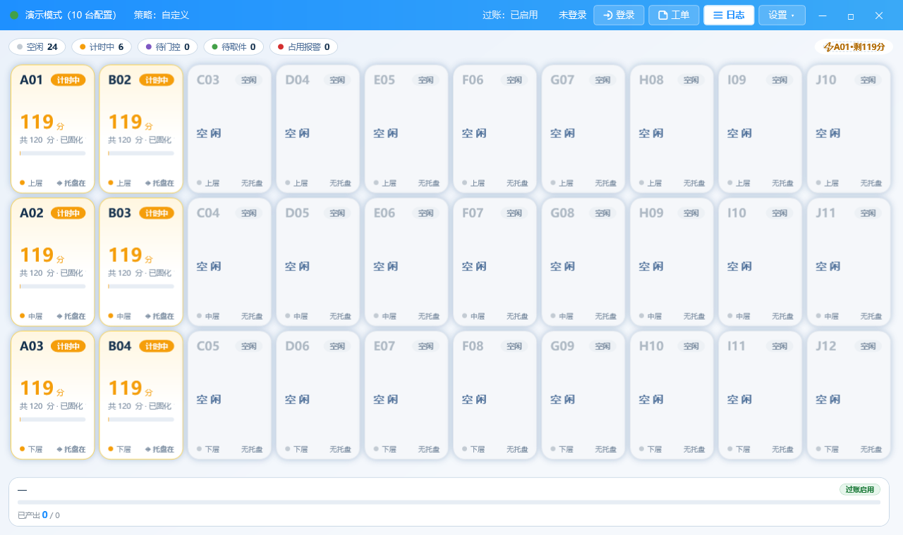
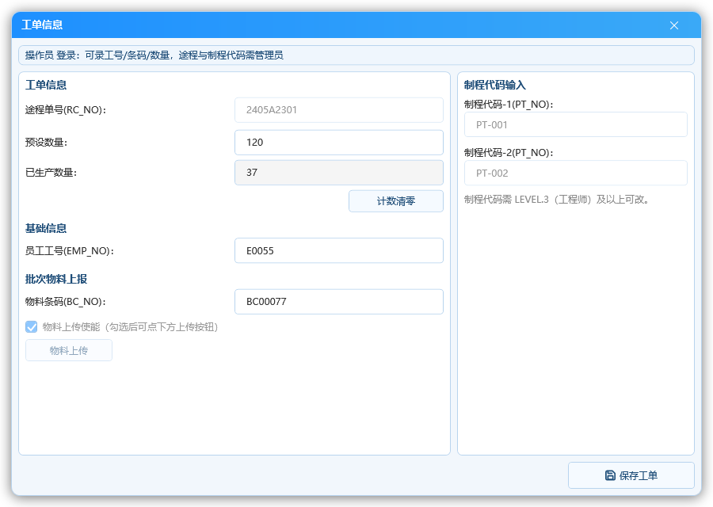

# 固化程控 操作员手册

> 适用版本：固化程控（CureStation）V0.0.49 及以后
> 适用对象：产线操作员（operator 账号即可完成本手册全部操作）
> 截图说明：文中截图均为**演示模式**数据（无真机时软件自带的模拟环境），
> 画面里的库位编码、剩余时间是演示值，以现场实际为准。

---

## 1. 这套软件是干什么的

固化程控软件安装在**固化炉旁边的工控机**上，负责两件事：

1. **自动计时**：托盘放进固化架后，软件按工艺策略自动开始倒计时，
   时间到了亮绿灯提醒你放行——不用看表、不用掐算；
2. **自动过账**（可选）：托盘进出炉时自动把信息报给 MES 系统，
   不用手工抄单。

软件管理 **2 台固化架、共 30 个仓位**（每台架 10 个站点 × 3 层），
屏幕上每个仓位一张卡，状态一目了然。

## 2. 开机与打开软件

1. 工控机开机，进入 Windows 桌面；
2. 双击桌面上的 **CureStation** 快捷方式（首次启动可能较慢，属正常）；
3. 软件自动最大化铺满屏幕，无需手动调窗口。

软件启动后自动连设备。屏幕左上角状态文字会显示：

- **演示：开**（顶栏按钮高亮）：表示当前没接真机，软件在跑模拟数据——
  只有调试/培训时才允许开；**产线生产时必须是【演示：关】**；
- 接真机时，顶栏中间的连接文字显示"已连接/未连接"（掉线自动重连）。

> 看板上如果出现**黄色三角或红字提示**，先对照第 8 节"常见问题"自查，
> 处理不了再叫管理员（或直接找工程师）。

**界面总览**（演示数据）：

功能都收在顶栏和"设置"下拉里：

| 入口 | 干什么 | 什么人能用 |
| --- | --- | --- |
| 登录 | 输入账号进入操作身份 | 所有人 |
| 深色 / 浅色 | 切换界面配色（车间灯亮用浅色、夜班用深色） | 所有人 |
| 工单 | 录员工工号、条码、数量、做批次核对 | 登录后（工单窗内部有权限分档） |
| 日志 | 看机上操作/报警流水 | 登录后 |
| 设置 ▾ 里的 重新连接/演示开关 | 演示开关=无真机跑模拟数据 | **管理员（admin）**；**操作员整个"设置"按钮禁用** |
| 设置 ▾ 里的 工艺策略/过账配置/IO测试 | 工艺参数、MES 过账、通道试验 | **管理员（admin）** |
| 设置 ▾ 里的 用户管理 | 新增/删除账号、重置密码 | **管理员（admin）** |
| 设置 ▾ 里的 点表配置 | IO 点位接线配置 | **开发者（dev）专属** |

## 3. 登录

顶栏点 **登录**，弹出登录窗：

- **用户名**：点输入框右侧下拉箭头，会列出全部在册账号——选自己的；
- **密码**：输入自己的密码（出厂初始密码由管理员当面给；操作员不能
  自己改密码，需要变更找管理员重置，见下文"忘记密码怎么办"）；
- **记住密码**：勾上后下次自动填好（密码加密保存，电脑上不会出现明文）；
- 点 **登 录**。

登录成功后顶栏你的名字会替代"未登录"，例如"操作员：zhangsan"。
在岗期间保持登录，交接班时让对方登录自己的账号——
**操作记录跟着账号走**，混用账号会查不到责任人。

### 忘记密码怎么办

自己找不回来（没有"自己改密码"的入口），按这个顺序处理：

1. 告诉当班**管理员**；
2. 管理员在"设置 ▾ → 用户管理窗"里**重置**你的密码（当场生效，新密码
   至少 6 位；重置不需要给旧密码，谁都能马上用新密码登录）；
3. 登录后注意保管，仍然不能自己改——保管不当再找管理员重置。

> 角色越高权限越大：管理员能做工艺/过账/账号管理，开发者（dev）额外
> 负责点表接线配置，并且账号永不能删（保底钥匙）。这些详见内部手册。

---

## 4. 看板怎么读

每一张仓位卡，从上到下四层信息：

| 区块 | 内容举例 | 说明 |
| --- | --- | --- |
| 大标题 | A01 | 仓位编号（架 A~J 个位点编号） |
| 小标题 | 第1-上层 | 第 1 台架的上层 |
| 状态行 | 计时中 剩119分 / 空闲 | 当前动作与倒计时 |
| 底部 | 黄灯 托盘在 / L:ON R:ON | 灯色、托盘在位、两侧工位信号 |

**卡片颜色即灯色**：黄底=计时中，绿=可放行，灰=空闲。

流转各阶段的卡片样子（演示数据）：

| 阶段 | 卡片显示 | 你要做的事 |
| --- | --- | --- |
| 空仓 | 空闲 / 灰灯 托盘无 | 无 |
| 托盘进架 | 黄灯亮、开始倒计时 | 无（软件自动） |
| 计时中 | "计时中 剩xx分"、黄灯 | 等待，不要提前取件 |
| 时间到 | 绿灯亮 | 尽快放行（取出托盘） |
| 托盘离架 | 灯灭、回空闲 | 无 |

> 图里"剩119分"是因为截图时工艺时长 120 分钟刚开始 1 分钟——
> 是**演示值**，现场以你定的工艺策略为准。

---

## 5. 工单窗（操作员能做的全部在这里）

顶栏点 **工单** 打开工单信息窗。**operator 操作员**进去后能做的是"基础
动作"——录工号条码、改数量、计数清零：

1. **员工工号（EMP_NO）**：录自己当天的工号；
2. **物料条码（BC_NO）**：录批次物料条码（注意是**批次级**，一炉一个）；
3. **预设数量 / 已生产数量**：可以改（跟 MES 对账时用）；
4. **计数清零**（两个工位各一个按钮）：开新批次时把"已生产"归零；
5. **保存工单**（右下角）。

**置灰不可改的**：途程单号（RC_NO）与制程代码（PT_NO×2）——那是
管理员及以上才改的，别尝试绕过，软件保存时也会把关（权限不够的字段
自动回落原值）。

> 更高的角色进来权限更大：管理员（admin）可以途程/制程/物料上传使能
> 全部编辑，见"客户技术工艺手册"。

**做批次核对**：过账开启时，保存工单会把物料信息自动报给 MES。
只见"已生产数量"涨数，不用自己记账。

---

## 6. 三条纪律（跑出来过教训的）

1. **时间没到不提前取件**。计时中把托盘拿走（光栅被触发），软件判定
   为"中途取件"：**该仓位计时作废**并记录日志——这板货按不合格处理，
   得从头再来。别赌运气，光栅每层都盯着。
2. **绿灯亮了尽快放行**。绿灯是"可以拿"的意思，别积压整层。
3. **一人一号**。操作都挂在你的账号下，混用账号查不到责任人。

---

## 7. 一句认档：管理员与开发者的活

以下功能**不在操作员手册**里展开，碰到了按表找对应的人：

| 上什么问题 | 找谁 | 对应手册 |
| --- | --- | --- |
| 固化时长、每层/每仓位差异、工艺调整 | 管理员（admin） | 客户技术工艺手册 |
| 仓位卡不亮/IO 不动作 | 管理员先跑 IO 测试窗 | 客户技术工艺手册 |
| MES 过账开关、URL、进出站口径 | 管理员（admin） | 交付清单→内部手册 |
| 账号增删、重置密码 | 管理员（admin） | 交付清单→内部手册 |
| 接线、点位绑定、设备增删（点表配置） | 开发者（dev 专属） | 交付清单→内部手册 |

---

## 8. 常见问题

**Q1：屏幕上仓位卡全灰、顶栏提示断线/重连，怎么回事？**
网络或设备临时掉线。软件每 5 秒自动重试，多数自己会好。
超过 1 分钟还没好：看设备电源、网线，找管理员/工程师。

**Q2：卡上有时突然又从"已成"变回"计时中"？**
说明灯被重计了。常见原因：重启了软件或电脑（突然断电也算）。
**这不是 bug**——宁可重计也不放行没固化够的货。如果工艺上非要
"断电接着算"，让管理员在策略里勾"断电续算"（那是客户技术工艺手册
里的事）。

**Q3：怎么确认过账开没开？**
看顶栏中间的绿字：显示"过账：已启用（R 工位）"即在线上报中；
显示"已停用"只说明不报 MES（程控照常，不受影响）。

**Q4：屏幕显示的一手数据跟实际货不一致？**
演示模式（屏幕左上角显示"演示模式"字样）时全部是模拟数据显示。
**交接班记录是否真机模式**，可直接问当日管理员，别对着演示数据
改你自己的工艺。

---

> 反馈渠道：遇到本手册没讲清的操作，报给管理员/工程师更新手册。
> 手册版本：随软件版本同步更新（见 CHANGELOG）。
