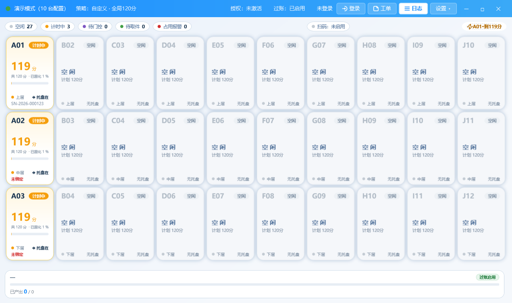
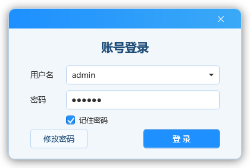
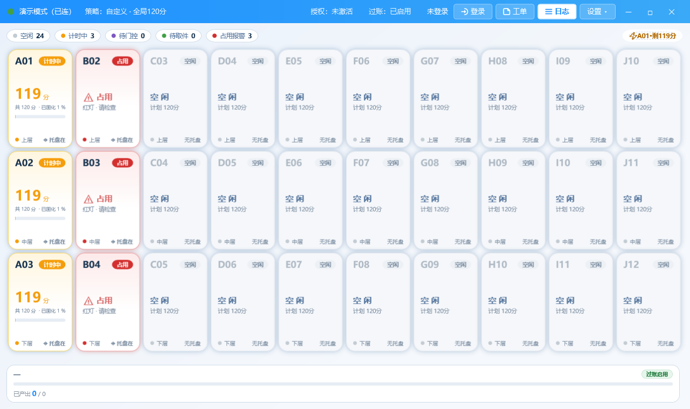
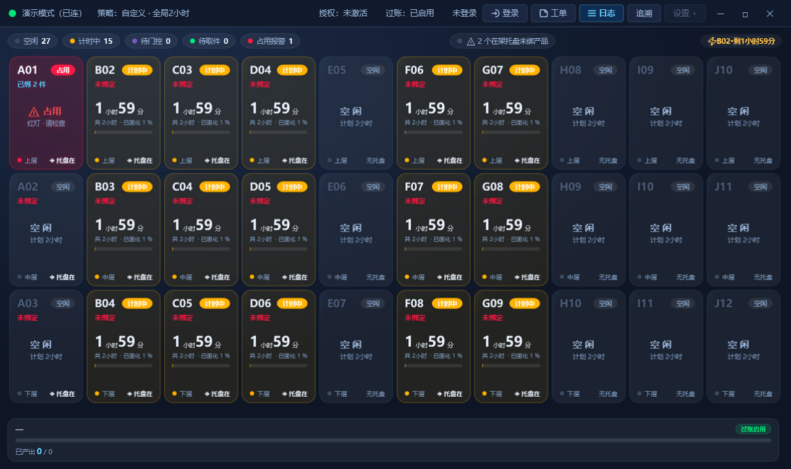
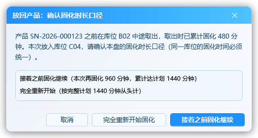
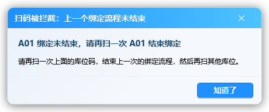
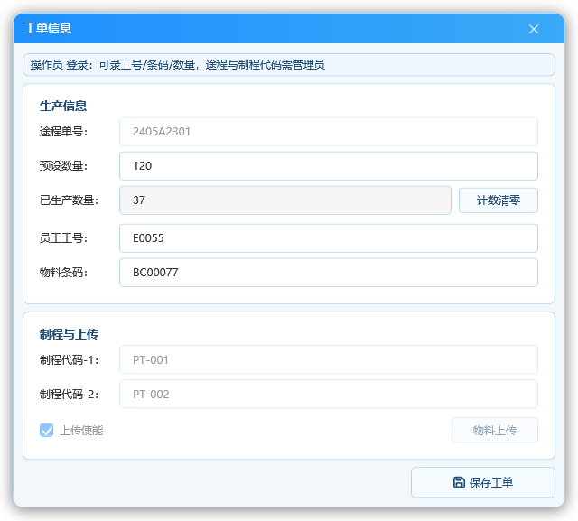
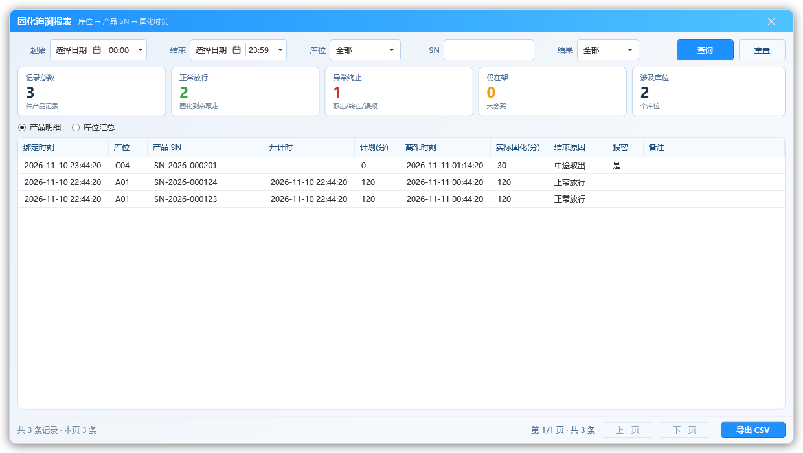
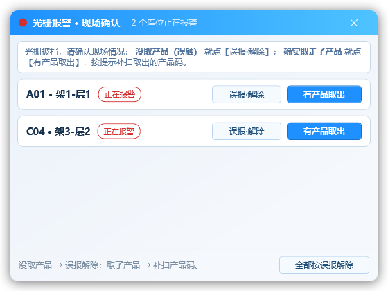

# 固化程控 操作员手册

> 适用版本：固化程控（CureStation）V0.0.76 及以后
> 适用对象：产线操作员（operator 账号即可完成本手册全部操作）
> 截图说明：文中截图均为**演示模式**数据（无真机时软件自带的模拟环境），
> 画面里的库位编码、剩余时间是演示值，以现场实际为准。

---

## 1. 这套软件是干什么的

固化程控软件安装在**固化炉旁边的工控机**上，负责两件事：

1. **自动计时**：托盘放进固化架后，软件按工艺策略自动开始倒计时，
   时间到了亮绿灯提醒你放行——不用看表、不用掐算；
2. **自动过账**（可选）：托盘进出炉时自动把信息报给 MES 系统，
   不用手工抄单。

软件管理 **2 台固化架、共 30 个仓位**（每台架 10 个站点 × 3 层），
屏幕上每个仓位一张卡，状态一目了然。

## 2. 开机与打开软件

1. 工控机开机，进入 Windows 桌面；
2. 双击桌面上的 **CureStation** 快捷方式（首次启动可能较慢，属正常）；
3. 软件自动最大化铺满屏幕，无需手动调窗口。

软件启动后自动连设备。屏幕左上角状态文字会显示：

- **演示：开**（顶栏按钮高亮）：表示当前没接真机，软件在跑模拟数据——
  只有调试/培训时才允许开；**产线生产时必须是【演示：关】**；
- 接真机时，顶栏中间的连接文字显示"已连接/未连接"（掉线自动重连）。

> 看板上如果出现**黄色三角或红字提示**，先对照第 9 节"常见问题"自查，
> 处理不了再叫管理员（或直接找工程师）。

**界面总览**（演示数据）：

功能都收在顶栏和"设置"下拉里：

| 入口 | 干什么 | 什么人能用 |
| --- | --- | --- |
| 登录 | 输入账号进入操作身份 | 所有人 |
| 深色 / 浅色 | 切换界面配色（车间灯亮用浅色、夜班用深色） | 所有人 |
| 工单 | 录员工工号、条码、数量、做批次核对 | 登录后（工单窗内部有权限分档） |
| 日志 | 看机上操作/报警流水 | 登录后 |
| 追溯 | 查产品追溯记录（哪个产品固化了多久、为什么结束），可导出 CSV | 登录后 |
| 设置 ▾ 里的 重新连接/演示开关 | 演示开关=无真机跑模拟数据 | **管理员（admin）**；**操作员整个"设置"按钮禁用** |
| 设置 ▾ 里的 工艺策略/过账配置/IO测试 | 工艺参数、MES 过账、通道试验 | **管理员（admin）** |
| 设置 ▾ 里的 用户管理 | 新增/删除账号、重置密码 | **管理员（admin）** |
| 设置 ▾ 里的 点表配置 | IO 点位接线配置 | **开发者（dev）专属** |

## 3. 登录

顶栏点 **登录**，弹出登录窗：

- **用户名**：点输入框右侧下拉箭头，会列出全部在册账号——选自己的；
- **密码**：输入自己的密码（出厂初始密码由管理员当面给；操作员不能
  自己改密码，需要变更找管理员重置，见下文"忘记密码怎么办"）；
- **记住密码**：勾上后下次自动填好（密码加密保存，电脑上不会出现明文）；
- 点 **登 录**。

登录成功后顶栏你的名字会替代"未登录"，例如"操作员：zhangsan"。
在岗期间保持登录，交接班时让对方登录自己的账号——
**操作记录跟着账号走**，混用账号会查不到责任人。

### 忘记密码怎么办

自己找不回来（没有"自己改密码"的入口），按这个顺序处理：

1. 告诉当班**管理员**；
2. 管理员在"设置 ▾ → 用户管理窗"里**重置**你的密码（当场生效，新密码
   至少 6 位；重置不需要给旧密码，谁都能马上用新密码登录）；
3. 登录后注意保管，仍然不能自己改——保管不当再找管理员重置。

> 角色越高权限越大：管理员能做工艺/过账/账号管理，开发者（dev）额外
> 负责点表接线配置，并且账号永不能删（保底钥匙）。这些详见内部手册。

---

## 4. 看板怎么读

每一张仓位卡，从上到下四层信息：

| 区块 | 内容举例 | 说明 |
| --- | --- | --- |
| 标题行 | `A01` + `计时中` 胶囊 | 仓位编号（架 A~J + 个位点编号）+ 状态胶囊（空闲/计时中/待门控/放行/占用/已终止/未配置） |
| 已绑件数 | `已绑 3 件`（蓝色加粗） | 紧跟在库位编号正下方：显示该库位**已入库登记的产品件数**，**未扫码=红字"未绑定"**；空位不显示（一个库位能放多个产品，卡片只显示件数，完整产品码在【追溯】报表里查） |
| 大数字 | `119 分` | 剩余时间（空闲时显示"—"；小时口径显示"1小时59分"） |
| 副文 | `共 120 分 · 已固化 1%` | 本次固化总时长与进度条（空闲时显示"计划 120分"） |
| 底部一行 | `● 上层　◈ 托盘在` | 状态彩点+层名（左）、托盘在/无托盘（右） |

**卡片颜色即灯色**：黄底=计时中，绿=可放行，灰=空闲。

流转各阶段的卡片样子（演示数据）：

| 阶段 | 卡片显示 | 你要做的事 |
| --- | --- | --- |
| 空仓 | 空闲 / 灰灯 托盘无 | 无 |
| 托盘进架 | 黄灯亮、开始倒计时 | 无（软件自动） |
| 计时中 | "计时中 剩xx分"、黄灯 | 等待，不要提前取件 |
| 时间到 | 绿灯亮 | 尽快放行（取出托盘） |
| 托盘离架 | 灯灭、回空闲 | 无 |

> 图里"剩119分"是因为截图时工艺时长 120 分钟刚开始 1 分钟——
> 是**演示值**，现场以你定的工艺策略为准。

---

## 5. 扫码上料（扫库位 → 扫产品 → 再扫一次库位码）

每个托盘放进固化架前，用扫码枪登记（登记用于产品追溯，
**不影响计时和过账**，漏扫只提醒不停机）。一个库位能放**多个**产品，
所以是"先扫库位、扫完所有产品、再扫一次库位码"：

1. **先扫库位码**：扫固化架格子旁的库位标签（A01~J12）——表示"这个库位开始上料"；
2. **再扫产品码**：托盘上放了几件就扫几个，**一个一个扫**（扫一件登记一件）；
3. **全部扫完后，再扫一次同一个库位码**——表示"这个库位上完了"。
   扫完这一次，该库位才算完成登记，软件才把它当成"已上料完成"。

规则（记住这几条就够）：

- 上料过程中（扫了库位码、还没二次确认前）**光栅被挡不报警**——上料时
  手和产品会挡住光栅，那是正常动作，报了是误报；**托盘刚放上、连库位码
  都还没扫的时候也不报**（手还没离开就挡了光栅，同样是正常动作）。
  **二次确认之后**光栅被挡才是真报警；
- **没有等待超时**：上料结束只认“再扫一次同一个库位码”，扫到一半也不会
  被打断；确实要放弃就点【取消】；
- **扫错库位码会被拦住**：上一个库位的上料还没结束时，软件不让直接换到
  另一个库位，会弹窗提示“请再扫一次 A01 结束绑定”——先把它结束再扫新的；
- **换产品**：再扫一次库位码=开始新一轮上料，会清掉该库位上一轮的登记；
- **取件（托盘离开）后登记自动作废**，下次入库必须重新扫码；
- **托盘在架但没扫码**：统计条红字“⚠ N 个在架托盘未绑产品”，对应卡片
  库位编号正下方红字“未绑定”——**只提醒、不停机**，补扫即可；
- 卡片上只显示**已绑件数**（“已绑 3 件”），单个产品码显示不下；
  要看完整产品码与固化时长，开顶栏【追溯】报表（见第 6.5 节）；
- 扫了库位码又不想继续：点扫码状态右边的【取消】回到“请扫库位码”。

> 扫码枪没反应先看胶囊点色：灰=扫码枪未连接/未启用；黄=正在等产品码；
> 红=有在架托盘没绑产品。检查扫码枪电源与连接（接线松了重新插好），
> 仍不行找开发者 dev 工程师改配置。

---

### 5.1 中途取出、再加工放回（放回件的三道闸）

固化没到点就把产品拿出来再加工，之后要放回架子上——软件按**同一库位固化
时间必须统一**的规矩处理：

1. **不能放回原来的库位**：把取出的产品扫回原库位会被弹窗拦住（那一盘
   的固化起点已经定了，塞回去时间对不上）。请放到**其它空库位**；
2. **放到新库位时**，扫完库位码、扫到这件产品的码，软件会弹窗问你这次
   怎么算固化时长：

   

   - **【接着之前固化继续】**：它之前已经固化过 8 小时、这盘计划 24 小时，
     那这盘只需再固化 16 小时就放行，**累计正好 24 小时**（达标口径）；
   - **【完全重新开始固化】**：前 8 小时作废，这盘按完整 24 小时从头计；
   - **【取消】**：这件产品先不放（不登记）。

3. **正在固化的库位不能再加新产品**：那一盘已经定型了，往里加货会让同库位
   产品的固化时间不一致，扫库位码就会被拦下来。

> 扫码被拦住时都会弹窗讲清原因与下一步，点【知道了】即可：
>
> 

## 6. 工单窗（操作员能做的全部在这里）

顶栏点 **工单** 打开工单信息窗。**operator 操作员**进去后能做的是"基础
动作"——录工号条码、改数量、计数清零：

1. **员工工号（EMP_NO）**：录自己当天的工号；
2. **物料条码（BC_NO）**：录批次物料条码（注意是**批次级**，一炉一个）；
3. **预设数量 / 已生产数量**：可以改（跟 MES 对账时用）；
4. **计数清零**（两个工位各一个按钮）：开新批次时把"已生产"归零；
5. **保存工单**（右下角）。

**置灰不可改的**：途程单号（RC_NO）与制程代码（PT_NO×2）——那是
管理员及以上才改的，别尝试绕过，软件保存时也会把关（权限不够的字段
自动回落原值）。

> 更高的角色进来权限更大：管理员（admin）可以途程/制程/物料上传使能
> 全部编辑，见"客户技术工艺手册"。

**做批次核对**：过账开启时，保存工单会把物料信息自动报给 MES。
只见"已生产数量"涨数，不用自己记账。

---

## 6.5 追溯报表（查"哪个产品固化了多久"）

顶栏点 **追溯** 打开固化追溯报表（登录即可用）。这里记着每个产品从
入库到离架的完整过程：**产品码、绑定时刻、开计时时刻、离架时刻、
实际固化了多少分钟、为什么结束的**。质量追溯、客户查账都看这里。

- **筛选**：起始/结束=整框点选（点框弹日历选日期、框内右侧选时刻，
  起始缺省 00:00，结束缺省 23:59）；库位=点格子面板选（格子和主界面
  仓位排布一致，一格格点，"全部"=不限）；产品 SN、结束原因；
  点【查询】刷新，点【重置】清空条件；
- **统计卡**：记录总数 / 正常放行 / 异常终止 / 仍在架 / 涉及库位——一眼看
  今天有没有异常件；
- **两个页签**：【产品明细】一件产品一行（要查某个 SN 看它固化了多久
  就看这页）；【库位汇总】一个库位一行（放了几件、几个正常、几个异常）；
- **导出 CSV**：把当前筛选条件下的**全部**记录导出成表格文件，给质量部
  或客户都能直接看。

> 结束原因里：**正常放行**=固化到点取的；**中途取出**=没到点就被拿走
> （固化不足，返工重点看这类）；**报警终止**=报警确认后整库位停表。

---

## 6.6 光栅报警：现场确认三步（重要）

固化中光栅被挡（有人伸手进架区）会报警，红灯亮、蜂鸣响，屏幕右下角
弹出确认窗。**报警不等于有人违规**——上料时手挡光栅不报（已二次确认
上料完成后才报），真报了就要你现场确认三步：

**第一步 · 判断现场**（窗口里每个报警库位一行，两个按钮二选一）：

- **【误报·解除】**：现场**没有人取产品**（只是误碰/风吹/别的遮挡）——
  点它，报警解除、红灯灭、蜂鸣停，**固化计时继续**，产品留在架上；
- **【有产品取出】**：确实从架上**拿走了产品**——点它，进入第二步。

**第二步 · 补扫取出的产品码**：把刚才拿走的那些产品的二维码**扫回来**
（一个一个扫，扫一个记一个）。这一步是给追溯留证据：被提前取出的产品
固化时间不足，事后要能查到是哪几件、固化了多久。扫完点【扫完了】。

> **只扫码不点确认，追溯库里不会留记录**——扫到的码先在弹窗里列着，直到
> 你在第三步点了【继续计时】或【终止计时】，才真正入库（宁可少记，不可记错）。

**第三步 · 这库位的计时怎么办**：

- **【继续计时】**（常规）：这个库位上**没取出的产品继续固化**——只拿走
  几件不该影响其余的货；
- **【终止计时】**：这个库位的产品**全部停表**（比如整层判定无效要返工），
  当前已固化时长会记进追溯库。

> 三步都可以在窗口里来回点：点【返回】回到清单继续处理别的报警库位。

---

## 7. 三条纪律（跑出来过教训的）

1. **时间没到不提前取件**。计时中把托盘拿走（光栅被触发），软件判定
   为"中途取件"：**该仓位计时作废**并记录日志——这板货按不合格处理，
   得从头再来。别赌运气，光栅每层都盯着。**真被报警了别慌**：按第 6.6 节
   三步确认——上料时手挡光栅不报警，报了多半是误碰；确实取件了就补扫
   产品码并选【终止计时】，好让这批货有据可查。
2. **绿灯亮了尽快放行**。绿灯是"可以拿"的意思，别积压整层。
3. **一人一号**。操作都挂在你的账号下，混用账号查不到责任人。

---

## 8. 一句认档：管理员与开发者的活

以下功能**不在操作员手册**里展开，碰到了按表找对应的人：

| 上什么问题 | 找谁 | 对应手册 |
| --- | --- | --- |
| 固化时长、每层/每仓位差异、工艺调整 | 管理员（admin） | 客户技术工艺手册 |
| 仓位卡不亮/IO 不动作 | 管理员先跑 IO 测试窗 | 客户技术工艺手册 |
| MES 过账开关、URL、进出站口径 | 管理员（admin） | 交付清单→内部手册 |
| 扫码枪没反应、连接方式/参数配置 | 开发者（dev 专属） | 客户技术工艺手册 |
| 账号增删、重置密码 | 管理员（admin） | 交付清单→内部手册 |
| 接线、点位绑定、设备增删（点表配置） | 开发者（dev 专属） | 交付清单→内部手册 |

---

## 9. 常见问题

**Q1：屏幕上仓位卡全灰、顶栏提示断线/重连，怎么回事？**
网络或设备临时掉线。软件每 5 秒自动重试，多数自己会好。
超过 1 分钟还没好：看设备电源、网线，找管理员/工程师。

**Q2：卡上有时突然又从"已成"变回"计时中"？**
说明灯被重计了。常见原因：重启了软件或电脑（突然断电也算）。
**这不是 bug**——宁可重计也不放行没固化够的货。如果工艺上非要
"断电接着算"，让管理员在策略里勾"断电续算"（那是客户技术工艺手册
里的事）。

**Q3：怎么确认过账开没开？**
看顶栏中间的绿字：显示"过账：已启用（R 工位）"即在线上报中；
显示"已停用"只说明不报 MES（程控照常，不受影响）。

**Q4：屏幕显示的一手数据跟实际货不一致？**
演示模式（屏幕左上角显示"演示模式"字样）时全部是模拟数据显示。
**交接班记录是否真机模式**，可直接问当日管理员，别对着演示数据
改你自己的工艺。

**Q5：扫码枪扫了没反应 / 卡片一直红字"未绑定"？**
先看统计条扫码胶囊：灰=未连接或未启用（检查扫码枪电源与连接，仍不行找
开发者 dev 工程师改配置）；黄=正在等产品码（补扫产品码）；
红=有在架托盘没绑产品（补扫库位码+产品码即可，不停机）。扫码登记只用于
追溯，不影响计时与过账。

**Q6：光栅报警了，是不是我把货搞坏了？**
不是——报警只是“有人/有东西挡住了光栅”，**要你现场确认**。上料时手挡
光栅不会报（连库位码都还没扫的托盘也不报——托盘刚放上、手还没离开）；
二次确认上料完成后才报。报了就按第 6.6 节三步走：
没人取产品就【误报·解除】（计时照走）；确实取了就【有产品取出】、
补扫产品码、再选【继续计时】或【终止计时】。

**Q7：产品码在哪儿看？卡片上只有"已绑 3 件"。**
顶栏【追溯】报表里看：产品码、绑定时刻、实际固化多少分钟、结束原因都在，
还能导出 CSV。

---

> 反馈渠道：遇到本手册没讲清的操作，报给管理员/工程师更新手册。
> 手册版本：随软件版本同步更新（见 CHANGELOG）。
