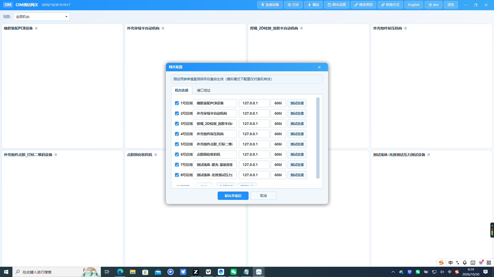
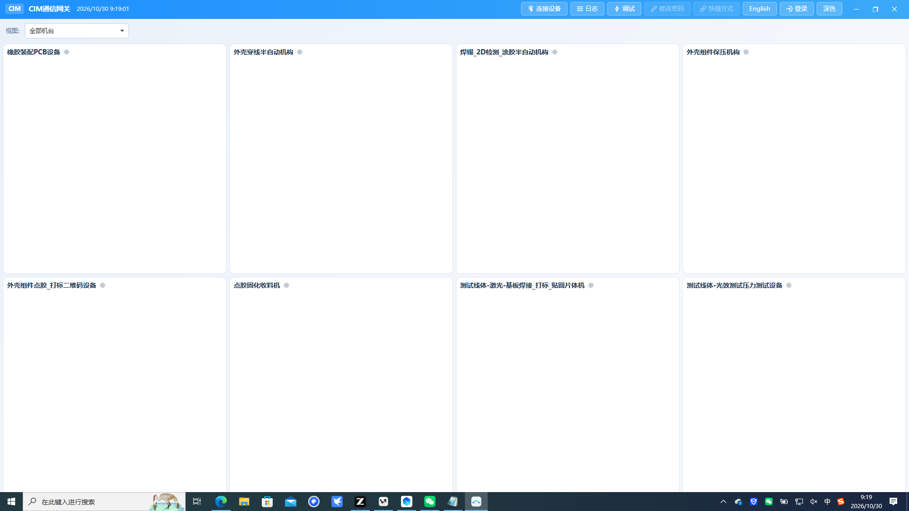
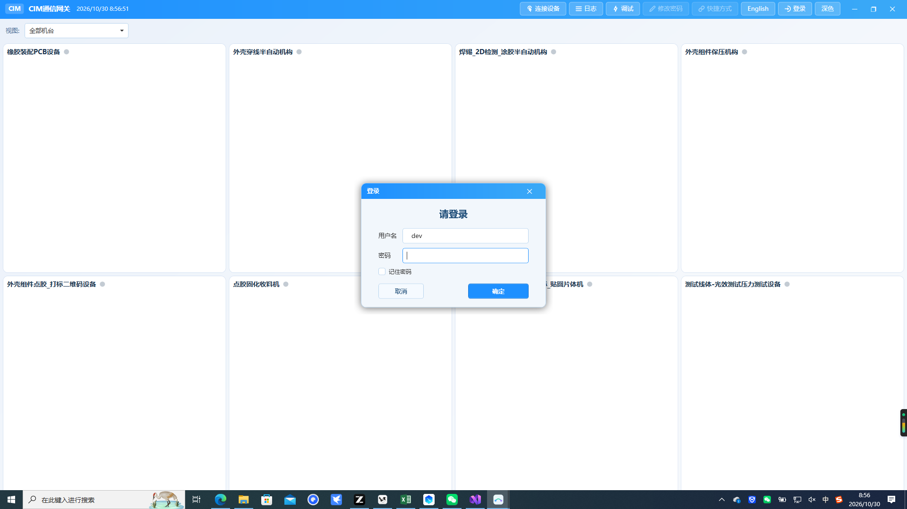
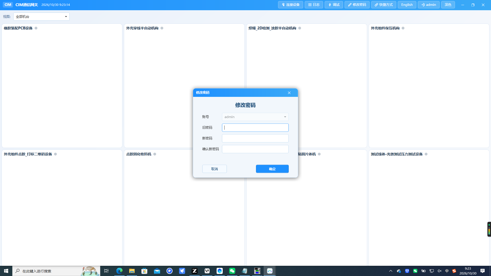
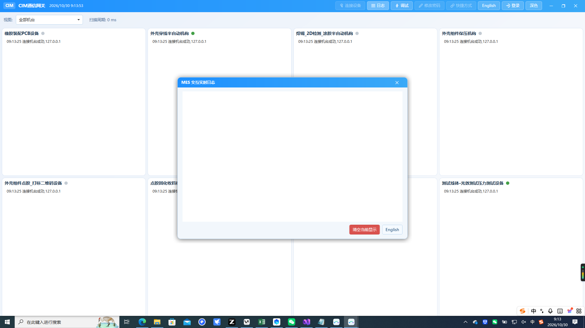
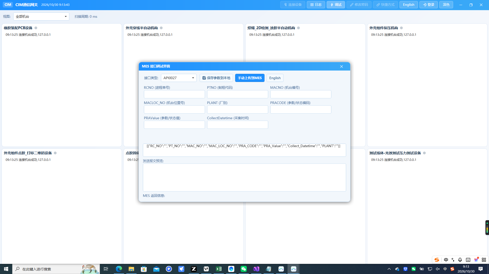

# 整线网关 内部手册

> 适用版本：整线网关（CimGateway）V0.0.22 及以后
> 适用对象：本公司部署与现场维护工程师（全量功能，含 LEVEL.4 项）
> 截图说明：截图均为演示模式数据。**本手册为内部资料，勿外发客户。**

---

## 1. 本手册讲什么

程序②（整线网关，CimGateway.exe）的全量一册：部署、通讯配置
（机台连接/接口地址）、六接口组包与回写、账号体系、排障手段。

客户侧材料两份（操作员手册/客户技术工艺手册）不含的只有两件：
**通讯参数配置**与**账号管理**——都在本手册口径内。

## 2. 部署与配置文件

净机部署四件事：

1. 拷贝发布目录（`CimGateway.exe` + 依赖 DLL + `config.sample.ini`）；
2. `config.sample.ini` 复制为 `config/config.ini` 改参数；
3. 首启自动建 `config/`、`DataBase/`（含 users 表）、`Logs/`；
4. 桌面快捷方式手工建；**先 `Simulate=1` 跑通模拟再切真机备份 ini**。

**模拟与真机**：`config.ini [setting] Simulate=1` 模拟 8 机台网关
（含触发回写全链路、可与本地桩 MES 端到端对账）；真机=0。

**现场文件**：

| 文件 | 内容 | 谁写 |
| --- | --- | --- |
| config.ini | 机台连接（IP/端口）/六接口地址束/触发字/语言 | 配置窗 |
| mes_params.json | 16 参数记忆 | 调试窗"保存参数到本地" |
| DataBase/*.db3 | users 表（账号） | 启动播种 |
| Logs/*.log | 操作日志与逐条报文 | 运行时 |

> **初始密码红线**：admin/123456 与 dev/各一处播种（`App.OnStartup`
> 空表才写）；上线必须登录改密并交接。密码 PBKDF2 存储，
> **文档不记录现场明文**。

## 3. 网关配置窗（LEVEL.4/dev 专属）

菜单 **设置▼ → 网关设置**（或配置页直接进入）：

### 机台连接页

> V0.0.32 起每行含**机台名**输入框（`[StationNames]` 节键 1..8，缺键/空值
> 逐台回落出厂缺省名）；机台名同时是 MES 日志文件名与视图筛选下拉的显示名，
> 校验拦"非空 + ≤50 字 + 无文件名非法字符"。

- 每机台一行：**启用勾选 + IP + 端口 + 测试连接**——逐台试完再保存；
- **扫描周期(ms)**：轮询各机台触发字的节拍（现场常用 200ms）；
- **全部测试**：一键逐台试链路（省去逐个点）；
- **恢复缺省**：拉回出厂缺省连法（谨慎：现场改过的参数会被覆盖）。

### 接口地址页

每接口一组 **7 行**（触发地址/URL/DATA/MSG/状态/完成等）：
真机联调时按客户机台地址表逐项填——**地址束/数据长度/字节序/
分段偏移全部走配置，代码零改动**（保存即热生效）。

**保存并重启**：写盘后自动拉新进程（"跳过退出确认"，旧进程一定退）。

> **测试用表单值直测保存后重启生效（模拟模式下配置仅对真机有效）**
> ——窗体顶部这行蓝字是重要口径：模拟模式保存的连接参数不会
> 立即作用到模拟链路，切真机时才起作用。

---

## 4. 真机底座与打包规则（Modbus TCP）

三语义一处定义（`ModbusStationClient`，勿在业务层改动）：

1. **地址口径**：寄存器地址 = "剥 R/D 前缀取数字"（协议地址，从
   0x0000 起保持寄存器）；残缺/超 65535 拒收走失败链，**绝不**误写
   寄存器 0——真机联调先核对 CIM 侧寄存器表与该假设一致；
2. **字符串打包**：2 字节/寄存器 big-endian（首字节装高位，
   "NG"→0x4E47）；现场字节序校准**零改代码**：
   `config.ini [setting] StringByteOrder=SwapBytes` 翻转；
3. **分帧**：FC03 ≤125 / FC10 ≤123 寄存器（网关 DataLength=799
   字节必须分块），中间块失败整次失败——与老项目整串写同口径，
   **勿加事务**。

## 5. 六接口与字段落位（与客户版同表）

16 记忆字段表与各接口取用清单见《整线网关 客户技术工艺手册》
第 4 节（同一口径表）。内部补充：

| 项 | 口径 |
| --- | --- |
| 外层形状 | 0027/0028/0033 数组 `[]`，0030/0031/0032 对象 `{}`（W68 规定） |
| 组包 | `MesDebugViewModel.BuildJson` 与真实触发同源（手动上传=真实报文） |
| DATA 拆包 | **无补零**：`R17900+30=R17930`（MES 侧约定勿"整理"） |
| 空值占位 | 空字段写 `" "`（保留寄存器宽度） |
| 失败回写 | STATUS=2 / MSG=NG（MES 侧约定） |
| 机台 IP 键 | `StationIp1..8` 连续对应 1..8 号机（V0.0.32 中性化，原跳号键已废） |
| 统计口径 | "明日"只比 Day 数；L/R 只看第 4 字符——老项目误差口径保持一致 |

## 6. 界面与账号

主窗空闲/登录两态：

- **users 表两账号**：admin（普通管理）/ dev（最高权限）——
  **网关设置（通讯配置）菜单只有 dev 可见**；admin 可用调试窗与
  日志窗（这两个不设门槛）；
- **修改密码**（顶栏【修改密码】按钮）：

  

  旧密码必验 + 新密码 ≥6 位 + 两次一致；dev 可代改他人；
  对应用户记忆链与程序①同款（勾记住=存新密文，没勾=清本户）；
- **桌面快捷方式**：菜单设置项里一键创建（逻辑在 Core，窗只弹结果）。

日志窗与调试窗的报文口径见客户工艺手册第 6/7 节（不重复展开）：

> **报警窗注意**：`MesAlarmWindow` 是**非模态**窗（直接 Show 非
> ShowDialog）——弹了可以继续作业，但每台报一次弹一次；连续失败
> 日志只记边沿（防刷屏），逐条详单在日志窗。

## 7. 排障手册（现场高频 8 问）

1. **8 台里某台一直灰**：先重启该台设备侧软件/看网线；`模拟=0` 下
   真机 IP 变过走配置窗"测试连接"逐台核；
2. **报文发出但 MES 返回 500/404**：接口 URL 错位（配置窗接口地址
   页核对）；与字号/编码无关；
3. **`STATUS=2 / MSG=设备号不存在`**：MES 侧设备未建档——把
   MAC_NO 发给客户管理员建档即通；
4. **字符串读出来是乱码**：字节序没对——切
   `StringByteOrder=SwapBytes` 试（现场校准零改代码）；
5. **组包 800 字节写入分片后段失败**：中间块失败整次失败属设计
   （与老项目整串同口径）；检查该段寄存器是否可写（某些地址只读）；
6. **某机台触发后无反应**：触发地址束是否配置（接口地址页
   "触发"行）；`Simulate=1` 时模拟触发不依赖真机——区分环境看顶栏；
7. **过账两程序 URL 冲突**：程序①/程序②共用 Url_API0027/0030/0032
   键——同一 MES 地址改一处两程序都生效（保存各自本地 ini 即可）。
8. **进程双开**：同目录第二份 exe 会锁 database——检验后停一份。

## 8. 测试与交付自检

1. `dotnet build` 0 警告 0 错误 + `dotnet test` 全绿（≥315 用例，
   含本地桩 MES 端到端）；
2. `Simulate=1` 模拟起 exe：8 机台连接 + 触发/回写/日志窗跑通
   （借 HttpListener 桩即检验完整链路）；
3. 真机：配置窗逐台"测试连接"→ 六接口逐组核地址束 →
   调试窗逐条手动上传对返回；
4. 账号交接：admin 与 dev 各自改密；桌面快捷方式创建；
5. `config.sample.ini` 与 README/CHANGELOG 同步更新再交付。

---

> 内部资料：密码/授权号不出现在本文档。手册版本随 CHANGELOG。

<!-- SECTION-BREAK -->
